# The main landforms associated with these processes

## Specification coverage

| Point | Section |
| --- | --- |
| 2.2.1 Headlands, bays | §1 |
| 2.2.1 Cliffs, wave-cut platforms | §2 |
| 2.2.1 Caves, arches, stacks, stumps | §3 |
| 2.2.1 Beaches | §4 |
| 2.2.1 Spits, bars | §5 |
| 2.2.1 Sand dunes | §6 |
| 2.2.2 Discordant and concordant coastlines | §1 |

## 1. Headlands, bays, and discordant and concordant coastlines

Rocks erode at different rates. **Hard** (more resistant) rocks such as limestone and chalk erode
slowly; **soft** (less resistant) rocks such as clay erode quickly. How the rock bands meet the sea
decides the shape of the coast.

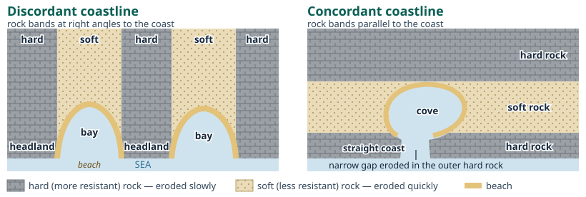

*Figure 5. Discordant and concordant coastlines.*

**Discordant coastline** — bands of hard and soft rock at right angles to the coast, giving an
irregular coast of headlands and bays.

- Soft rock is eroded back into **bays**: curved inlets of the sea, sheltered, usually with a
  beach (wave refraction spreads energy out there, → 2.1).
- Hard rock is left sticking out as **headlands**: high, rocky land with cliffs. Refraction
  concentrates wave energy on them, so they are eroded into caves, arches, stacks and stumps.

:::: grid
::: card | Concordant coastline
Bands of rock run **parallel** to the coast.

- An outer band of hard rock protects the soft rock → a **straight, regular coastline**.
- Where the sea breaks through (along a crack), it quickly erodes the soft rock behind → a
  wide, round **cove** with a narrow entrance.
- The next band of hard rock forms the back of the cove.
:::

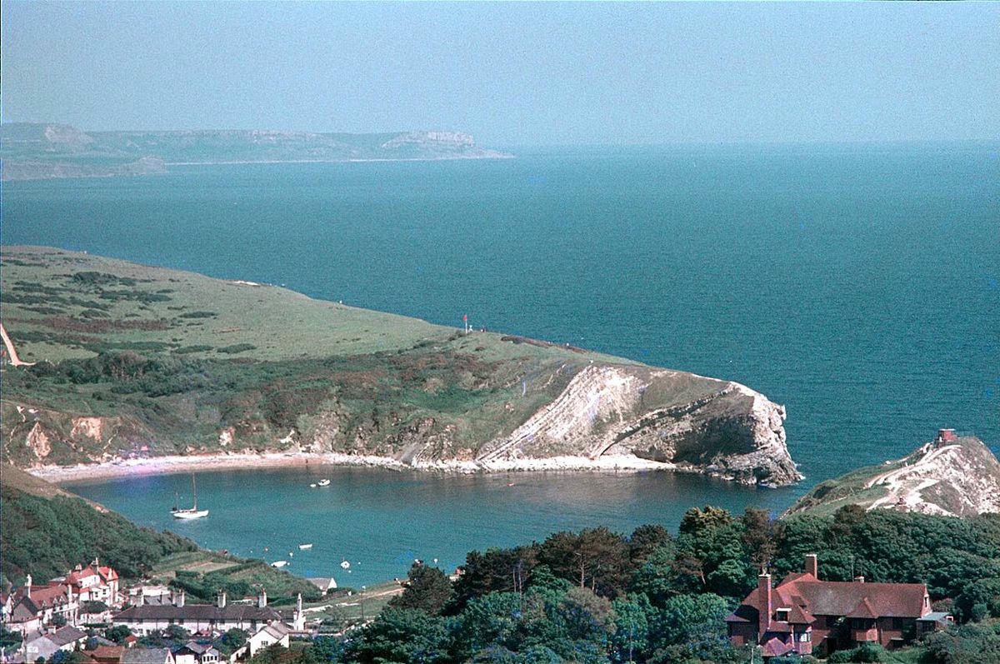

*Figure 6. Lulworth Cove, Dorset (UK): a cove on a concordant coast. Photo: Martin Tester,
CC BY-SA 2.0.*
::::

## 2. Cliffs and wave-cut platforms

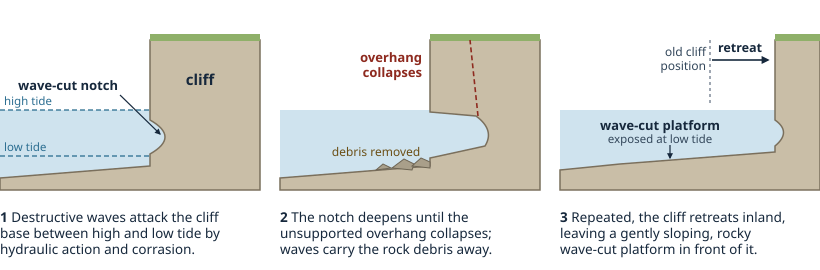

*Figure 7. Cliff retreat and the formation of a wave-cut platform.*

:::: grid
::: card | Characteristics
- **Cliff** — steep or vertical rock face, often with a wave-cut notch at its base.
- **Wave-cut platform** — flat or gently sloping rock surface at the cliff foot; covered at high
  tide, exposed at low tide; rock pools; widens as the cliff retreats.
:::

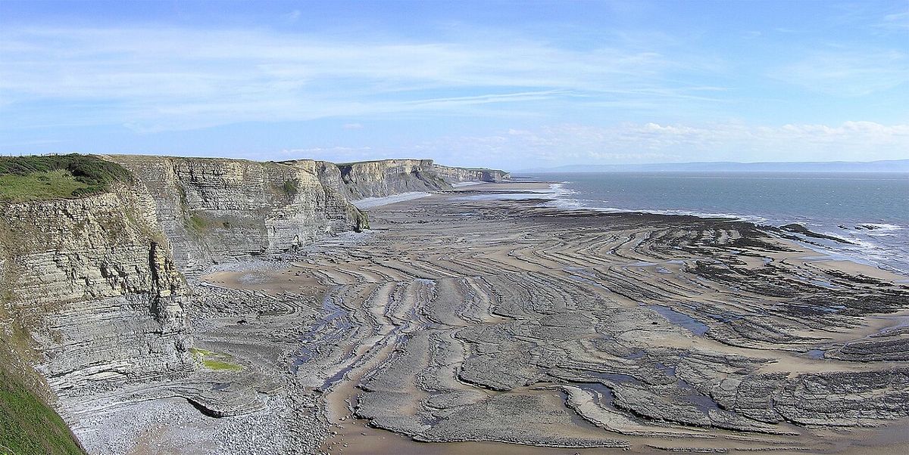

*Figure 8. Cliff and wave-cut platform at Southerndown, Wales. Photo: Yummifruitbat,
CC BY-SA 2.5.*
::::

::: pagebreak
:::

## 3. Caves, arches, stacks and stumps

These form on **headlands**, where refraction concentrates wave energy and the rock has lines of
weakness (joints and faults).

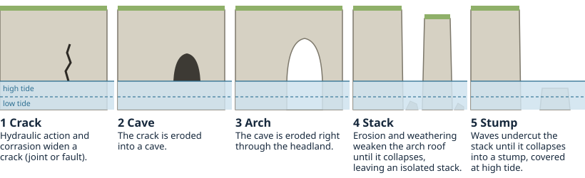

*Figure 9. The erosion sequence on a headland.*

:::: grid
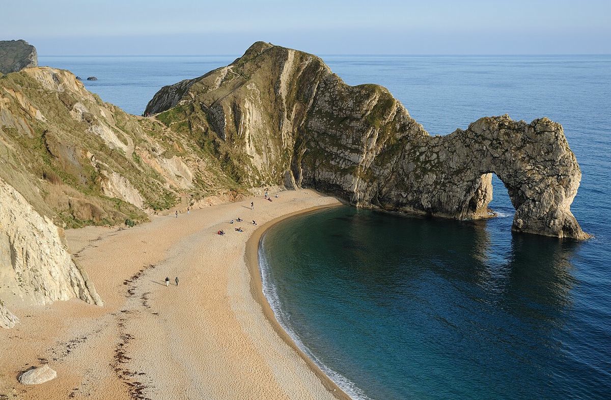

*Figure 10. Arch: Durdle Door, Dorset (UK). Photo: Saffron Blaze, CC BY-SA 3.0.*

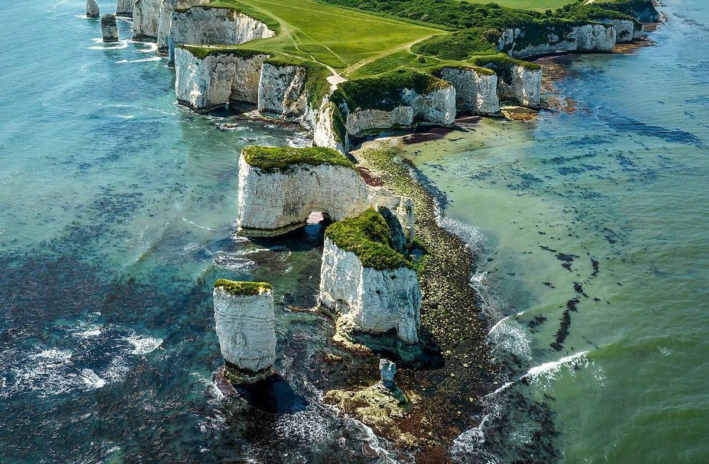

*Figure 11. Stacks and a stump off a chalk headland: Old Harry Rocks, Dorset (UK). Photo:
Simaron, CC BY-SA 2.0.*
::::

## 4. Beaches

**Formation.** Constructive waves (swash stronger than backwash) deposit sand and shingle where
wave energy is low, especially in bays. The material comes from longshore drift, rivers and cliff
erosion.

**Characteristics.** A beach is the zone of sand or pebbles between the low-tide line and the
highest point storm waves reach. **Berms** are ridges of material along the high-tide lines.

| | Sand beach | Shingle (pebble) beach |
| --- | --- | --- |
| Material | fine particles | pebbles |
| Slope | gentle | steep |
| Why | water cannot drain into the sand, so the backwash is strong and carries sand back down | water drains into gaps between pebbles, so the backwash is weak and pebbles stay high up |

## 5. Spits and bars

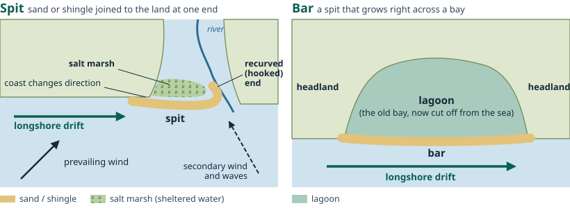

*Figure 12. A spit forms where the coast changes direction; a bar is a spit that joins two
headlands.*

**Spit** — a long, narrow ridge of sand or shingle joined to the land at one end, with the other
end in open water.

1. Longshore drift carries sediment along the coast.
2. Where the coastline changes direction (e.g. at an estuary), the sediment is deposited in the
   calmer water and builds out from the land.
3. Deposition continues and the spit grows; waves from a **secondary wind direction** curve its
   end into a **recurved (hooked) end**.
4. Sheltered, low-energy water behind the spit lets mud settle → **salt marsh**.
5. The river's current carries sediment out to sea, so the spit cannot cross the estuary.

**Bar** — a ridge of sand or shingle joining two headlands. A spit grows right across a bay
(no river current stops it) and cuts off the water behind as a **lagoon**.

:::: grid
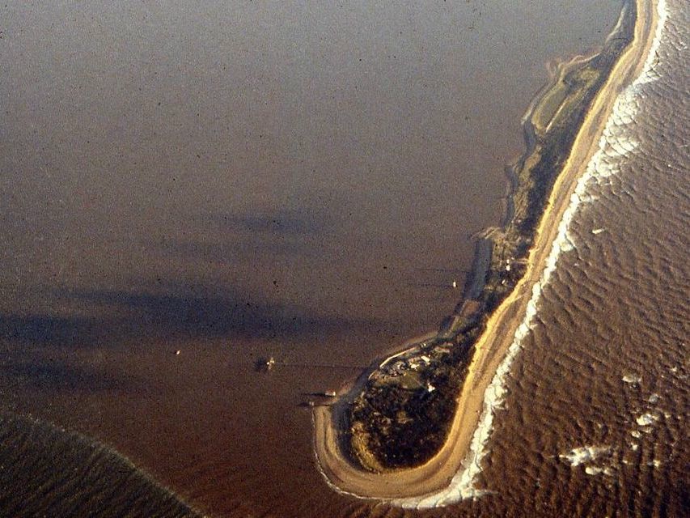

*Figure 13. Spit with a hooked end: Spurn Head, England. Photo: Stanley Howe, CC BY-SA 2.0.*

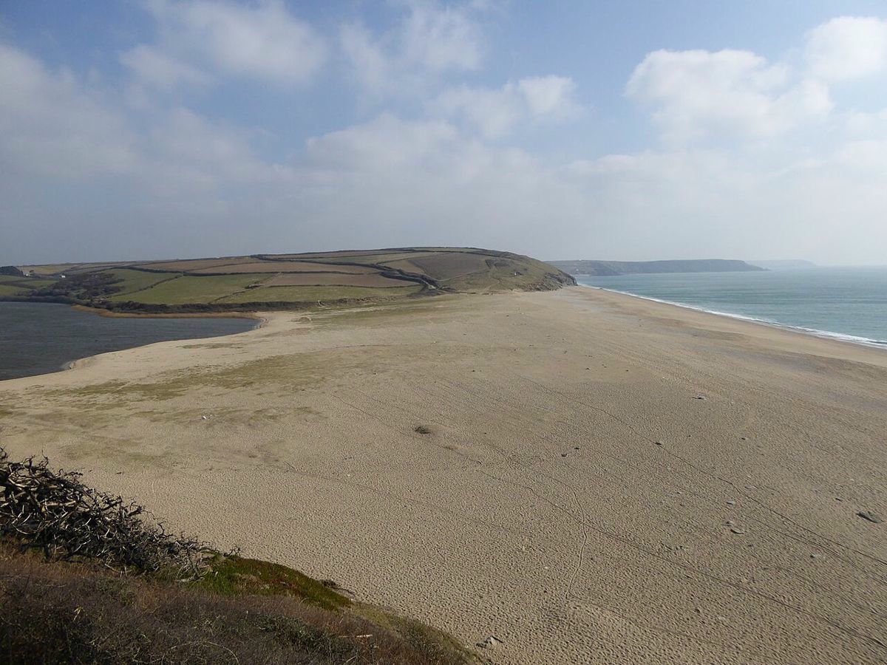

*Figure 14. Bar with a lagoon (left) behind it: Loe Bar, Cornwall (UK). Photo: David Smith,
CC BY-SA 2.0.*
::::

## 6. Sand dunes

**Formation.**

1. A wide, flat beach with a large supply of sand; at low tide the sand dries out.
2. **Onshore winds** blow the dry sand inland.
3. Obstacles (strandline debris, plants) trap the sand → small **embryo dunes**.
4. Plants colonise and stabilise the sand. **Marram grass** grows up through new sand and its
   long roots bind it, so the dunes grow higher.
5. Plants die and decay into **humus**, soil develops and more plants grow, so dunes further
   inland are older, greyer and more vegetated.

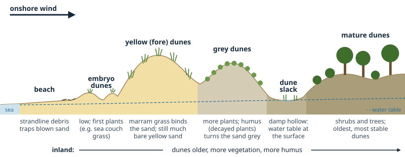

*Figure 15. Characteristics of the dunes from the beach inland.*

## Common traps

| Wrong | Right |
| --- | --- |
| A wave-cut platform is deposited | It is **erosional**: the rock left behind as the cliff retreats |
| Stacks and stumps are the same | A stack stands above high tide; a stump is covered at high tide |
| Spits and bars form in the same place | A spit needs a change in coastline direction; a bar joins two headlands and traps a lagoon |
| Discordant = parallel bands | Discordant = bands **at right angles** to the coast; concordant = **parallel** |

## Exam relevance

"Explain the formation of…" questions (a stack, a spit) are marked on the **sequence**: name the
process at each stage (hydraulic action, corrasion, longshore drift, deposition). A labelled
sequence of sketches earns credit.
