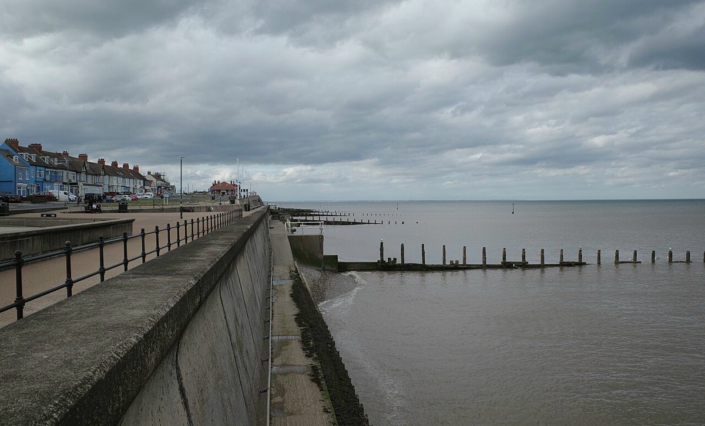
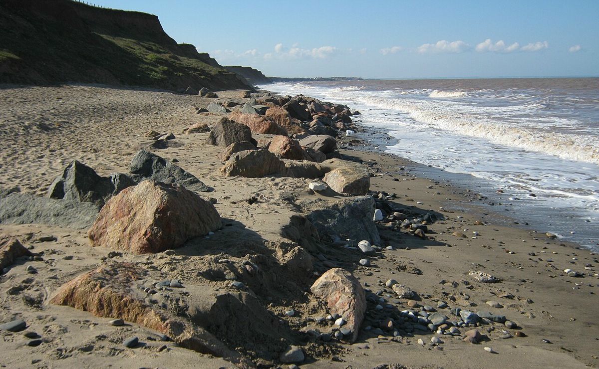
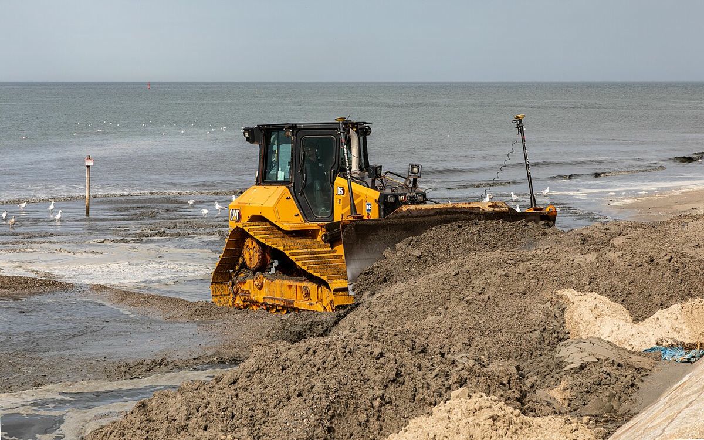
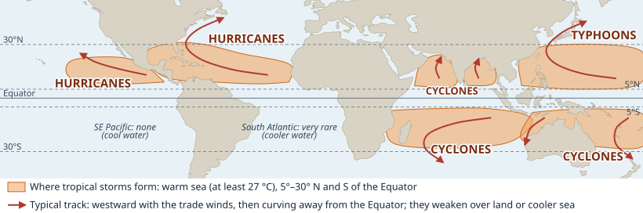
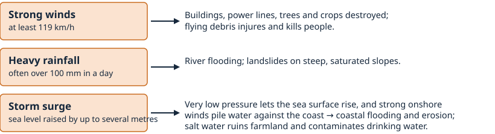
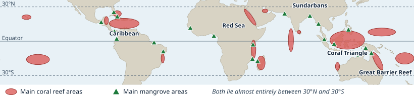
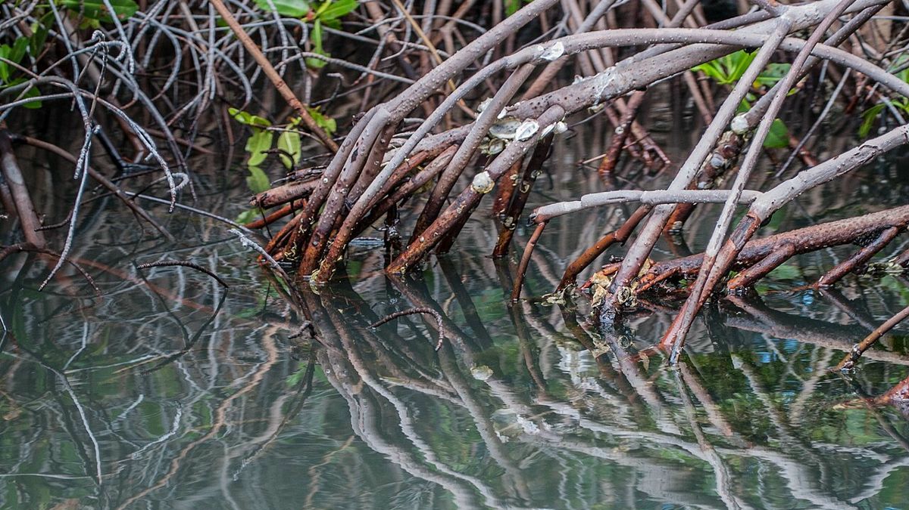
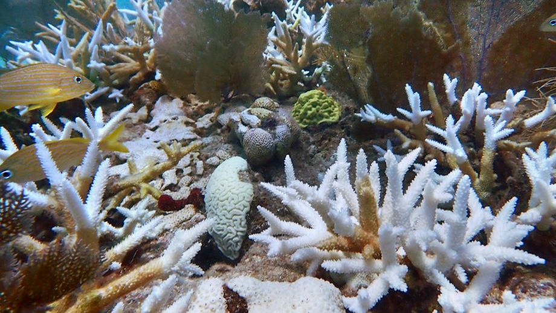
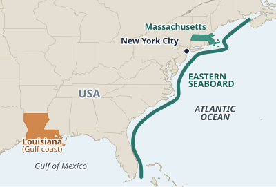
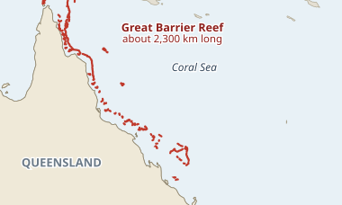

# Coasts present opportunities and hazards for people

## Specification coverage

| Point | Section |
| --- | --- |
| 2.3.1 Opportunities of living near the coast | §1 |
| 2.3.2 Hazards of living near the coast | §2 |
| 2.3.3 Evaluation of hard and soft engineering for coastal erosion and flooding; including sustainable | §3 |
| 2.3.4 Distribution and impacts of tropical storms: cyclones, hurricanes, typhoons | §4 |
| 2.3.5 Evaluation of managing tropical storm impacts: preparation, planning, protection, prediction | §5 |
| 2.3.6 Coral reefs and mangroves: distribution, importance, threats, protection and management; including sustainable | §6 |
| 2.3.7 Detailed example: causes and impacts of coastal erosion; protection from tropical storms and managing erosion; including sustainable — USA Eastern Seaboard (class source, `READY`) | §7 |
| 2.3.8 Detailed example: why the coral reef is important; threats; protection and management; including sustainable — Great Barrier Reef (class source, `READY`) | §8 |

## 1. Opportunities of living near the coast

- **Trade and ports** — sheltered harbours link countries by sea; industries grow around ports.
- **Fishing** — food and jobs.
- **Tourism and recreation** — beaches, reefs and scenery bring income and jobs.
- **Industry and energy** — flat land and seawater for cooling (power stations, refineries);
  offshore oil and gas; wind, wave and tidal energy.
- **Flat, fertile land** — coastal plains and deltas for farming and building.
- **Quality of life** — mild climate and an attractive environment.

## 2. Hazards of living near the coast

- **Coastal erosion** — cliffs collapse, and homes, farmland and roads are lost.
- **Coastal flooding** — from storm surges and very high tides; low-lying land and deltas are
  most at risk. **Rising sea level** increases both erosion and flooding (→ Topic 5).
- **Tropical storms** — winds, heavy rain and storm surges (§4).
- **Tsunamis** — large waves caused by undersea earthquakes (→ Topic 4).

## 3. Managing coastal erosion and flooding: hard and soft engineering

**Strategy** (the plan): for each stretch of coast, decide whether to **hold the line** (protect
it), use **managed retreat** (let the sea in, in a controlled way) or **do nothing**, by comparing
the value of what is at risk with the cost of protecting it. **Techniques** are the methods used.

::: definition
**Hard engineering** — building artificial structures to stop the sea eroding or flooding the
land.

**Soft engineering** — working with natural processes to reduce erosion and flooding.
:::

:::: grid

*Figure 16. Sea wall and groynes, Hornsea (UK). Photo: habiloid, CC BY-SA 2.0.*

*Figure 17. Rock armour, Mappleton (UK). Photo: peter robinson, CC BY-SA 2.0.*

*Figure 18. Beach nourishment: pumped sand being spread, Norderney (Germany). Photo: Dietmar
Rabich, CC BY-SA 4.0.*
::::

| Technique | How it works | Strengths | Weaknesses | Sustainable? |
| --- | --- | --- | --- | --- |
| Sea wall (hard) | Concrete wall, often curved, reflects wave energy back to sea | strong, long-lasting protection for high-value land | very expensive to build and maintain; reflected waves scour the beach and undermine the wall; can be overtopped as sea level rises | **Low** — costly, must be maintained and raised |
| Groynes (hard) | Timber or rock barriers at right angles to the beach trap sediment moved by longshore drift | wider beach absorbs wave energy; fairly cheap; good for tourism | starve beaches further along the coast of sediment, so erosion increases there | **Medium** — moves the problem along the coast |
| Rock armour (hard) | Large boulders at the foot of a cliff or beach absorb wave energy | cheaper than a sea wall; quick to build | rocks can be shifted by storms; blocks beach access; looks out of place | **Medium** |
| Gabions (hard) | Wire cages of rocks at the cliff foot absorb wave energy | cheap and quick | cages rust and break; unattractive | **Low** — short life |
| Beach nourishment (soft) | Sand or shingle added to a beach, often dredged offshore | natural look; helps tourism; does not cause erosion elsewhere | must be repeated; costly over time; dredging damages the sea bed | **Medium–high** |
| Dune regeneration (soft) | Planting marram grass and fencing dunes | cheap; dunes form a natural barrier to flooding; habitat | slow; storms can breach dunes; access restricted | **High** |
| Managed retreat (soft) | Old defences removed so low-value land floods and becomes salt marsh | salt marsh absorbs wave energy and floodwater; cheap; new habitat | farmland and some buildings lost; owners need compensation | **High** — works with nature long term |

::: note | Basis for judgement
Is what is protected worth more than the scheme costs? Does it deal with the cause or only the
symptom? Does it move the problem along the coast? Will it still work as sea level rises? Hard
engineering is justified for towns, ports and other high-value land; soft engineering and
managed retreat are usually the more **sustainable** choices where land value is low.
:::

## 4. Tropical storms: distribution and impacts

::: definition
**Tropical storm** — an intense, rotating low-pressure storm that forms over warm tropical
oceans. With winds of at least 119 km/h it is called a **hurricane** (Atlantic, north-east
Pacific), a **typhoon** (north-west Pacific) or a **cyclone** (Indian Ocean, South Pacific).
:::

*Figure 19. Where tropical storms form and the names they are given.*

- They need **sea at least 27 °C**, so they form in the tropics in late summer and autumn,
  when oceans are warmest. Warm, moist rising air is their energy supply.
- They form **between 5° and 30° N and S**: within 5° of the Equator the Earth's rotation is too
  weak to make the storm spin.
- They move **westwards** with the trade winds, then curve away from the Equator, and **weaken
  over land or cooler sea** because their supply of heat and moisture is cut off.

*Figure 20. The hazards a tropical storm brings and the damage they do.*

- **Social** — deaths and injuries (most from drowning in storm surges); people made homeless;
  disease such as cholera from contaminated water; food and water shortages.
- **Economic** — cost of repairing homes, roads and power supplies; crops, livestock and
  fishing boats lost; businesses and tourism disrupted. *Positive:* rebuilding creates jobs.
- **Environmental** — coastal erosion; salt water on farmland; coral reefs and mangroves damaged;
  trees uprooted. *Positive:* rain refills reservoirs and can end droughts.
- **Scale** — from local (a town destroyed) to national (a country's economy set back) and
  global (international aid, insurance costs).
- **LICs** usually suffer **more deaths** (weaker buildings, poorer warnings, fewer resources);
  **HICs** suffer **higher economic losses** (more valuable property).

## 5. Managing the impacts of tropical storms

| Strategy | Techniques | Strengths | Weaknesses |
| --- | --- | --- | --- |
| Prediction | Satellites, aircraft, radar and computer models track the storm and forecast its path and strength; warnings issued days ahead | gives time to evacuate; saves the most lives | exact landfall and strength uncertain; false alarms reduce trust; warnings must reach people (hard in remote areas of LICs) |
| Preparation | Emergency kits, stored food and water, boarded windows, evacuation drills, education | cheap; reduces deaths and injuries | depends on people acting; the poorest lack money or transport; does little to reduce property damage |
| Planning | Land-use zoning (no building in surge zones), building codes, evacuation routes, cyclone shelters, organised emergency services | reduces risk for the long term; shelters save lives | costly; rules poorly enforced in many LICs; people may refuse to move |
| Protection | Sea walls, storm-surge barriers and embankments; storm-resistant buildings (roof straps, shutters, raised on stilts); planting mangroves | reduces damage to property and infrastructure; mangroves are cheap and natural | hard defences very expensive and can be overtopped; mangroves take years to grow |

::: note | Judgement
**Prediction and preparation save the most lives for the least money**: after Bangladesh built
early warnings and cyclone shelters, deaths fell from about 300,000 (1970) to about 3,400
(Cyclone Sidr, 2007). **Protection** mainly cuts economic losses and is largely affordable only
in HICs. The most **sustainable** approach combines warnings, land-use planning and natural
protection such as mangroves.
:::

## 6. Coral reefs and mangroves

::: definition
**Coral reef** — a ridge of calcium carbonate built by colonies of tiny animals (coral polyps) in
warm, shallow, clear seawater. Algae living inside the polyps make food for them by
photosynthesis.

**Mangroves** — salt-tolerant trees and shrubs growing between the tide lines on sheltered
tropical and subtropical coasts; their tangled roots trap mud.
:::

*Figure 21. Generalised world distribution of coral reefs and mangroves.*

- **Coral reefs** need water above about 18 °C, shallow enough for sunlight, clear and salty. So
  they lie between about 30°N and 30°S, but are **absent near large river mouths** (fresh, muddy
  water) and on **west coasts cooled by cold ocean currents**.
- **Mangroves** grow on **sheltered, muddy tropical coasts and estuaries**, roughly 30°N–30°S.
  Largest areas: Indonesia, Brazil, Nigeria, Australia, the Sundarbans (Bangladesh/India).

| | Coral reefs | Mangroves |
| --- | --- | --- |
| **Importance** | very high biodiversity; nurseries for fish → food and fishing income; tourism (diving); break waves and protect the coast; source of medicines | nurseries for fish and shellfish; protect coasts from storm surges, tsunamis and erosion; trap sediment and filter pollutants (protecting reefs); store carbon; timber, fuelwood and food for local people |
| **Threats** | warmer seas → **bleaching**; ocean acidification weakens skeletons; farm run-off, sewage and sediment; overfishing and destructive fishing (dynamite, cyanide); tourism damage (anchors, trampling); coastal development; storms | cleared for **shrimp farms**, rice and other farming; coastal development (ports, tourism, cities); cut for fuelwood and timber; oil pollution; sea-level rise |
| **Protection and management** | marine protected areas and zoning (no-take zones); fishing controls and bans on destructive fishing; reducing run-off and treating sewage; sustainable tourism (mooring buoys, diver education, visitor limits); coral restoration and artificial reefs; global cuts in greenhouse gas emissions | legal protection and protected areas; replanting; community-based management; sustainable aquaculture; ecotourism |

**Coral bleaching:** sea temperature stays 1–2 °C above normal for weeks → corals expel their
algae → they turn white and starve → they die if the heat lasts.

:::: grid

*Figure 22. Mangrove roots trap mud and absorb wave energy. Photo: Wilfredor, CC0.*

*Figure 23. Bleached (white) coral, Florida Keys, 2023. Photo: NOAA, public domain.*
::::

::: note | Sustainable management
Most sustainable: schemes that give **local people income from a healthy ecosystem**
(community management, ecotourism, enforced zoning), so they have a reason to protect it.
Mangrove replanting is cheap and has many benefits but lasts only if the reason for clearance
(e.g. shrimp-farm profits) is dealt with. Reefs also need **global emission cuts**: local action
cannot stop warming or acidification.
:::

## 7. Detailed example: USA Eastern Seaboard (2.3.7)

:::: grid

*Figure 24. The USA Eastern Seaboard.*

::: card | Location
The **east (Atlantic) coast of the USA**. About **40% of the USA's population** lives near the
coast.

**Causes of coastal erosion and flooding**

1. **Sea-level rise** faster than the global average: **+47 cm at New York City since 1925**.
2. **Subsidence**: in many coastal areas the land is sinking about **10 mm per year**. Sea-level
   rise plus subsidence make the *relative* sea-level rise much higher than the global average.
3. **Low relief**: the coast is flat and low-lying.
:::
::::

### Impacts

- **Beach retreat and erosion** — beaches in Massachusetts have almost entirely disappeared in
  places. On the neighbouring **Gulf coast**, Louisiana loses about **40 hectares of wetland per
  day**.
- **Flood risk** to coastal settlements.
- **Economic damage, worsened by hurricanes** — **Hurricane Andrew (1992, Category 5)** killed
  **65 people** and caused **over $27 billion** of damage.

### Strategies and techniques to protect the coast from tropical storms and manage erosion

| Strategy / technique | What it does | Evaluation | Sustainability |
| --- | --- | --- | --- |
| **Sea walls** | built along many sections of the seaboard; reflect wave energy and protect settlements | **+** effective in the short term for high-value land **−** expensive to build and maintain; reflected waves erode the base; may become useless as storms intensify with climate change | **Less sustainable** — expensive; do not fit the natural look |
| **Beach nourishment** | sand pumped onto the beach from offshore | **+** maintains the beach's appearance; does not cause erosion elsewhere; good for tourism **−** must be repeated regularly; expensive; sand gradually lost by longshore drift | **More sustainable** — but needs frequent top-ups |
| **Raised roads and infrastructure** | roads and infrastructure raised | adapts to changing conditions | **Mid** |
| **Hurricane Loss Mitigation Program** | introduced after Hurricane Andrew; makes homes storm-resistant | addresses impacts rather than causes | **Mid** |
| **Trap bags and sandbags** | temporary flood barriers put in place when a hurricane is forecast | **+** positioned where needed and reusable **−** temporary only | **Less sustainable** — temporary |

## 8. Detailed example: Great Barrier Reef, Australia (2.3.8)

:::: grid

*Figure 25. The Great Barrier Reef off Queensland.*

::: card | Location and importance
Off the **north-east coast of Australia, near Queensland**; about **2,300 km long**.

- **Biodiversity:** about **9,000 species** — **400** types of coral, **1,500** fish species and
  about **4,000** types of mollusc.
- **Habitats** for turtles, fish, molluscs and polyps.
- **Tourism:** over **2 million tourists a year**, generating over **$8 billion**.
- **Jobs:** over **60,000**.
:::
::::

### Threats

- **Climate change** — rising sea temperatures cause **coral bleaching** and put the coral under
  pressure.
- **Declining water quality** — fine sediment, acidification, run-off, pesticides.
- **Coastal development** — agriculture, tourism, boats and ports.
- **Crown-of-thorns starfish outbreaks** — coral-eating starfish in plague numbers; one outbreak
  can destroy **over 90% of a reef's coral**.

### Strategies and techniques to protect and manage the reef

| Strategy / technique | What it does | Sustainability |
| --- | --- | --- |
| **Zoning** | the Marine Park is divided into zones for strict protection, controlled tourism and safe research; **green zones** (no-take) are about **33%** | long-term; the reef recovers while controlled tourism keeps jobs and income → **sustainable**; cannot stop climate change |
| **Reef 2050 Plan** | long-term strategy of the Australian and Queensland governments to protect the reef to 2050: reducing the impacts of climate change, controlling oil spills, restricting coastal development | tackles several threats, including climate change → **most sustainable** in aim; depends on action continuing to 2050 |
| **Crown-of-thorns starfish control** | outbreaks identified; starfish removed by hand in priority areas | quick protection, but only in priority areas and repeated at every outbreak → treats the symptom, **less sustainable** |
