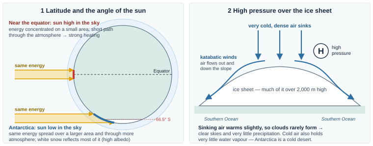
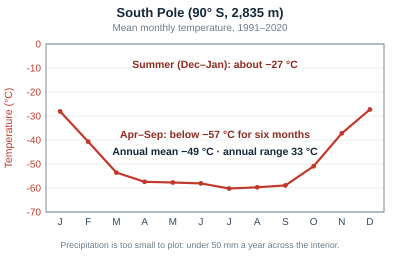
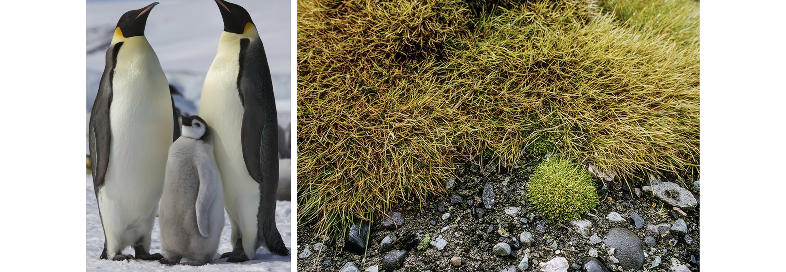

# Characteristics of the Antarctic ecosystem

## Specification coverage

| Point | Section |
| --- | --- |
| 3.1.1 The location of the Antarctic ecosystem | §1 |
| 3.1.2 The characteristics of the Antarctic climate: high pressure, the influence of latitude, angle of the sun, temperature, precipitation | §2 |
| 3.1.3 The features of the Antarctic ecosystem | §3 |
| 3.1.4 The interrelationships between abiotic and biotic factors in the Antarctic ecosystem and how flora and fauna adapt to survive | §4 |

## 1. Location (3.1.1)

::: definition
**Ecosystem** — a community of living things interacting with each other and with their non-living environment.

**Biotic factors** — the living parts of an ecosystem: plants (flora), animals (fauna), algae, fungi and bacteria.

**Abiotic factors** — the non-living parts: temperature, light, water, wind, soil and nutrients.
:::

Antarctica is the continent centred on the **South Pole**. Almost all of it lies south of the
**Antarctic Circle (66.5° S)**; only the **Antarctic Peninsula** reaches further north, towards South
America across the Drake Passage. It is surrounded by the **Southern Ocean**.

The ecosystem is more than the continent: it includes the ice shelves, the sea ice and the Southern
Ocean as far north as the **Antarctic Convergence** (about 50°–60° S), where cold Antarctic surface
water meets warmer water from the north — a sharp natural boundary for marine life.

*Figure 1. The Antarctic ecosystem. Map drawn for this repository from Natural Earth; sea-ice edges
from the US National Snow and Ice Data Center.*

## 2. Climate (3.1.2)

*Figure 2. Why Antarctica is so cold and so dry.*

- **Latitude** — Antarctica lies between about 63° and 90° S. South of the Antarctic Circle there is
  at least one day of 24-hour darkness in winter and one of 24-hour daylight in summer; at the Pole,
  six months of each. In the winter darkness no solar energy arrives at all.
- **Angle of the sun** — even in summer the sun stays low in the sky (at the Pole never more than
  23.5° above the horizon). Its energy is spread over a large area and passes through more atmosphere,
  and the white ice reflects most of what arrives.
- **High pressure** — the very cold air over the ice sheet is dense and sinks, creating a permanent
  area of high pressure. Sinking air stops clouds forming, and the cold air drains off the ice sheet
  as **katabatic winds**.
- **Temperature** — the coldest continent. Interior winter months average below −60 °C; the world's
  lowest recorded temperature, **−89.2 °C**, was at Vostok station on 21 July 1983. Coasts are much
  milder, around 0 °C in summer. Height adds to the cold: much of the ice sheet is over 2,000 m.
- **Precipitation** — under **50 mm** a year in the interior and over 200 mm on the coasts, almost all
  as snow: a **cold desert**, because cold air holds little water vapour and sinking air prevents
  clouds.

::: grid

*Figure 3. The South Pole: an interior climate graph.*

::: definition
**Albedo** — the proportion of incoming sunlight that a surface reflects. Fresh snow and ice have a very high albedo.

**Katabatic wind** — cold, dense air flowing downhill under gravity, off the ice sheet towards the coast.

**Cold desert** — a region with under 250 mm of precipitation a year that is also very cold.
:::
:::

## 3. Features of the ecosystem (3.1.3)

**Physical features**

- **Ice sheet** — covers about **98%** of the continent (about 14 million km²); up to 4.8 km thick.
- **Ice shelves** — floating extensions of the ice sheet over the sea, such as the Ross and Ronne ice
  shelves; they fringe almost half the coastline.
- **Sea ice** — frozen sea water about 1 m thick. It grows from about 3 million km² in February to
  about 18 million km² in September — each winter an area larger than the continent freezes.
- **Ice-free land** — under 1%: parts of the Peninsula, the coast and mountain peaks. Soil is thin or
  absent.

**Living features**

- **Life on land is very limited**: mosses, lichens, algae and only **two native flowering plants**,
  Antarctic hair grass and Antarctic pearlwort, mostly on the Peninsula. No land mammals.
- **Life in the sea is abundant** in summer: huge numbers of krill, fish, penguins, seals, whales and
  seabirds — but relatively few species, in short food chains that almost all depend on krill.
- **Fragile**: the cold slows growth and decay, so damage takes decades to recover.
- **No permanent population**: only scientists at over 70 research stations, and summer tourists.

## 4. Interrelationships and adaptations (3.1.4)

*Figure 4. The Antarctic marine food web and the abiotic factors that drive it.*

How abiotic and biotic factors depend on each other:

- **Light → life's seasonal rhythm.** 24-hour summer daylight triggers a huge bloom of phytoplankton,
  krill feed on it and swarm, and whales migrate in to feed; in the winter darkness production stops
  and many animals leave.
- **Sea ice → krill.** Algae growing on the underside of the sea ice feed young krill through the
  winter, so years with more sea ice produce more krill — and less sea ice means fewer krill for
  everything above them in Figure 4.
- **Cold water → productivity.** Cold water holds more dissolved oxygen, and upwelling brings
  nutrients to the surface, so the Southern Ocean is very productive despite the cold.
- **Cold → almost no soil.** Low temperatures slow weathering and decomposition, so soil hardly forms;
  only mosses and lichens can grow, so there are no land herbivores.
- **Animals → plants.** Penguin and seal droppings fertilise the ground, so mosses and lichens grow
  best around colonies. A lichen is itself a partnership: a fungus holds water and gives shelter, an
  alga photosynthesises.

*Figure 5. Left: emperor penguins, Snow Hill Island (Ian Duffy, CC BY 2.0). Right: Antarctic hair
grass and a cushion of Antarctic pearlwort, South Shetland Islands (Sharon Chester, CC BY-SA 3.0).*

| Organism | Adaptation | How it helps it survive |
| --- | --- | --- |
| **Emperor penguin** | Thick fat and dense, overlapping layers of feathers; huddles of thousands in winter; blood vessels in the feet and flippers pass heat to the cold blood returning to the body | Keeps body heat in; huddling shares warmth and shelters from the wind; very little heat is lost through the feet on the ice |
| **Weddell seal** | Thick blubber; scrapes breathing holes open in the sea ice with its teeth | Insulation in freezing water; can stay under the ice all winter and still breathe |
| **Antarctic krill** | Feeds on algae under the sea ice; can survive months without food by shrinking its body | Food through the dark winter; survives when food runs out |
| **Antarctic fish** (e.g. toothfish) | Antifreeze proteins in the blood | Stop ice crystals forming in the body at sea temperatures below 0 °C |
| **Hair grass and pearlwort** | Grow low, in tufts and cushions; photosynthesise at temperatures close to 0 °C; grow and set seed in the short summer | Out of the wind, where the ground is warmest; make the most of a very short growing season |
| **Mosses and lichens** | Survive being frozen and dried out by becoming dormant; restart photosynthesis quickly when they thaw; grow very slowly | Survive the long winter and grow whenever conditions briefly allow |

## Common misunderstandings

| Wrong | Right |
| --- | --- |
| Antarctica gets heavy snowfall, which is why it is covered in ice. | It is a desert. The ice built up over a very long time because the little snow that falls almost never melts. |
| Polar bears live in Antarctica. | Polar bears live only in the Arctic; penguins live only in the southern hemisphere. |
