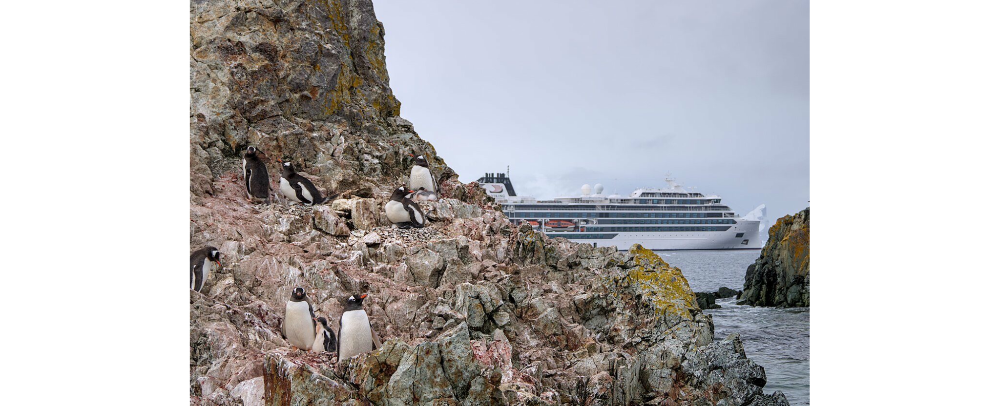

# Threats to the Antarctic ecosystem and how they can be managed

## Specification coverage

| Point | Section |
| --- | --- |
| 3.2.1 The threats posed to Antarctica, for example, resource exploitation, climate change, fishing, tourism | §1 |
| 3.2.2 The impacts of the destruction of the Antarctic ecosystem | §2 |
| 3.2.3 An evaluation of the strategies and techniques used to manage the Antarctic ecosystem; including sustainable. For example, international agreements and environmental impact surveys | §3 |

## 1. Threats (3.2.1)

| Threat | What is happening | How it damages the ecosystem |
| --- | --- | --- |
| **Climate change** | The Antarctic Peninsula has warmed by about **3 °C** since the mid-20th century, one of the fastest rates on Earth. Sea ice is shrinking and ice shelves are breaking up — the **Larsen B** ice shelf (3,250 km²) collapsed in 2002. The ocean is also absorbing CO₂ and becoming more acidic | Less sea ice means fewer krill (3.1, Figure 4); penguins that breed on sea ice lose their platform; acidity harms plankton that build shells; warmer conditions let non-native species survive |
| **Fishing** | **Krill** are caught for fish-farm feed and omega-3 supplements; the catch limit of **620,000 tonnes** was reached in 2025 and again in 2026, closing the fishery early, with fishing concentrated near the Peninsula. **Toothfish** are valuable, and some are caught illegally | Removes the food of penguins, seals and whales; overfishing can collapse fish stocks; longlines have killed albatrosses and petrels (bycatch) |
| **Resource exploitation** | Seals and whales were hunted almost to extinction in the 19th and 20th centuries. Coal, iron ore and possibly oil and gas lie under the ice and continental shelf; mining is banned, but the ban can be reviewed from 2048 | Mining would destroy scarce ice-free land and risk oil spills in water where pollution breaks down very slowly |
| **Tourism** | Over **118,000 visitors** in 2024–25, 98% of voyages to the Peninsula in summer — the same few ice-free sites where wildlife breeds | Trampling of mosses and lichens; disturbance of breeding penguins and seals; seeds and microbes carried in on clothing; waste, fuel spills and ship emissions |
| **Research stations** | Over 70 stations, built on the small area of ice-free coast | Fuel spills, sewage and rubbish; vehicles, aircraft and buildings on fragile ground |

*Figure 6. Gentoo penguins and a cruise ship, Galindez Island, Antarctic Peninsula. Photo: Anna Soina,
CC BY-SA 4.0.*

## 2. Impacts of destruction (3.2.2)

*Figure 7. The main chains of impact from a warming Antarctica.*

| Scale | Impacts |
| --- | --- |
| **Local** | Biodiversity falls as species that depend on ice or krill decline. Damage lasts for decades (3.1): trampled moss regrows very slowly and spilled fuel or waste hardly breaks down. Non-native plants, such as annual meadow grass, compete with the two native flowering plants |
| **Regional** (Southern Ocean) | The krill decline in Figure 7 reaches predators right across the ocean; ice-dependent species such as Adélie and emperor penguins decline. Overfishing leaves stocks that take years to recover |
| **Global** | The ice sheet holds enough ice to raise sea level by about **58 m** if it all melted, so even partial loss floods coasts worldwide (Topic 5). A damaged Southern Ocean absorbs less CO₂ and heat. Lost ice cores and a clean baseline remove evidence of past climate and global pollution (5.1). Fishing and tourism lose the ecosystem their income depends on |

## 3. Managing the ecosystem: an evaluation (3.2.3)

A **strategy** is an agreement, plan or policy; a **technique** is a practical method used to carry it
out. Because no country owns Antarctica, the strategies are **international agreements**. No separate
detailed example is required: the whole of 3.1–3.2 is about one place, Antarctica.

| Strategy / technique | What it does | Strengths | Weaknesses | Sustainable? |
| --- | --- | --- | --- | --- |
| **Antarctic Treaty**, 1959 (12 countries at first; 58 now) | Antarctica is for peace and science only: military activity, nuclear explosions and nuclear waste banned; territorial claims frozen; decisions by consensus at yearly meetings | Over 60 years without conflict; science is shared freely; created the framework for every agreement below | No police or court — each country enforces the rules on its own citizens; countries outside the Treaty are not bound; consensus lets one country block change | **Yes** — it prevents damage rather than repairing it |
| **Madrid Protocol** (Environmental Protocol), signed 1991, in force 1998 | Bans all mining; requires an **environmental impact assessment** before any activity; all waste must be removed; protected areas; strict rules on disturbing wildlife and bringing in non-native species | No mining has ever taken place; old dumps at research stations have been cleaned up | The mining ban can be reviewed from 2048; enforcement is left to each country; does nothing about climate change | **Yes** — keeps the resources and the ecosystem for future generations |
| **Environmental impact assessments** (surveys) — a technique | Every station, expedition or tour must be assessed before it goes ahead; bigger projects need a full assessment that all Treaty countries review | Damaging plans are changed or stopped before they start; forces planning for fuel, waste and wildlife | The operator's own government judges the assessment; projects are rarely refused; many small visits add up to damage no single assessment captures | **Partly** — good at preventing large damage, weak on the combined effect of many small activities |
| **CCAMLR** (Commission for the Conservation of Antarctic Marine Living Resources), 1982 | Sets catch limits for krill and toothfish that leave enough food for predators; monitors fishing vessels; requires measures to stop birds being hooked; creates marine protected areas — the **Ross Sea** protected area (1.55 million km², agreed 2016) has 1.12 million km² where no fishing is allowed | Illegal toothfish fishing cut sharply; seabirds killed on longlines fell from tens of thousands a year to fewer than 100; one of the world's largest marine protected areas | Consensus again: new protected areas for East Antarctica and the Weddell Sea have been blocked for years; the krill limit was reached in 2025 and 2026 with fishing crowded near penguin feeding grounds; the Ross Sea no-take zone lasts only 35 years | **Partly** — limits are set on ecosystem principles, but rising krill demand is only slowly managed |
| **Tourism rules** — Treaty site guidelines and IAATO (the tour operators' association) | No more than 100 people ashore at a site at once; one ship per site; ships with over 500 passengers may not land anyone; stay 5 m from wildlife; boots and clothing cleaned of seeds | Almost all operators comply — their business depends on an unspoilt Antarctica; visits are guided and spread out | Largely self-regulated; numbers are over 100,000 a year and growing; landings concentrate at the same sites; ship fuel emissions and spill risk remain | **Partly** — controls each visit well, but not the growth in total visitors |
| **Whaling ban** — International Whaling Commission, 1986 | Stops commercial whaling; the Southern Ocean has been a whale sanctuary since 1994 | Some populations, such as humpback whales, are recovering | Japan kept whaling in the Antarctic for "research" until 2019 | **Yes** — lets depleted populations recover |
| **Global action on climate change** — e.g. the Paris Agreement (5.3) | Cuts greenhouse gas emissions worldwide | The only response that tackles the biggest threat at its cause | Entirely outside Antarctica's control; progress is slow | **Yes, if achieved** — it removes the cause |

::: card | Reaching a judgement
The Antarctic is protected more strongly than any other region, and its agreements work because they
are **preventive** — mining, military use and dumping were banned before they could happen, which is
what makes them sustainable. Their weakness is that they rely on **consensus** and on each country
enforcing its own rules, so growing pressures such as krill fishing and tourism are managed slowly.
Above all, the **greatest threat, climate change, comes from outside** Antarctica: no Antarctic
agreement can stop it, so the ecosystem's future depends on global emissions cuts.
:::

## Common misunderstandings

| Wrong | Right |
| --- | --- |
| Melting sea ice and ice shelves raises sea level. | They already float, so their melting adds almost nothing; sea level rises when the **land ice** they hold back flows into the sea. |
| The Antarctic Treaty bans mining. | The mining ban is in the **Madrid Protocol** (1991), added to the Treaty system later. |
