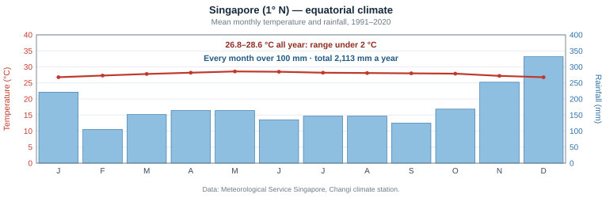
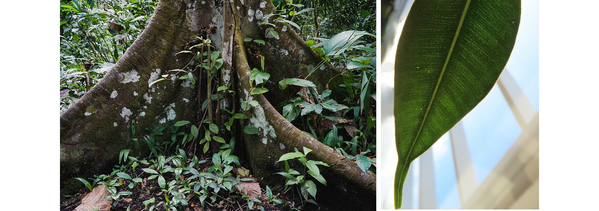

# Characteristics of the tropical rainforest ecosystem

## Specification coverage

| Point | Section |
| --- | --- |
| 3.3.1 The global distribution of tropical rainforests | §1 |
| 3.3.2 The characteristics of the equatorial climate: overhead sun, low pressure, convectional rainfall, temperature, latitude | §2 |
| 3.3.3 The characteristics and structure of the tropical rainforest ecosystem | §3 |
| 3.3.4 The interrelationships between abiotic and biotic factors in the tropical rainforest ecosystem and how flora and fauna adapt to survive | §4 |

Ecosystem, biotic and abiotic are defined in 3.1.

## 1. Global distribution (3.3.1)

*Figure 8. Where tropical rainforest would grow naturally. Drawn for this repository from Natural
Earth and RESOLVE Ecoregions 2017 (CC BY 4.0).*

Tropical rainforests lie in a belt **either side of the equator**, mostly within about 10° N and S and
all between the tropics. The three largest areas are the **Amazon Basin** in South America (the
largest), the **Congo Basin** in central Africa and **South-East Asia** (Indonesia, Malaysia, New
Guinea); smaller areas are in Central America, West Africa, eastern Madagascar and north-east
Australia. They grow wherever the climate is hot and wet all year (section 2); further from the equator
a dry season appears and forest gives way to savanna.

## 2. The equatorial climate (3.3.2)

*Figure 9. Convectional rainfall — the daily cycle that gives the equatorial climate its rain.*

- **Latitude** — within about 10° of the equator. Day and night are about 12 hours long all year, so
  there are no warm and cold seasons.
- **Overhead sun** — the sun is directly overhead at the equator in March and September and never far
  from overhead in between. The midday sun is always high, so its energy is concentrated on a small
  area (the opposite of Antarctica, 3.1 Figure 2) and heating is intense all year.
- **Temperature** — high and almost constant, about **26–28 °C** in every month; the annual range is
  under 3 °C, smaller than the range between day and night.
- **Low pressure** — intense heating makes air rise, creating a belt of low pressure along the equator
  where the trade winds meet (the Intertropical Convergence Zone). Rising air means clouds and rain.
- **Convectional rainfall** — the daily cycle in Figure 9. Total rainfall is over **2,000 mm** a year
  with no dry season, and humidity is high.

*Figure 10. An equatorial climate graph. Compare its shape with the South Pole (Figure 3).*

## 3. Characteristics and structure (3.3.3)

*Figure 11. The layered structure of a tropical rainforest.*

- **Biodiversity** — rainforests cover only about **6%** of the Earth's land surface but contain **more
  than half** of its plant and animal species.
- **Evergreen and dense** — with no cold or dry season, trees grow and shed leaves all year round, so
  the forest is always green and the biomass is very large.
- **Tall, straight trees** — trunks are bare until the canopy, where the light is; crowns spread out
  at the top.
- **Poor soils** — the soils (latosols) are deep and red but low in nutrients: heavy rain leaches
  nutrients out, and most nutrients are held in the vegetation, not the soil (Figure 12).

## 4. Interrelationships and adaptations (3.3.4)

*Figure 12. The two cycles that link abiotic and biotic factors in the rainforest.*

Other links between abiotic and biotic factors:

- **Light** — the canopy absorbs most of the light, so the forest floor is dark and few plants grow
  there. When a large tree falls, the gap lets light in and young trees race up to fill it.
- **Plants and animals depend on each other** — trees give food and shelter; animals pollinate flowers
  and spread seeds (fruit-eating birds, bats and monkeys), so the loss of either affects the other.

*Figure 13. Left: buttress roots, Semuliki National Park, Uganda (Mgslee, CC BY-SA 4.0). Right: a drip
tip (JonRichfield, CC BY-SA 4.0).*

| Organism | Adaptation | How it helps it survive |
| --- | --- | --- |
| **Emergent and canopy trees** | Buttress roots — wide ridges at the base of the trunk | Support very tall trees whose roots are shallow, because the nutrients are in the top layer of soil |
| **Many rainforest plants** | Drip tips — waxy leaves narrowing to a point | Heavy rain runs off quickly, so fungi and algae cannot grow on the leaf and block the light |
| **Lianas** | Woody climbers rooted in the ground that climb up trees | Reach the light in the canopy without growing a trunk of their own |
| **Epiphytes** (orchids, bromeliads, ferns) | Grow on branches high in the trees; take water from rain and humid air | Reach the light without rooting in the dark forest floor |
| **Rainforest trees** | Thin, smooth bark | No insulation is needed in constant warmth; climbers and epiphytes find it hard to cling |
| **Sloth** | Very slow metabolism; algae grow in its fur; long, curved claws | Saves energy on a low-energy diet of leaves; green camouflage; hangs from branches for hours |
| **Spider monkey** | Long limbs and a prehensile (gripping) tail | Moves and feeds in the canopy without coming to the ground |
| **Poison dart frog** | Bright colours | Warn predators that its skin is poisonous |

## Common misunderstandings

| Wrong | Right |
| --- | --- |
| Rainforest soils are fertile because the forest is so lush. | The soils are poor: the nutrients are in the plants, recycled fast, and leached from the soil by heavy rain. |
| It rains all day in the rainforest. | Rain comes mostly as heavy afternoon storms, after the morning's heating (Figure 9). |
| The equator has hot and cold seasons like elsewhere. | The sun is always high and days are always about 12 hours long, so there are no temperature seasons. |
