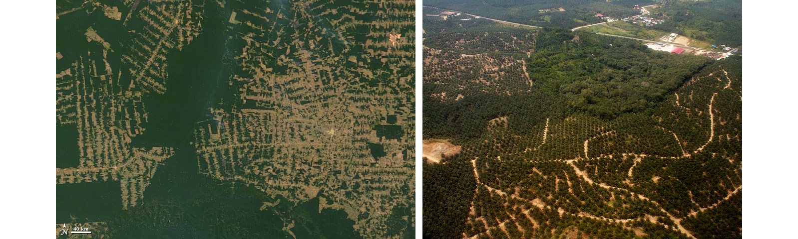

# Threats to tropical rainforest ecosystems and how they can be managed

## Specification coverage

| Point | Section |
| --- | --- |
| 3.4.1 The threats to tropical rainforest ecosystems, for example, deforestation, resource exploitation, logging, road and railway building, cattle ranching, hydroelectric power, farming, settlements | §1 |
| 3.4.2 The impacts of the destruction and deforestation of tropical rainforest ecosystems | §2 |
| 3.4.3 An evaluation of the strategies and techniques used to manage the tropical rainforest ecosystem; including sustainable | §3 |
| 3.4.4 One detailed specific example of a named country or tropical rainforest area: threats; impacts of destruction and deforestation; strategies and techniques used to manage it, including sustainable | §4 — **class source missing** |

## 1. Threats (3.4.1)

::: definition
**Deforestation** — the cutting down or burning of forest, usually for another land use, without replanting.
:::

The pressure is huge: in 2024 the world lost a record **6.7 million hectares** of tropical primary
forest, nearly half of it to fire. Most clearance is driven by countries' need for income and by
global demand for beef, soya, palm oil and timber.

| Threat | How it destroys the forest |
| --- | --- |
| **Cattle ranching** | Forest is cut and burned to make pasture for beef cattle — the largest single cause of deforestation in the Amazon. Pasture wears out within years, so ranchers clear more |
| **Commercial farming** | Huge plantations of soya (South America) and oil palm (South-East Asia) replace the forest completely (Figure 14) |
| **Subsistence farming and settlements** | Growing populations and government resettlement schemes bring farmers who slash and burn the forest; the poor soil is exhausted in a few years, so more is cleared |
| **Logging** | **Selective** logging removes valuable hardwoods such as mahogany but damages the trees around them and needs roads; **clear-felling** removes everything; much logging is illegal |
| **Resource exploitation** | Mining (iron ore, gold, bauxite) and oil and gas extraction clear land for pits, spoil heaps and pipelines, and pollute rivers — gold miners use mercury |
| **Road and railway building** | Opens remote forest to loggers, farmers and settlers; clearance spreads out from each road in a "fishbone" pattern (Figure 14) |
| **Hydroelectric power** | Dams flood large areas of forest behind them; the drowned vegetation rots and releases methane; people living there are displaced |

*Figure 14. Left: "fishbone" clearance along roads, Rondônia, Brazil (NASA, public domain). Right: a
rainforest fragment left among oil palm plantations, Sabah, Malaysian Borneo (T. R. Shankar Raman,
CC BY-SA 4.0).*

## 2. Impacts of destruction and deforestation (3.4.2)

*Figure 15. The environmental impacts of deforestation, and the scale at which each is felt.*

| | Negative impacts | Positive impacts |
| --- | --- | --- |
| **Social** | Indigenous people lose their land, homes, food sources and way of life; conflict over land; diseases brought in by outsiders | Jobs; new roads, schools and clinics for settlers |
| **Economic** | Long-term resources lost — timber, medicines, future tourism; cleared land soon becomes unproductive; costs of flooding, drought and fire | Income and jobs from timber, beef, soya, palm oil, minerals and electricity; export earnings and taxes that pay debts and fund development |

The benefits are mostly **short-term** and felt **locally or nationally**; the costs are **long-term**
and reach the **global** scale.

## 3. Managing the rainforest: an evaluation (3.4.3)

Strategies are the plans, laws and agreements; techniques are the practical methods on the ground.

| Strategy / technique | How it works | Strengths | Weaknesses | Sustainable? |
| --- | --- | --- | --- | --- |
| **Protected areas and indigenous territories** (strategy) | National parks and reserves where clearance is banned; land rights given to indigenous peoples | Legal protection for large areas; indigenous lands have lower deforestation rates | "Paper parks" — illegal logging and mining continue where there is no money to patrol | **Yes, if enforced** |
| **Laws, satellite monitoring and fines** (strategy) | Satellites detect new clearance within days; illegal clearance is fined; buyers refuse produce from newly cleared land | Brazil cut Amazon deforestation by about **80%** between 2004 and 2012 this way | Depends on political will: when enforcement was weakened in 2019–22, deforestation rose again | **Yes, while enforced** |
| **International agreements and funding** (strategy) — e.g. REDD+ payments, CITES, debt-for-nature swaps | Richer countries pay forest countries to keep forests standing; CITES bans or limits trade in endangered species, including some hardwoods; debts are cancelled in return for spending on conservation | Makes the standing forest worth money; tackles the poverty that drives clearance | Payments are small compared with profits from beef or palm oil; hard to prove forest was saved | **Partly** |
| **Certification** (strategy) — e.g. FSC timber, certified palm oil | Labels show consumers that products come from sustainably managed land | Uses consumer demand in richer countries | Covers only a small share of the trade; labels can be misused; certified goods cost more | **Partly** |
| **Selective logging** (technique) | Only mature trees of chosen species are felled; younger trees are left to grow; trees can be lifted out by helicopter so no roads are needed | The forest stays standing and regenerates; income continues | Still damages surrounding trees; any road opens the forest to settlers; slower and more expensive than clear-felling | **Yes, if carefully controlled** |
| **Replanting** (technique) | Native trees are planted on cleared land | Restores soil protection, habitat and the carbon sink | Takes decades; plantations of one species have little biodiversity | **Partly** — repairs damage rather than preventing it |
| **Agroforestry** (technique) | Crops such as coffee or cocoa are grown beneath and between trees | Soil stays covered and nutrients keep cycling; farmers earn an income without clearing | Lower yields than cleared farmland; farmers need training and markets | **Yes** |
| **Sustainable extraction** (technique) | Products are harvested without felling trees — rubber, Brazil nuts, fruit, medicines | The forest is worth more standing than cleared; supports local people | Earns less than ranching or plantations; needs protected land and buyers | **Yes** |
| **Ecotourism** (technique) | Small-scale tourism based on the forest and its wildlife, run with local people | Income and jobs that depend on keeping the forest | Small scale; too many visitors cause damage; profits may leave the area | **Yes, if small-scale** |

::: card | Reaching a judgement
Techniques that repair damage, such as replanting, are slow and treat only the symptom. The most
sustainable approaches make the **standing forest worth more than cleared land** to the people who
live there — indigenous land rights, agroforestry, sustainable extraction, ecotourism and forest
payments — and they work only when governments **enforce** the law. Because the demand for beef, soya,
palm oil and timber is global, consuming countries share the responsibility.
:::

## 4. A named country or tropical rainforest area (3.4.4)

> ⚠ Case study source needed — Specification 3.4.4  
> Required detailed specific example not found in the supplied class sources.
