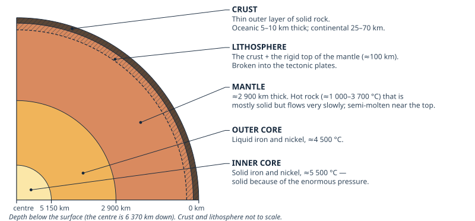
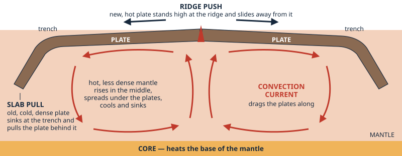
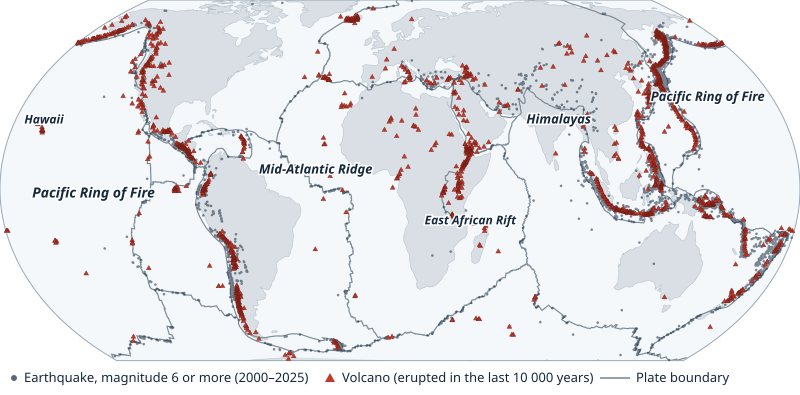

# The structure of the Earth and distribution of earthquakes and volcanoes

## Specification coverage

| Point | Section |
| --- | --- |
| 4.1.1 | §1 |
| 4.1.2 | §2 |
| 4.1.3 | §3 |

## 1. The layers of the Earth (4.1.1)

*Figure 1. The layers of the Earth and their characteristics.*

The two types of crust behave differently at plate boundaries (→ 4.2):

| | Oceanic crust | Continental crust |
| --- | --- | --- |
| Density | denser (basalt) | less dense (granite) |
| At a convergent boundary | sinks into the mantle and is destroyed | too light to sink; is not destroyed |

**Definition — Tectonic plate:** a large, rigid slab of the lithosphere that moves slowly over the
hotter, softer mantle beneath it.

## 2. The tectonic plates and how they move (4.1.2)

1. The core heats the mantle above it. Hot mantle rock becomes less dense and rises slowly.
2. Near the top it spreads sideways, cools, becomes denser and sinks again — a **convection
   current**. The currents drag the plates above them, a few centimetres a year.
3. **Ridge push** and **slab pull** (Figure 2) add to the movement.

*Figure 2. How plates move.*

*Figure 3. The main tectonic plates. Most plates carry both ocean floor and continent, so plate
boundaries rarely follow coastlines. Boundaries after Bird (2003).*

## 3. Plate boundaries and where earthquakes and volcanoes occur (4.1.3)

:::: grid
| | Divergent / constructive | Convergent / destructive | Convergent / collision | Conservative / transform |
| --- | --- | --- | --- | --- |
| Plate movement | apart | together: oceanic plate sinks under the other plate | together: two continental plates | slide past each other |
| Crust | created | destroyed | neither — crumpled up | neither |
| Example | Mid-Atlantic Ridge (North American and Eurasian plates), Iceland | Nazca plate under South American plate — Andes | Indo-Australian and Eurasian plates — Himalayas | Pacific and North American plates — California; North American and Caribbean plates — Haiti |
| Earthquakes | yes — small, shallow | yes — strong, shallow to deep | yes — strong, shallow | yes — can be strong, shallow |
| Volcanoes | yes — gentle | yes — explosive | none | none |
::::

Why each boundary behaves like this is explained in 4.2.1.

*Figure 4. Earthquakes and volcanoes. Data: USGS earthquake catalogue; Smithsonian Global
Volcanism Program.*

The pattern:

- Both occur mainly in **narrow belts along plate boundaries**; plate interiors have very few.
- The **Pacific Ring of Fire** — a belt of destructive boundaries around the edge of the Pacific —
  has most of the world's active volcanoes and strongest earthquakes.
- **Mid-ocean ridges** (e.g. the Mid-Atlantic Ridge) have lines of shallow earthquakes and
  volcanoes, mostly under the sea; Iceland is where the ridge rises above sea level. The East
  African Rift is a divergent boundary on land.
- **Collision zones** (e.g. the Himalayas) and **conservative boundaries** (e.g. California) have
  earthquakes but no volcanoes.
- A few volcanoes lie far from any boundary, over **hotspots** where hot mantle rises under the
  middle of a plate — e.g. **Hawaii**.

## Common misunderstandings

- The lithosphere is not just the crust: it is the crust **plus the rigid top of the mantle**.
- The inner core is **solid** even though it is the hottest layer — the pressure is too great for
  it to melt. The outer core is liquid.
