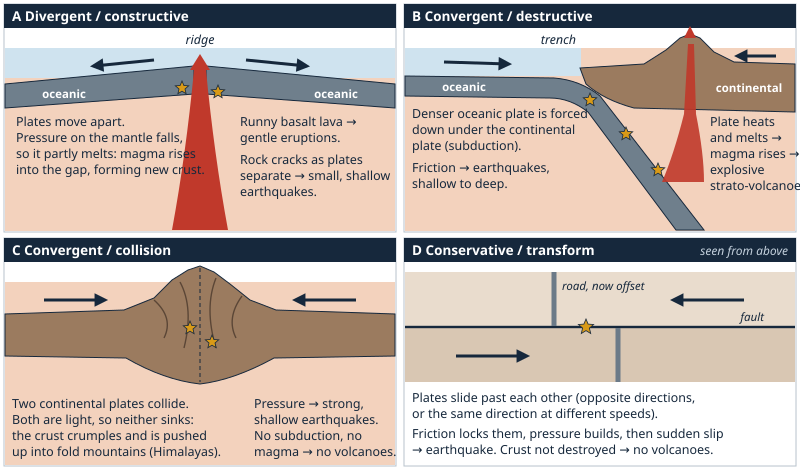
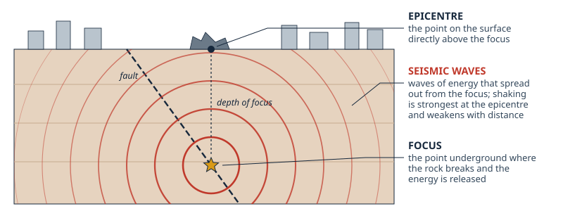
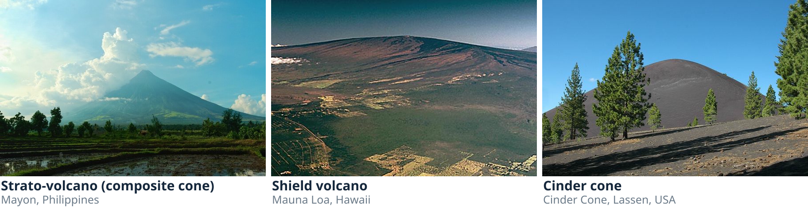
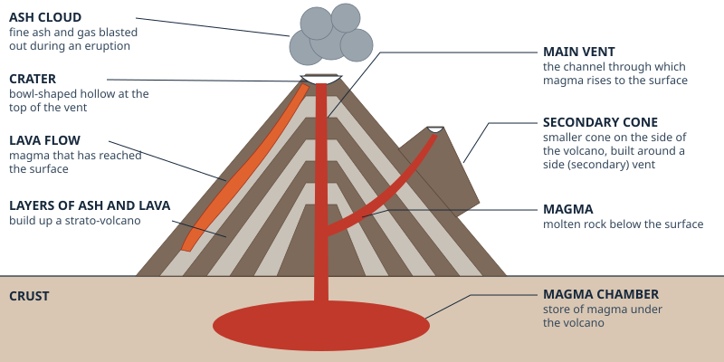
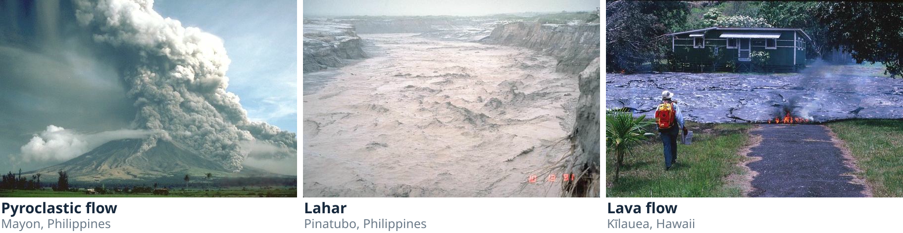

# The processes and features associated with earthquakes and volcanoes

## Specification coverage

| Point | Section |
| --- | --- |
| 4.2.1 | §1 |
| 4.2.2 | §2 |
| 4.2.3 | §3 |
| 4.2.4 | §4 |
| 4.2.5 | §5 |
| 4.2.6 | §6 |

## 1. Processes at each type of plate boundary (4.2.1)

*Figure 1. The processes at the four types of plate boundary. Stars show earthquake foci.*

**How every earthquake happens** — the same process at all four boundaries:

1. Plates do not move smoothly: **friction** locks the rocks at their edges together.
2. The plates keep moving, so **pressure (stress) builds up** in the locked rock.
3. When the pressure becomes greater than the friction, the rock **suddenly breaks or slips** along
   a fault.
4. The stored energy is released as **seismic waves** — an earthquake.

**Volcanoes** form only where magma is made: at divergent and destructive boundaries (Figure 1,
A and B).

## 2. The main characteristics of earthquakes (4.2.2)

*Figure 2. Focus, epicentre and seismic waves.*

Seismic waves are recorded by **seismometers**. The closer the focus is to the surface, the less
energy the waves lose before reaching it: a **shallow-focus** earthquake (less than about 70 km
deep) causes much stronger shaking than a deep-focus one of the same magnitude.

## 3. Types of volcano (4.2.3)

*Figure 3. The three types of volcano. Photos: Z. Fabia, CC BY 4.0; J.D. Griggs, USGS;
DimiTalen, CC BY-SA 3.0.*

| | Strato-volcano (composite cone) | Shield volcano | Cinder cone |
| --- | --- | --- | --- |
| Shape | tall, steep-sided, symmetrical cone | very wide base, gentle slopes | small (usually under 300 m), steep straight sides, bowl-shaped crater |
| Built from | alternate layers of ash and lava | many layers of runny lava that flowed far | loose cinders (lumps of lava that cooled in the air) piled around one vent |
| Magma | thick, sticky (viscous), gas-rich | runny (basalt), little gas | gas-rich |
| Eruptions | infrequent, very explosive | frequent, gentle lava flows | short-lived, often a single eruption; mildly explosive |
| Where | destructive boundaries | divergent boundaries and hotspots | on the sides of larger volcanoes or in groups |
| Example | Mayon, Philippines | Mauna Loa, Hawaii | Parícutin, Mexico |

**Why eruptions differ:** in runny magma, gas bubbles escape easily, so lava pours out gently and
flows far — building a wide, gentle shield. In thick, sticky magma, gas is trapped until the
pressure blasts the magma apart into ash — explosive eruptions that build steep cones of ash and
lava layers.

## 4. Active, dormant and extinct volcanoes (4.2.4)

| Class | Meaning | Example |
| --- | --- | --- |
| Active | has erupted recently (in recorded history) and is likely to erupt again | Mayon, Philippines |
| Dormant | has not erupted for a long time but could erupt again | Kilimanjaro, Tanzania |
| Extinct | has not erupted for at least 10 000 years and is not expected to erupt again | Arthur's Seat, Edinburgh |

## 5. The main features of volcanoes (4.2.5)

*Figure 4. The main features of a volcano.*

**Definition — Magma:** molten rock beneath the Earth's surface. Once it erupts onto the surface
it is called **lava**.

## 6. Volcanic hazards (4.2.6)

*Figure 5. Three volcanic hazards. Photos: C.G. Newhall, USGS; USGS.*

| Hazard | What it is | Speed and spread | Main danger |
| --- | --- | --- | --- |
| Lava flow | molten rock flowing over the ground | usually slow (walking pace); follows valleys | burns and buries buildings, roads and crops; rarely kills |
| Ash fall | fine powdered rock blown into the air, settling like snow | carried by the wind for hundreds to thousands of km | roofs collapse under its weight; buries crops; breathing problems; damages aircraft engines |
| Tephra | all rock fragments thrown into the air, from fine ash to large lumps | large pieces fall near the vent; fine ash drifts far | falling fragments injure people and damage buildings |
| Volcanic rocks | large pieces: **volcanic bombs** (blobs of lava) and blocks of solid rock | thrown up to a few km from the vent | crush people and buildings; start fires |
| Pyroclastic flow | avalanche of very hot gas, ash and rock (several hundred °C) | very fast (often over 100 km/h) down the slopes | the deadliest: cannot be outrun; burns and suffocates everything |
| Lahar | volcanic mudflow: ash and rock mixed with water (heavy rain or melted snow and ice) | fast; travels tens of km along river valleys, even long after an eruption | buries towns and farmland; destroys bridges |
| Toxic gases | e.g. carbon dioxide, sulphur dioxide | spread by the wind; carbon dioxide is heavier than air and collects in hollows | suffocation; lung damage; acid rain |

**Why speed, size, frequency and spread matter:**

- **Speed** — fast hazards (pyroclastic flows, lahars) give no time to escape and cause most
  deaths; slow lava flows mainly destroy property.
- **Size** — a bigger eruption (higher VEI, → 4.3.4) produces more material and affects a larger
  area and more people.
- **Frequency** — where eruptions are frequent, people are prepared and monitoring is in place;
  where they are rare, people may underestimate the risk and live close to the volcano.
- **Spread** — the area affected: bombs and lava stay near the volcano, lahars follow valleys far
  downstream, and ash and gas can spread across countries.

## Common misunderstandings

- The **epicentre** is on the surface; the **focus** is underground, where the earthquake starts.
- **Magma** is underground; it becomes **lava** only when it reaches the surface.
- A **dormant** volcano is not safe: it can still erupt.
