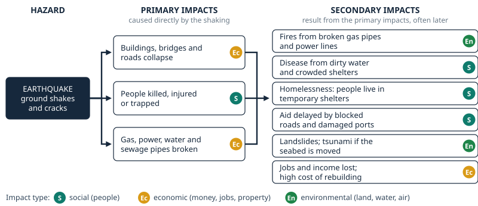
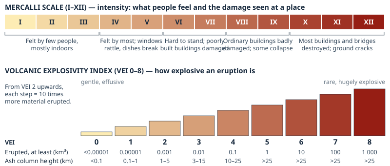

# The impacts of tectonic hazards

## Specification coverage

| Point | Section |
| --- | --- |
| 4.3.1 | §1 |
| 4.3.2 | §2, §4 |
| 4.3.3 | §3, §4 |
| 4.3.4 | §5 |

## 1. Why people live in areas at risk (4.3.1)

:::: grid
::: card | What the area offers
- **Fertile soils:** volcanic ash weathers into soil rich in minerals → high crop yields.
- **Geothermal energy:** heat from magma gives cheap electricity and hot water.
- **Minerals** such as sulphur, copper and gold → mining jobs.
- **Tourism:** volcanoes, hot springs and geysers bring visitors, jobs and income.
- **Cities and jobs:** many large cities grew in earthquake zones for other reasons — coasts,
  ports, trade — and offer work and services.
:::
::: card | Why people stay or cannot leave
- **Poverty:** they cannot afford to move or to buy land elsewhere, and their living depends on
  their land.
- **Home and family:** they have lived there for generations.
- **Low perceived risk:** big events are rare, so people think it will not happen to them, or do
  not know the risk.
- **Confidence in protection:** monitoring, warnings and earthquake-resistant buildings make people
  feel safe (mainly in HICs).
:::
::::

## 2. The impacts of earthquakes (4.3.2)

**Definition — Primary impacts:** the effects caused directly by the hazard itself (e.g. buildings
collapsing from the shaking).

**Definition — Secondary impacts:** the effects that result from the primary impacts, often hours to
months later (e.g. disease from broken water pipes).

*Figure 1. How the impacts of an earthquake follow on from each other.*

Impacts can reach every scale: a whole city (local), the national economy and government, and the
world (international aid; a tsunami crossing an ocean). There are few positive impacts:
rebuilding creates jobs and can leave safer buildings.

## 3. The impacts of volcanic eruptions (4.3.3)

| | Negative — primary | Negative — secondary | Positive |
| --- | --- | --- | --- |
| Social | deaths and injuries, mainly from pyroclastic flows and falling rocks; homes destroyed | evacuation and homelessness; breathing problems from ash; food shortages if crops are lost | — |
| Economic | buildings, roads and crops destroyed | businesses closed; flights cancelled by ash clouds; tourism lost; cost of rebuilding | tourism, geothermal energy and mining bring income and jobs |
| Environmental | land buried by lava and ash; forests burned; wildlife killed | lahars; acid rain; rivers polluted; ash and gas can cool the global climate for a year or two | ash forms fertile soil; lava creates new land |

A large ash cloud can spread across borders, so a single eruption can have international impacts
(→ Eyjafjallajökull, 4.4.4).

## 4. Why the impacts vary (4.3.2, 4.3.3)

| Factor | Impacts are greater when… |
| --- | --- |
| Size of the event | the magnitude or VEI is high (§5) |
| Depth of focus | the focus is shallow, so shaking at the surface is stronger |
| Distance | people live close to the epicentre or volcano |
| Population density | many people and buildings are exposed, e.g. a city |
| Building quality | buildings are poorly built and collapse |
| Level of development | the country is poor (LIC): little monitoring, weak buildings, few emergency services, slower aid — so **more deaths**. In HICs deaths are fewer but the **economic cost** is often higher because property is worth more. |
| Time of day | people are asleep indoors at night, or roads are crowded at rush hour |
| Preparation | people have no warning, education or emergency plans |

## 5. Measuring the magnitude of tectonic events (4.3.4)

| Scale | What it measures | How | Values |
| --- | --- | --- | --- |
| Richter | the magnitude of an earthquake: size (amplitude) of the seismic waves | seismometer readings | usually 1–9; logarithmic; inaccurate for the largest earthquakes |
| Moment magnitude | the magnitude: total energy released | area of fault that slipped × distance it slipped × strength of the rock | similar numbers to Richter; logarithmic; accurate for the largest earthquakes, so now the standard scale |
| Mercalli | intensity: the effects felt and the damage seen at a place | observations and reports from people | I–XII; one earthquake has many values — highest near the epicentre |
| Volcanic explosivity index (VEI) | how explosive an eruption is | volume of material erupted and height of the ash column | 0–8; logarithmic |

**Definition — Logarithmic scale:** each whole number is ten times larger than the one below. A
magnitude 7 earthquake has ten times bigger seismic waves than a magnitude 6 and releases about 32
times more energy.

*Figure 2. The Mercalli scale and the volcanic explosivity index.*

## Common misunderstandings

- **Magnitude** (Richter, moment magnitude) is one number for the whole earthquake; **intensity**
  (Mercalli) describes the effects at a particular place and varies with distance.
- Magnitude 8 is not "twice" magnitude 4: each step is ten times bigger.
