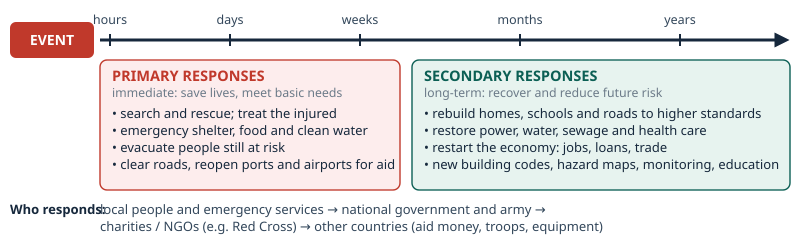
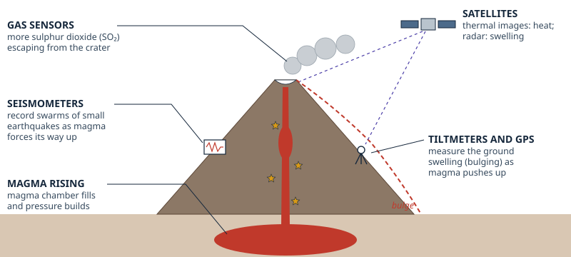
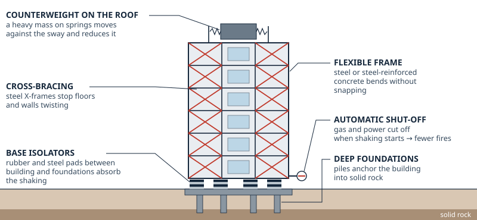
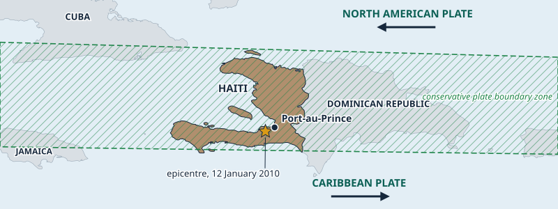
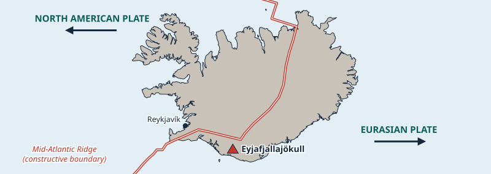

# Managing the impacts of tectonic hazards

## Specification coverage

| Point | Section |
| --- | --- |
| 4.4.1 | §1 |
| 4.4.2 | §2 |
| 4.4.3 | §3 |
| 4.4.4 | §4 |

## 1. Primary and secondary responses (4.4.1)

**Definition — Primary responses:** the immediate actions, in the first hours to weeks, to save lives
and meet people's basic needs.

**Definition — Secondary responses:** the longer-term actions, over months to years, to rebuild,
restore the economy and reduce the risk from the next event.

*Figure 1. Primary and secondary responses.*

Speed and success depend on wealth: an HIC can pay for its own rescue and rebuilding; an LIC
relies more on international aid, which is slowed when roads, ports and airports are damaged.

## 2. Strategies and techniques to manage the impacts — an evaluation (4.4.2)

**Strategies** are the plans and policies (e.g. an evacuation plan, a building code); **techniques**
are the practical methods used to carry them out (e.g. seismometers, base isolators).

*Figure 2. Monitoring a volcano: the warning signs of rising magma.*

*Figure 3. Protection: an earthquake-resistant (aseismic) building.*

| | What is done | Strengths | Weaknesses |
| --- | --- | --- | --- |
| Monitoring | **Volcanoes:** seismometers, tiltmeters and GPS, gas sensors, satellites (Figure 2). **Earthquakes:** seismometers and GPS measure the movement and strain along faults. | Volcanoes give clear warning signs days to weeks ahead | Costly equipment and trained staff; many volcanoes in LICs are not monitored; shows where strain builds, not when a fault will break |
| Prediction | **Volcanoes:** eruptions forecast from monitoring data. **Earthquakes:** only the **probability** of an earthquake in an area over the coming decades, from past records and hazard maps. | Evacuating before an eruption saves many lives | The time of an earthquake cannot be predicted; the exact timing and size of an eruption are uncertain; false alarms cost money and trust |
| Protection | **Earthquakes:** aseismic buildings (Figure 3); cheaper methods for LICs — steel bars in concrete, lighter roofs, timber frames, strengthening old buildings (retrofitting); building codes; sea walls against tsunamis. **Volcanoes:** channels and barriers to divert lava and lahars, strong roofs against ash. | Buildings are what kill in earthquakes, so safe buildings save the most lives, for decades | Expensive; building codes fail if not enforced; little protection is possible from pyroclastic flows |
| Planning | Hazard maps and land-use zoning (no building in the highest-risk areas); evacuation plans and routes; exclusion zones round volcanoes; emergency drills, education ("drop, cover, hold on") and emergency kits. | Cheap and effective — suits LICs; people know what to do | Needs organised government; people may ignore plans; hard to control where the poor build |
| Technology | Early-warning systems that detect the first seismic waves and send automatic alerts (stopping trains, shutting off gas); satellites and GPS; aseismic design features. | Fast, precise warnings and automatic safety measures | Seconds of warning only for earthquakes; expensive; needs power and communications |

**Judgement:** for **volcanoes**, monitoring, prediction and planning (evacuation) are most
effective, because eruptions give warning signs. **Earthquakes** cannot be predicted, so protection
(safe buildings) and planning (preparation) matter most. The deciding factor is money and
government: HICs can use all five approaches; LICs get most from cheap planning, education and
simple building improvements.

## 3. Detailed specific example: the Haiti earthquake, 12 January 2010 (4.4.3)

*Figure 4. The location of the Haiti earthquake.*

### Causes

- **When and where:** 12 January 2010, 16:53, near the capital, **Port-au-Prince**.
- **Magnitude 7.0**, with a **shallow focus only 13 km deep**.
- **Why:** Haiti lies on the **conservative plate margin** between the **North American** and
  **Caribbean** plates. The plates do not slide smoothly: the rocks interlock and friction builds up
  pressure until a sudden slip releases it as seismic waves.

### Impacts

:::: grid
::: card | Primary effects
- **230 000** people died
- **300 000** injured
- **250 000** homes and **30 000** commercial buildings destroyed
- **1 000 000** homeless
:::
::: card | Secondary effects
- **2 million** people without food and water
- regular power cuts
- crime increased
- people moved into temporary shelters
:::
::::

### Responses

:::: grid
::: card | Immediate (primary)
- aid was slow because the **port was damaged**
- **10 000 troops** sent by the USA
- **£20 million** donated by the UK
- bottled and purified water provided
:::
::: card | Long-term (secondary)
- Haiti relied on **overseas aid**
- new homes slowly built to a **higher standard**
- the port had to be rebuilt
:::
::::

### Strategies and techniques used to manage the impacts of earthquakes

::: note | Source note
The class notes do not cover this sub-bullet. It was completed by research the student authorised
on 22 September 2026: Eos (2019), AGU (2018), Pulitzer Center (2020), PreventionWeb (2020),
Haiti Express (2025).
:::

Before 2010 Haiti had **no seismic network, no seismic hazard map and no building code**.

:::: grid
| | What Haiti did | How well it works |
| --- | --- | --- |
| Monitoring | national seismic network run by the Bureau of Mines and Energy since 2011 — **10 stations** | only **one** station was working during the magnitude 5.9 earthquake of October 2018: there is no money to maintain them |
| Prediction and planning | a **national seismic hazard map** and hazard maps of cities, showing where shaking will be worst | no funds to update the map; in 2020 there was still **no national disaster plan** and earthquake education in schools was not compulsory |
| Protection | first national building code, **CNBH 2012**; over **7 000 masons** trained in earthquake-resistant building; revised code **CNBH 2025**, approved by the Ministry of Public Works in December 2025, also covers hurricanes and ordinary and rural houses | by 2020 the 2012 code had still not been passed into law, so it could not be enforced; **up to 90%** of buildings are informal, built without engineers |
::::

**Evaluation:** Haiti now has the knowledge and tools; what limits them is money and enforcement.
Poverty means most people build informally and equipment is not maintained, so training builders
and cheap planning are the most realistic ways to reduce deaths in the next earthquake.

## 4. Detailed specific example: Eyjafjallajökull, Iceland, March–May 2010 (4.4.4)

*Figure 5. The location of Eyjafjallajökull.*

### Causes

- A volcano **1 700 m** high in Iceland, capped by a glacier; it erupted between **March and May 2010**.
- **Why:** Iceland lies on the **constructive plate margin** between the **North American** and
  **Eurasian** plates. As the plates move apart, magma rises and fills the magma chamber of
  Eyjafjallajökull.

### Impacts

- **Primary:** the ash cloud — day turned to night as the ash blocked the sun.
- **Secondary:** **flooding** as the glacier melted; the ash closed airspace (no-fly zones) —
  delays cost **billions of euros**, airlines lost **£130 million a day** and airline share prices
  fell about **3%**; sporting events were cancelled and fresh food imports stopped. (The class notes
  list the aviation losses as primary; they are secondary because the ash cloud caused them.)
- **International — Kenya**, which typically exports **500 tonnes of flowers**, lost **$1.3 million a
  day** in shipments that could not reach Europe, and **5 000 workers** were laid off.
- **Opportunities:** cancelled flights prevented **2.8 million tonnes of CO₂** being released; other
  transport companies earned more (over **50 000 extra passengers**); the ash made the soil more
  fertile.

### Responses and strategies used to manage the impacts

- **Immediate:** flights cancelled and roads closed; the European Red Cross evacuated over **700
  volunteers and citizens three times** during the eruption.
- **Long-term strategy:** the **European Union developed integrated air traffic management**,
  replacing the old, faulty routes.

**Evaluation:** evacuation, road closures and no-fly zones kept people away from the hazard, but
closing airspace cost billions across Europe and as far as Kenya; integrated air traffic management
aims to cut that disruption next time.
