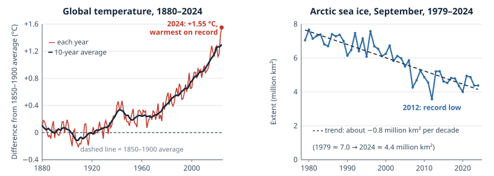
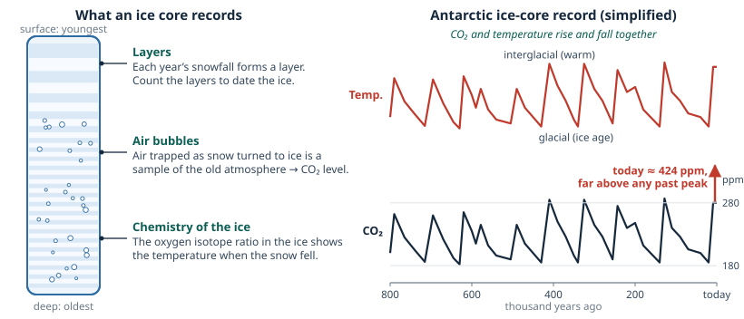
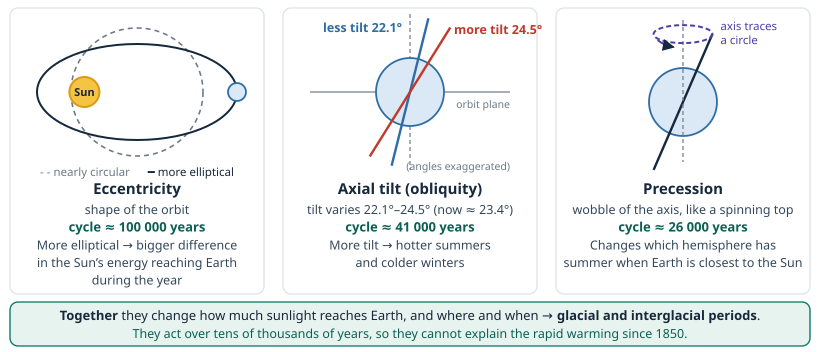
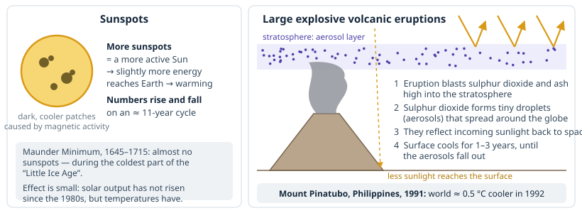
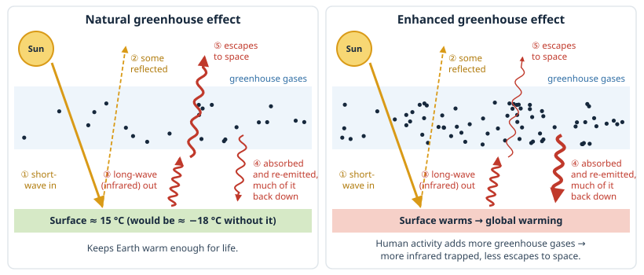

# The natural and human causes of climate change

## Specification coverage

| Point | Section |
| --- | --- |
| 5.1.1 Evidence of climate change: global temperature data, ice cores, sea ice positions, historic writing and paintings | §1 |
| 5.1.2 Factors influencing natural climate change: orbital changes (Milankovitch cycles), sunspots, volcanic activity | §2 |
| 5.1.3 The human influence on the atmosphere causing the enhanced greenhouse effect (e.g. fossil fuels, deforestation, agriculture) | §3 |

## 1. Evidence of climate change

::: definition
**Climate change** — a long-term change, over decades or longer, in the average weather conditions
(such as temperature and rainfall) of a place or of the whole Earth.
:::

Climate has always changed naturally, between cold **glacial** periods (ice ages) and warmer
**interglacials**. The evidence shows that since about 1850 the Earth has warmed unusually fast.

*Figure 1. Global temperature data and Arctic sea ice positions. (Data: NASA, NSIDC, WMO.)*

*Figure 2. What an ice core records, and the Antarctic ice-core record.*

| Evidence | What it shows | How far back | Limitation |
| --- | --- | --- | --- |
| **Global temperature data** | Thermometer readings from land weather stations, ships and ocean buoys, averaged for the globe. Now about 1.3–1.4 °C above 1850–1900, most of the rise since 1980; 2015–2025 were the 11 warmest years on record. | about 1850 | Few stations at first, especially at sea, near the poles and in poorer countries; towns growing around a station make its readings warmer. |
| **Ice cores** | Cylinders of ice drilled from the Antarctic and Greenland ice sheets (Figure 2). CO₂ and temperature rise and fall together, and CO₂ is now higher than at any time in 800 000 years. | about 800 000 years | Only from polar and high-mountain ice; deep layers are squeezed thin, so they are harder to date precisely. |
| **Sea ice positions** | Satellites map how far the frozen sea extends; older positions come from ships' logs. Arctic sea ice is shrinking and thinning (Figure 1). | reliable satellite record from 1979 | Short record; extent varies a lot from year to year, so only the long-term trend is meaningful. |
| **Historic writing and paintings** | Diaries, harvest dates and ships' logs describe past weather; paintings show frozen rivers and snowy winters. Example: frost fairs were held on the frozen River Thames in London between 1608 and 1814, during the **Little Ice Age** (about 1300–1850). | hundreds of years | Descriptions, not measurements; only where records were kept; artists may exaggerate; one place may not represent the globe. |

## 2. Natural factors that change climate

Natural factors change **how much of the Sun's energy reaches the Earth's surface**.

*Figure 3. Orbital changes (Milankovitch cycles).*

*Figure 4. Sunspots and volcanic activity.*

## 3. The human influence: the enhanced greenhouse effect

::: definition
**Greenhouse effect** — the natural process by which gases in the atmosphere (such as carbon dioxide,
methane and water vapour) absorb long-wave (infrared) radiation given off by the Earth's surface and
re-emit some of it back towards the surface, keeping the Earth warmer than it would otherwise be.
:::

::: definition
**Enhanced greenhouse effect** — the increase in the greenhouse effect caused by human activities
adding extra greenhouse gases to the atmosphere, so that more heat is trapped and the Earth warms.
The resulting rise in the Earth's average surface temperature is **global warming**.
:::

*Figure 5. The natural and the enhanced greenhouse effect.*

The concentration of CO₂ in the atmosphere has risen from about **280 ppm** (parts per million) before
the Industrial Revolution to about **424 ppm in 2024**. Emissions keep rising because a growing,
wealthier world population uses more energy, food and land.

| Human activity | Gas | How it adds to the greenhouse effect |
| --- | --- | --- |
| **Burning fossil fuels** | carbon dioxide (CO₂) | Coal, oil and natural gas burned for electricity, transport, industry and heating release carbon stored underground for millions of years. The largest source of greenhouse gases. |
| **Deforestation** | carbon dioxide (CO₂) | Forest cleared for farming, logging, mining and settlement is burned or left to rot, releasing its stored carbon; fewer trees remain to absorb CO₂ by photosynthesis — a **carbon sink** is lost. |
| **Agriculture** | methane, nitrous oxide | Cattle and sheep give off methane as they digest food; flooded rice fields release methane; nitrogen fertilisers release nitrous oxide. Methane traps about 30 times more heat than the same mass of CO₂. |

## Common misunderstandings

| Wrong | Right |
| --- | --- |
| Greenhouse gases trap incoming sunlight. | They let sunlight through and absorb the **infrared** given off by the surface. |
| The ozone hole causes global warming. | Ozone depletion is a separate problem. |
| Volcanoes cause the recent warming. | Eruptions cause **short-term cooling**; humans emit about 100 times more CO₂ a year than volcanoes. |
| A cold winter disproves climate change. | That is weather; climate is the average over 30+ years. |

## Exam relevance

When describing a temperature or sea-ice graph, give the overall **trend**, the **rate** (faster
since about 1980), and **figures with units and dates**, then any anomaly (e.g. the 2012 sea-ice
low). "Explain how human activity causes climate change" needs the full chain: **activity → gas →
absorbs infrared radiation → more heat trapped → global warming**.
