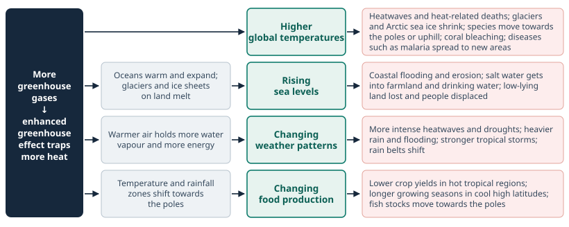
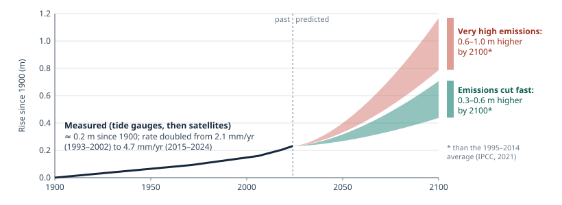

# The impacts of climate change at a range of geographic scales

## Specification coverage

| Point | Section |
| --- | --- |
| 5.2.1 Present-day and predicted future impacts (e.g. rising sea levels; changes to global temperature, weather patterns and food production) | §1 how impacts arise · §2 present and predicted · §3 scales · §4 positive/negative, social/economic/environmental |

## 1. How warming produces the impacts

*Figure 1. Each impact traced back to its cause.*

## 2. Present-day and predicted impacts

Predictions depend on how much more greenhouse gas is emitted, so they are given as ranges for
different **emissions scenarios** (IPCC, 2021).

*Figure 2. Global sea level: measured and predicted.*

| Impact | Present day | Predicted future (by 2100) |
| --- | --- | --- |
| **Global temperature** | About 1.3–1.4 °C above 1850–1900; 2024 the warmest year, at about 1.55 °C. Land and the Arctic warm faster than the global average. | About +1.4 °C if emissions are cut fast, up to about +4.4 °C if they stay very high. |
| **Sea level** | About 0.2 m higher than in 1900, and rising faster (Figure 2). More frequent flooding of low coasts at high tide and in storms. | 0.3–1.0 m higher (Figure 2), and still rising for centuries. Coastal floods that used to happen once a century will happen at least once a year at over half of the world's tide-gauge sites. |
| **Weather patterns** | A heat extreme that used to happen once in 50 years now happens about 5 times as often. Heavier downpours; more drought in some regions, e.g. the Mediterranean; a larger share of tropical storms are very intense. | At 2 °C of warming the same heat extreme happens about 14 times as often. Wet regions become wetter and dry regions drier; tropical storms become stronger, with heavier rain. |
| **Food production** | Warming has already slowed the growth of crop yields, especially in the tropics; heatwaves and droughts cause harvest failures. Growing seasons are longer at high latitudes. | Lower yields of maize, wheat and rice in many hot regions → higher food prices and more food insecurity *(→ 10.3)*. Farming expands in cool regions such as Canada and Russia; fish stocks move towards the poles. |

## 3. Impacts at different scales

| Scale | Example impacts |
| --- | --- |
| **Global** | Rising sea level and temperature everywhere; higher world food prices when major crop regions have poor harvests; loss of biodiversity. |
| **Regional** | Arctic: sea ice loss opens shorter shipping routes, but destroys habitat for polar bears and hunting grounds of Inuit communities. Mediterranean: more drought and wildfires. Tropical seas: coral bleaching *(→ 2.3)*. |
| **National** | Low-lying countries lose land and homes: Bangladesh (a large, crowded river delta — flooding and salt water entering rice fields) and the Maldives (most land less than 1 m above sea level). |
| **Local** | A coastal town loses homes to erosion and flooding; a farm loses its harvest in a drought — or gains a longer growing season in a cool region. |

Impacts are **unequal**: low-income countries are often hit hardest, because more people depend on
farming and there is less money for defences, although they have emitted the least greenhouse gas.

## 4. Positive and negative impacts

|  | Social | Economic | Environmental |
| --- | --- | --- | --- |
| **Negative** | Deaths from heatwaves, floods and storms; diseases such as malaria spread to new areas; water shortages; people forced to migrate | Damage to homes, roads and ports; lower crop yields; rising costs of insurance and flood defences; lost tourism (e.g. ski resorts, coral reefs) | Habitats lost and species at risk of extinction; coral bleaching; glaciers and sea ice shrink; more wildfires |
| **Positive** | Fewer cold-related deaths in winter at high latitudes | Longer growing seasons and new crops in cool regions; shorter Arctic shipping routes; access to Arctic resources; longer tourist seasons in cool countries | Some species spread into newly warm areas; some plants grow faster with more CO₂ |

## Common misunderstandings

| Wrong | Right |
| --- | --- |
| Melting sea ice raises sea level. | Sea ice is already floating, so its melting adds almost nothing. Sea level rises through **thermal expansion** of warming water and **melting ice on land** (glaciers, ice sheets). |
| All impacts are negative. | Some places gain, mainly at high latitudes — but the negative impacts are far greater and fall hardest on poorer countries. |

## Exam relevance

For "impacts" questions, name the **scale** (local → global), the **type** (social, economic,
environmental) and whether it is **positive or negative**, and link each impact back to its cause
(Figure 1). For predicted impacts use "is likely to / could", and say that the amount depends on
future emissions.
