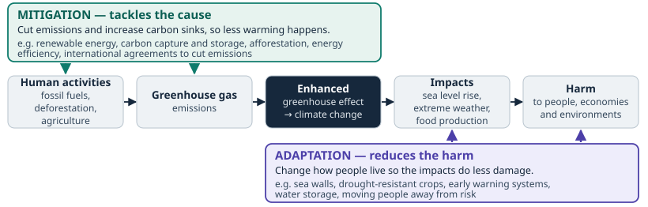

# Responses to climate change

## Specification coverage

| Point | Section |
| --- | --- |
| 5.3.1 The strategies (including national and international agreements) and techniques used to manage the impacts of climate change | §1 terms · §2 international · §3 national · §4 techniques |
| 5.3.2 An evaluation of mitigation (including international agreements) and adaptation strategies and techniques | §2 agreement strengths/weaknesses · §4 technique strengths/weaknesses · §5 overall evaluation |
| 5.3.3 Named country or region: impacts of climate change · responses · strategies and techniques being used to manage climate change; including sustainable | §6 — **placeholder: no class source** (`CASE_STUDY_TRACKER.md`: `MISSING_SOURCE`) |

## 1. Mitigation and adaptation

::: definition
**Mitigation** — action that reduces the cause of climate change, by cutting greenhouse gas emissions
or increasing the CO₂ removed from the atmosphere, so that less warming happens.
:::

::: definition
**Adaptation** — action that adjusts the way people live to the actual or expected impacts of climate
change, so that the impacts do less harm.
:::

**Strategies** are the action plans and agreements (e.g. the Paris Agreement, a national law);
**techniques** are the methods used to carry them out (e.g. wind turbines, sea walls).

*Figure 1. Where mitigation and adaptation act.*

## 2. International agreements

Climate change is global: every country's emissions warm the whole planet, so cuts only work if most
countries make them. Countries meet every year at a UN climate conference (a **COP**) to negotiate.

|  | Kyoto Protocol | Paris Agreement |
| --- | --- | --- |
| **Agreed** | 1997 (in force 2005) | 2015, at COP21 (in force 2016); almost every country |
| **Who must cut emissions** | Only developed countries (HICs): on average 5% below 1990 levels by 2008–2012 | Every country, rich and poor |
| **Targets** | Fixed and legally binding; countries could trade emission allowances (**carbon trading**) | Each country sets its own target (a *nationally determined contribution*) and must update it every 5 years with more ambition. Aim: keep warming **well below 2 °C**, and try for **1.5 °C** |
| **Money** | — | HICs give **climate finance** to LICs for mitigation and adaptation: US$100 billion a year (reached in 2022), rising to US$300 billion a year by 2035 |
| **Strengths** | First legally binding targets; set up carbon trading; the countries that took part met their overall target | Includes all major emitters, including China and India; flexible; regular reviews push targets up; pays for adaptation in LICs |
| **Weaknesses** | The USA never ratified it; China and India had no targets; Canada withdrew; world emissions kept rising | Targets are voluntary with no penalties; pledges so far lead to about 2.3–2.8 °C of warming (UNEP, 2025); the USA left twice, most recently in January 2026 |

## 3. National strategies

| Strategy | How it works |
| --- | --- |
| **Law with emissions targets** | A legally binding target and plan, e.g. the UK's Climate Change Act (2008), now aiming for **net zero** by 2050 — greenhouse gases emitted balanced by those removed. |
| **Carbon pricing** | A carbon tax, or an emissions trading scheme (e.g. the EU's), makes polluters pay for each tonne of CO₂, so cutting emissions saves them money. |
| **Subsidies and bans** | Grants for renewable energy, home insulation and electric vehicles; bans on, for example, new coal power stations or new petrol and diesel cars. |
| **National adaptation plan** | Identifies the country's main risks and funds the response, e.g. flood defences, water supply, stricter building standards. |

## 4. Techniques

### Mitigation techniques

| Technique | How it works | Strength | Weakness |
| --- | --- | --- | --- |
| **Renewable energy** | Solar, wind and HEP generate electricity without burning fossil fuels *(→ 10.4)* | Tackles the largest source of CO₂; solar and wind are now cheap | Sun and wind are intermittent, so storage or back-up is needed; HEP dams flood land |
| **Carbon capture and storage** (CCS) | CO₂ is captured at power stations and factories, compressed and stored deep underground, e.g. in old gas fields | Cuts emissions from industries that are hard to change, e.g. cement, steel | Expensive; uses extra energy; few working projects; risk of leaks |
| **Planting and protecting forests** | Afforestation, reforestation and stopping deforestation: trees absorb CO₂ by photosynthesis and store the carbon | Cheap; also protects wildlife, soils and water supply | Takes decades; the carbon returns if the forest burns or is cleared; competes with farmland |
| **Using less energy** | Insulation, efficient appliances, public transport and electric vehicles burn less fuel for the same result | Saves money and cuts air pollution too | Up-front cost; electric vehicles are only low-carbon if the electricity is |
| **Changing farming** | Better fertiliser use, cattle feed that reduces methane and eating less meat cut methane and nitrous oxide | Also reduces water pollution | Diets and farming habits are slow to change |

### Adaptation techniques

| Technique | Impact it manages | Strength | Weakness |
| --- | --- | --- | --- |
| **Hard defences** — sea walls, flood barriers | Sea level rise, storm surges, river floods | Protect valuable towns and ports straight away | Very expensive; must be raised as the sea rises; can increase erosion elsewhere |
| **Mangroves and wetlands** | Coastal flooding, storm surges | Cheap and natural; also store carbon and support fishing | Take years to grow; less protection from the biggest storms |
| **Raising buildings; managed retreat** (moving people away) | Flooding, coastal erosion | Moving away removes the risk for good | Relocation breaks up communities; costly compensation |
| **Changing crops** — drought- and salt-tolerant varieties, irrigation, new planting dates | Falling crop yields | Protects food supply and farm incomes | New seed costs more; irrigation uses scarce water |
| **Storing and saving water** — reservoirs, rainwater harvesting | Drought, water shortage | Secures supply through dry seasons | Reservoirs are costly and flood land; water lost by evaporation |
| **Early warning and evacuation plans** | Storms, floods, heatwaves | Save many lives at low cost | Do not stop damage to property and crops |

## 5. Evaluation: mitigation versus adaptation

|  | Mitigation | Adaptation |
| --- | --- | --- |
| **Deals with** | the cause | the symptoms (impacts) |
| **Who benefits** | every country — so each is tempted to let others pay | the place that pays for it |
| **When** | slowly: gases already emitted keep warming the Earth for decades | straight away, e.g. a sea wall protects now |
| **Cost and limits** | high up-front cost of changing energy, transport and farming; fossil-fuel jobs lost | cost rises as warming increases; some impacts cannot be adapted to, e.g. islands lost to the sea |
| **Fairness** | HICs emitted most in the past; LICs want the right to develop | LICs need it most but can least afford it, so depend on climate finance |
| **Sustainability** | high: removes the cause and lasts (renewables, forests) | soft techniques (mangroves, new crops, early warnings) are more sustainable than hard engineering, which needs endless maintenance and money |

**Judgement.** Neither works alone. Mitigation is the only long-term solution, because it limits how
much the climate changes; without it, adaptation becomes ever more expensive and eventually
impossible. But some warming is already locked in, so adaptation is needed now, above all in LICs.
Judge any strategy or technique by: does it tackle the **cause or the symptom**; how **long** does it
last; **who pays and who benefits**; and what are its **social, economic and environmental** costs?

## 6. Named country or region (5.3.3)

> ⚠ Case study source needed — Specification 5.3.3  
> Required detailed specific example not found in the supplied class sources.

## Common misunderstandings

| Wrong | Right |
| --- | --- |
| Mitigation and adaptation mean the same thing. | Mitigation reduces the **cause** (emissions); adaptation reduces the **harm** (impacts). |
| The Paris Agreement forces countries to cut emissions by set amounts. | Each country chooses its own target; the targets are not enforceable. Only reporting and updating them is required. |
| Planting trees can quickly offset emissions. | Trees take decades to grow, and the carbon returns if they burn or are cut down. |

## Exam relevance

*Evaluate* needs strengths, weaknesses **and** a judgement using the criteria in §5. Always say
whether a response is **mitigation** or **adaptation**, and use *strategy* (plan, agreement) and
*technique* (method) correctly.
