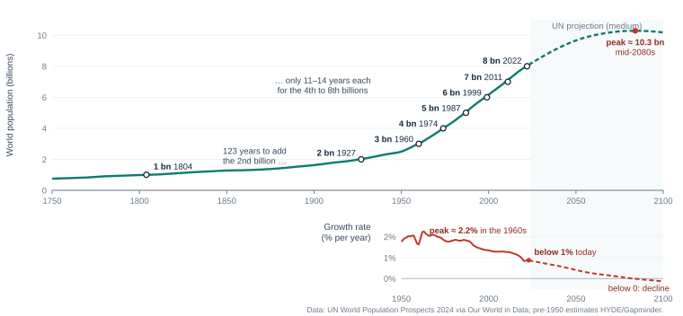
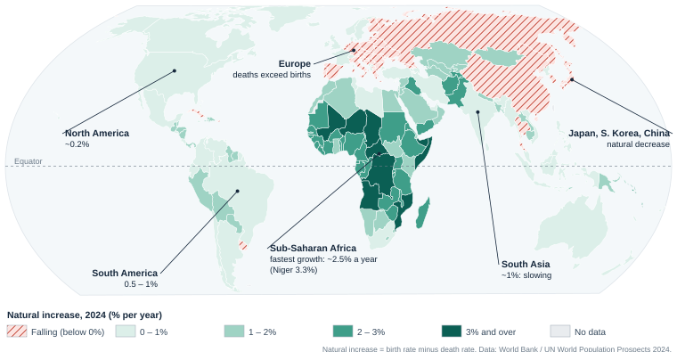
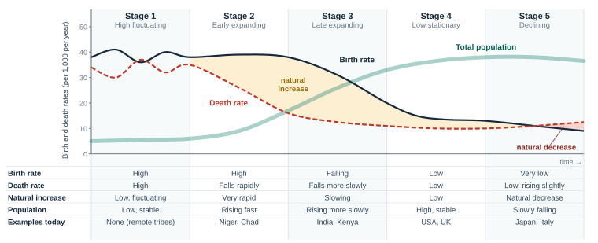

# Populations grow and decline

## Specification coverage

| Point | Section |
| --- | --- |
| 6.1.1 Patterns and trends in global population growth | §1 |
| 6.1.2 Reasons for the growth and decline of a country's population: fertility rate, birth rate, death rate, natural increase, migration | §2 |
| 6.1.3 An evaluation of the impacts of pro-natalist and anti-natalist policies on birth rates | §3 |
| 6.1.4 The demographic transition model (DTM) and its strengths and limitations | §4 |

## 1. Global population growth (6.1.1)

*Figure 1. The trend: world population and its growth rate.*

**Trend.** Growth was slow until about 1800. Then death rates fell — first in Europe, after 1950 across the world — while birth rates stayed high: the "population explosion". Since the 1960s the **growth rate** has fallen from about 2.2% to **below 1%** a year, because birth rates are now falling almost everywhere (global fertility: over 5 children per woman in the 1960s, about 2.2 today). The population is **still rising, but by less each year**, towards a UN-projected peak of about 10.3 billion in the 2080s.

*Figure 2. The pattern: natural increase by country, 2024.*

**Pattern.** Growth is fastest in the poorest countries and slowest in the richest:

- **Sub-Saharan Africa** grows fastest — about 2.5% a year, with fertility above 4. Most of the world's future growth will be here and in South Asia.
- **South Asia, Latin America and South-East Asia** still grow, but more slowly, as fertility falls towards 2.1.
- **Europe, Russia, Japan, South Korea and China** have **natural decrease** — more deaths than births. Sixty-three countries, home to a quarter of the world's people, have already passed their peak population.

## 2. Why a country's population grows or declines (6.1.2)

:::: definition
**Birth rate** — the number of live births per 1,000 people per year.

**Death rate** — the number of deaths per 1,000 people per year.

**Natural increase** — the birth rate minus the death rate. When deaths exceed births it is a **natural decrease**.

**Fertility rate** (total fertility rate) — the average number of children a woman has in her lifetime. **Replacement level** is **2.1**: two to replace the parents, plus a little for children who die young.

**Migration** — the movement of people to live in a new place. **Net migration** = immigrants − emigrants.
::::

::: note | Population change
**Population change = natural increase + net migration = (births − deaths) + (immigrants − emigrants)**

Example: Niger's birth rate is 41 per 1,000 and its death rate 9 per 1,000, so natural increase is 32 per 1,000 = **3.2% a year**.
:::

A birth rate is only high or low for a reason:

| Factor | High birth rate where… | Low birth rate where… |
| --- | --- | --- |
| Infant mortality | many babies die, so parents have more children to be sure some survive | most babies survive, so fewer births are needed |
| Economic value of children | children work on the farm and support parents in old age (no pensions) | children are expensive — schooling, housing — and pensions exist |
| Status of women | girls leave school early and marry young | women are educated, work, and marry and have children later |
| Family planning | contraception is unavailable or unaffordable | contraception is freely available |
| Religion and culture | beliefs value large families or oppose contraception | a small-family norm, often in cities |
| Government | pro-natalist policy (§3) | anti-natalist policy (§3) |

**Death rates fall** with a better food supply, clean water and sanitation, vaccination and medicines, and access to doctors and hospitals. They **rise** with famine, war and disease — and also in rich countries with an **ageing population**, simply because a larger share of people are old.

**Migration** can outweigh natural change. Germany has had more deaths than births every year since 1972, yet its population has grown, because of immigration. Bulgaria has lost both ways — natural decrease *and* the emigration of young adults — and fell from 9.0 million in 1988 to 6.4 million in 2024.

## 3. Pro-natalist and anti-natalist policies (6.1.3)

:::: definition
**Anti-natalist policy** — a government policy that aims to **reduce** the birth rate.

**Pro-natalist policy** — a government policy that aims to **raise** the birth rate.
::::

::::: grid
:::: card | Anti-natalist techniques
- free contraception and family-planning clinics
- education, especially of girls, and campaigns for small families
- raising the legal marriage age
- rewards for small families; fines or lost benefits for large ones
- at the extreme, coercion: forced sterilisation or abortion
::::
:::: card | Pro-natalist techniques
- cash payments for each birth, larger for later children
- child benefit and tax cuts for large families
- long paid parental leave
- free or subsidised childcare and nurseries
- help with housing for young families
::::
:::::

| Policy | What was done, and the impact on the birth rate | Judgement |
| --- | --- | --- |
| China: one-child policy, 1980–2015 (anti-natalist, coercive) | One child per couple, enforced by fines, job loss and forced sterilisation. Fertility fell from 2.8 in 1979 to about 1.6 by the mid-1990s — but it had *already* fallen from over 6 in 1970 under the earlier "later, longer, fewer" campaign, so the policy's own effect is disputed | Cut births fast, at a huge human cost: 118 boys born per 100 girls by 2010, and rapid ageing. Two- and three-child policies (2016, 2021) have not reversed it: births fell from 17.9 million in 2016 to 7.9 million in 2025 |
| Iran: family planning from 1989 (anti-natalist, voluntary) | Free contraception through village health centres, compulsory family-planning classes before marriage, more girls in school. Fertility fell from 5.2 in 1989 to **2.0 by 2000** | Voluntary policy can work as fast as coercion when it goes with education and healthcare |
| France: family policy (pro-natalist) | Family allowances, tax cuts for large families, cheap nurseries, paid parental leave. Fertility stayed near 2.0 in 2006–2014, among the highest in Europe, but fell to 1.56 in 2025, when deaths exceeded births for the first time since 1945 | The most successful pro-natalist policy — childcare lets women combine work and children — but it only **slows** the fall |
| South Korea (pro-natalist) | Over US$200 billion since 2006 on birth payments, childcare, parental leave and housing. Fertility still fell from 1.13 in 2006 to **0.72 in 2023**, the lowest ever recorded; 0.80 in 2025 | Money fails when the causes — housing and education costs, long working hours, careers that punish mothers — are untouched |

**Judgement.** Anti-natalist policies have been far more effective than pro-natalist ones, because they help people do what development already makes them want: have fewer children. Coercion works quickly but violates human rights and leaves gender imbalance and ageing behind; voluntary programmes built on education and healthcare can be as fast. Pro-natalist policies are expensive and weak: they change *when* people have children more than *how many*, because the reasons for low fertility are bigger than any payment — the best combine money with childcare. In both directions, social and economic change moves birth rates more than policy does.

## 4. The demographic transition model (6.1.4)

The **DTM** shows how birth rates, death rates and total population change as a country develops over time.

*Figure 3. The demographic transition model.*

**Why the rates change:**

- **Stage 2 — death rate falls:** better food supply, clean water, sanitation, vaccination and medical care. The birth rate stays high, so the gap between them widens and the population grows fast.
- **Stage 3 — birth rate falls:** fewer infant deaths, so fewer births are needed; contraception becomes available; women are educated and work; people move to cities, where children cost money instead of working on the farm.
- **Stage 4 — both low:** the birth rate fluctuates with the economy and family choices.
- **Stage 5 — birth rate below death rate:** children are expensive and many people delay or avoid having them; the death rate edges up because the population is old.

::::: grid
:::: advantages | Strengths
- Simple: any country can be placed on it and compared with others.
- Links population change to development, so it helps predict what comes next — and plan for it (schools now, care homes later).
- Fits the history of Europe and North America well.
::::
:::: disadvantages | Limitations
- Based on Europe and North America: death rates in LICs fell much faster after 1950, with imported medicine, so their growth was more explosive and some may not follow the same path.
- Ignores migration — it shows natural change only.
- Ignores culture, religion, government policy (such as China's one-child policy), and war, famine or disease that raise death rates.
- No time scale: it does not say how long each stage lasts.
- It cannot predict what follows Stage 5.
::::
:::::

## Common misunderstandings

| Wrong | Right |
| --- | --- |
| The growth rate is falling, so the world population is falling. | It is still rising, only by less each year. It is projected to peak only in the 2080s. |
| Birth rate and fertility rate are the same. | Birth rate is births **per 1,000 people**; fertility rate is children **per woman**. |
| In Stage 5 the death rate rises because healthcare gets worse. | It rises because a larger share of the population is elderly. |
