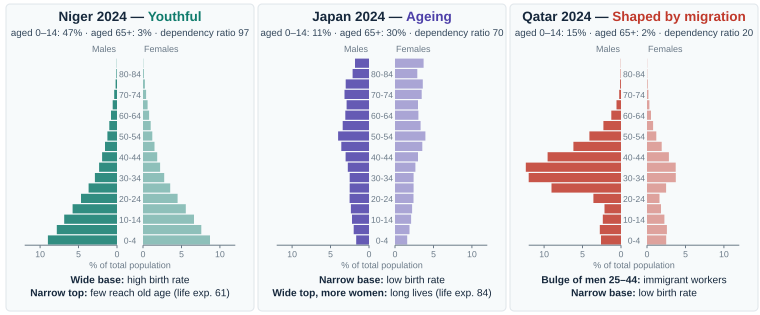

# Population structures change over time

## Specification coverage

| Point | Section |
| --- | --- |
| 6.2.1 Factors influencing population structures: natural increase and net migration | §1 |
| 6.2.2 The causes and impacts of youthful and ageing population structures, and an evaluation of their impacts | §2, §3 |
| 6.2.3 One detailed specific example of a named country: reasons for population growth or decline; the impacts of a population policy (pro- or anti-natalist) | §4 — placeholder |

## 1. What shapes a population structure (6.2.1)

:::: definition
**Population structure** — the make-up of a population by **age and sex**. It is shown by a **population pyramid**: each bar is the percentage of the total population in a five-year age group, males on the left, females on the right.
::::

*Figure 1. Three population structures, 2024 (same scale).*

**Natural increase** sets the basic shape:

- **Birth rate → the base.** A high birth rate gives a wide base (Niger); a falling birth rate narrows it, and each year's smaller group of births moves up the pyramid (Japan).
- **Death rate and life expectancy → the sides and top.** High death rates at every age make the sides slope in steeply to a narrow top. As death rates fall and people live longer, the sides straighten and the top widens. Women live longer than men, so the oldest bars are wider on the female side.
- **Past events → bulges and notches.** A baby boom shows as a bulge that climbs the pyramid year by year: Japan's 1970s boom is now aged about 50. War or famine leaves a notch.

**Net migration** changes the working ages, because most migrants are young adults:

- **Immigration** adds a bulge at about 20–45 — often mostly men where the jobs are in construction or oil (Qatar: 71% male). As immigrants have children, the base widens too.
- **Emigration** leaves a gap in the young adult bars and, later, fewer births.

**Over time**, a country's pyramid follows the demographic transition (6.1.4): wide triangle (high birth rate, Stage 2) → straighter sides and narrowing base (Stages 3–4) → base narrower than the middle, wide top (Stage 5).

## 2. Youthful and ageing populations (6.2.2)

:::: definition
**Youthful population** — a structure with a large proportion of people aged under 15 (Niger: 47%).

**Ageing population** — a structure in which the proportion of people aged 65 and over is rising (Japan: 30%).

**Dependency ratio** — (people aged 0–14 + people aged 65+) ÷ people aged 15–64 × 100. It measures how many dependants each 100 people of working age support.
::::

|  | Youthful population | Ageing population |
| --- | --- | --- |
| **Causes** | high birth rate (high fertility — see 6.1.2) · falling infant and child mortality, so more children survive | birth rate below replacement for decades · rising life expectancy from better healthcare and diet · emigration of young adults · large baby-boom generations reaching 65 |
| **Negative impacts** | high dependency ratio · heavy demand for schools, vaccination and maternal healthcare · too few jobs when the young reach working age → unemployment, emigration, unrest · a large future parent generation keeps the population growing, adding to pressure on food, water, housing and the environment | fewer workers for each pensioner · rising cost of pensions, healthcare and care homes, paid by a shrinking workforce through higher taxes · labour shortages · schools close and rural services decline as villages empty |
| **Positive impacts** | a large future workforce · young, adaptable workers attract investment · few pension costs | older people's savings and spending create jobs (care, health, leisure) · many provide childcare for grandchildren and do voluntary work · experienced workforce |

## 3. Evaluating the impacts (6.2.2)

**A youthful structure is a burden now and an opportunity later — if the conditions are right.** When the birth rate falls, the large young generation becomes a large workforce with few dependants: a **demographic dividend**, which helped drive fast economic growth in East Asia from the 1970s. It pays out only if the young are educated and find jobs. Where schools and jobs cannot keep up, as in Niger, the same structure brings unemployment, poverty and emigration.

**An ageing structure's costs are real but gradual and manageable — in a rich country.** Governments can raise the pension age, attract young immigrant workers and invest in automation, as Japan does. The impacts are most serious where a country ages before it is rich: China is ageing as a middle-income country, with far less wealth to pay for pensions and care than Japan had at the same stage.

**Judgement:** neither structure is good or bad in itself. What decides the impact is the **dependency ratio** together with whether the working-age population is **employed and productive enough** to support the dependants — and how early the government prepares.

## 4. Detailed specific example — a named country (6.2.3)

::::: trap | ⚠ Case study source needed — Specification 6.2.3
Required detailed specific example not found in the supplied class sources.
:::::

## Common misunderstandings

| Wrong | Right |
| --- | --- |
| The dependency ratio counts only old people. | It counts **both** dependent groups — under 15 **and** 65 and over — against the population aged 15–64. |
| An ageing population means there are more old people. | It means the old are a **rising proportion** of the population. |
| Every bulge on a pyramid is a baby boom. | A bulge in the working ages, especially of one sex, is usually **immigration** (Qatar). |
| A youthful population is always a problem. | It becomes a **demographic dividend** if birth rates fall and the young find education and jobs. |
