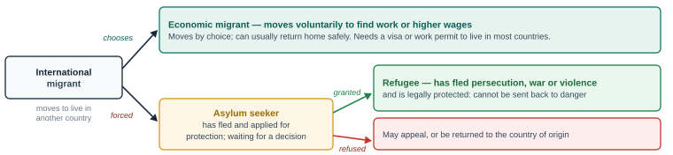
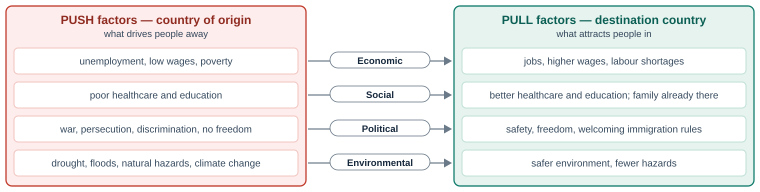

# The causes and impacts of international migration

## Specification coverage

| Point | Section |
| --- | --- |
| 6.3.1 Types of migrant: economic migrant, asylum seeker and refugee | §1 |
| 6.3.2 Causes of migration, to include push and pull factors | §2 |
| 6.3.3 The impacts of migration on the migrant, their country of origin and the destination country | §3 |
| 6.3.4 An evaluation of the strategies and techniques used to manage international migration | §4 |
| 6.3.5 One detailed specific example: push and pull factors of a named international migration (origin and destination named); its impacts on the migrants, origin and destination; how it is managed, including sustainable | §5 — placeholder |

## 1. Types of migrant (6.3.1)

**International migration** is moving to live in another country, usually for at least a year. In 2024 there were 304 million international migrants — 3.7% of the world's population.

*Figure 1. Voluntary and forced migrants.*

:::: definition
**Economic migrant** — a person who moves voluntarily to another country to find work or earn higher wages.

**Asylum seeker** — a person who has fled their own country and applied for protection (asylum) in another, but whose claim has not yet been decided.

**Refugee** — a person forced to leave their country by persecution, war or violence, who cannot safely return. Once recognised, they are protected under international law and cannot be sent back to danger.
::::

At the end of 2024 there were **42.7 million refugees**. Two-thirds live in a **neighbouring** country, and **73%** are hosted by low- and middle-income countries — not by rich ones.

## 2. Causes: push and pull factors (6.3.2)

:::: definition
**Push factor** — something that makes people want, or need, to leave their home country.

**Pull factor** — something that attracts people to a particular destination.
::::

*Figure 2. Push and pull factors.*

Most migration is caused by push and pull factors **together**, but the balance differs. **Economic migrants** weigh the gap in wages and jobs, so pull factors matter most; family and friends already in the destination make the move cheaper and easier. **Refugees** are driven by push factors — they flee — and most go to the nearest safe country, which is why most refugees are in neighbouring, poorer countries.

## 3. Impacts of migration (6.3.3)

|  | The migrant | Country of origin | Destination country |
| --- | --- | --- | --- |
| **Positive** | higher income and regular work · safety and freedom (refugees) · better schooling and healthcare for their children · new skills | **remittances** — money sent home (US$685 billion to low- and middle-income countries in 2024, more than foreign investment and aid combined; 45% of Tajikistan's GDP) · less unemployment and pressure on services · returning migrants bring savings and skills | fills labour shortages, e.g. in healthcare, construction and farming · young workers pay taxes that support an ageing population · trained workers arrive at no training cost · cultural diversity and new businesses |
| **Negative** | dangerous journeys and people smugglers · low-paid, insecure work and exploitation · discrimination · separation from family · qualifications not recognised, language barriers | **brain drain** — loss of doctors, nurses, teachers and engineers · loss of young adults leaves an older population and fewer births · families split · dependence on remittances | pressure on housing, schools and healthcare where migrants concentrate · possible competition for low-paid jobs · social tension and discrimination · cost of language teaching and integration · remittances leave the economy |

## 4. Managing international migration: an evaluation (6.3.4)

**Strategies** are the policies and agreements (a country's immigration policy, international agreements); **techniques** are the methods used to carry them out (visas, points tests, border patrols, language classes).

| Strategy or technique | How it works | Evaluation |
| --- | --- | --- |
| **Points-based system** (Canada, Australia; the UK since 2021) | Applicants score points for skills, qualifications, language, age and a job offer; only those above a threshold get a visa | Selects the workers the economy needs. But it excludes low-paid workers that sectors such as care and farming still need, adds to brain drain — and it controls **who** comes, not **how many**: UK net migration hit a record of almost a million a year in 2023, two years after its system began |
| **Quotas and temporary work visas** | A fixed number of permits, often for seasonal or contract work, after which the worker must go home | Fills seasonal labour gaps without permanent settlement, and remittances help the origin. But workers tied to one employer are open to exploitation, are not helped to integrate, and some overstay |
| **Free movement agreements** (EU) | Citizens of member countries may live and work in any member country without a visa | Labour moves to where it is needed, and migrants have full rights. But governments cannot limit numbers within the area, and poorer members lose young and skilled people (Bulgaria, 6.1.2) |
| **Border controls** — walls, fences, patrols, surveillance (US–Mexico border) | Physically stop irregular crossings | Reduces crossings at that point. But it is very expensive, pushes migrants onto longer and more dangerous routes run by smugglers, raises deaths, and does nothing about the causes |
| **International agreements** — the 1951 Refugee Convention; the EU–Turkey deal (2016) | Share responsibility between countries. Under the EU–Turkey deal, Turkey kept Syrian refugees and took back irregular migrants in return for €6 billion of EU aid | Cooperation is essential, as every migration involves two or more countries: sea arrivals in Greece fell from about 857,000 in 2015 to about 30,000 in 2017. But the deal depended on Turkey's goodwill (in 2020 it let migrants move to the Greek border), left thousands in overcrowded island camps, and moved the problem rather than solving it |
| **Resettlement and integration** — refugee resettlement, language classes, recognising qualifications, help with jobs and housing | Moves refugees safely from camps to a new country and helps migrants settle | Migrants work and pay tax sooner, and tension is reduced. But it costs money up front, and fewer than 1 in 100 refugees is resettled each year |
| **Reducing push factors** — aid, investment and peace-building in origin countries | Makes staying at home a real choice | The only approach that tackles the **causes**, so the most **sustainable**. But it is slow, costly and uncertain, and does not help people who must move now |

**Judgement.** Controls imposed by the destination — points systems, quotas and borders — decide who may enter, but do not remove the reasons people move; the tighter they are, the more migration shifts to irregular and dangerous routes. Agreements between countries work only while each partner keeps its side. The most effective and sustainable management combines **legal routes** matched to real labour shortages, **integration** so migrants contribute fully, and **development and peace** in origin countries so that migration becomes a choice, not a necessity — benefiting the migrant, the origin and the destination.

## 5. Detailed specific example — a named international migration (6.3.5)

::::: trap | ⚠ Case study source needed — Specification 6.3.5
Required detailed specific example not found in the supplied class sources.
:::::

## Common misunderstandings

| Wrong | Right |
| --- | --- |
| Asylum seekers and refugees are the same. | An **asylum seeker** is still waiting for a decision; a **refugee** has been recognised and is protected. |
| Most refugees go to rich countries. | Two-thirds stay in a neighbouring country; 73% are in low- and middle-income countries. |
| People forced out by a natural disaster are legally refugees. | They are often called "environmental refugees", but international refugee law protects people fleeing persecution and conflict, not disasters. |
