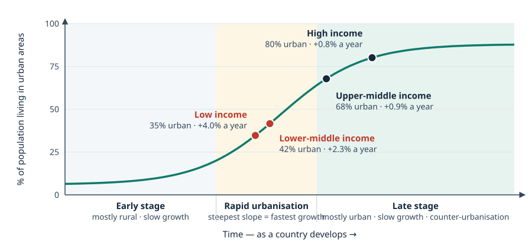
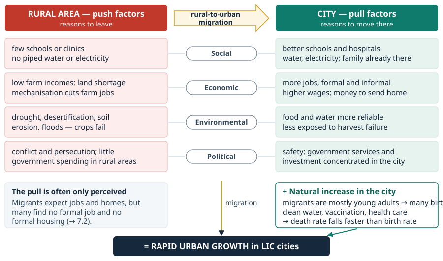

# Where people live

## Specification coverage

Paper 2 — Human Geography. Source: 0976 syllabus 2027–2029, p. 21.

| Point | Section |
| --- | --- |
| 7.1.1 Reasons for variations in global urban growth rates | 1 |
| 7.1.2 Causes of rapid urban growth in LICs: rural to urban migration, social, economic, environmental, and political factors, natural increase | 2 |

## 1. Why urban growth rates vary (7.1.1)

:::: definition
**Urban growth** — the increase in the **number** of people living in towns and cities. Its rate is given as % per year.

**Urbanisation** — the increase in the **proportion** (percentage) of a country's population living in urban areas.

**Counter-urbanisation** — the movement of people out of cities to smaller towns and rural areas.
::::

A city can grow without urbanisation: if the whole population grows at the same rate, the urban
share stays the same.

*Figure 1. The urbanisation curve. Each income group is plotted at its share of people living in urban
areas; "+% a year" is the growth rate of its urban population. World Bank, World Development
Indicators, 2024 data.*

Urban growth is fastest in low-income countries (**4.0% a year**) and slowest in high-income
countries (**0.8%**). By region it is fastest in **sub-Saharan Africa (3.6%)** and slowest in
**Europe (EU 0.5%)**.

| Reason | Fast urban growth — most LICs and lower MICs | Slow urban growth — HICs |
| --- | --- | --- |
| **Share already urban** | Only a third to two-fifths urban, so a large rural population is still available to move | About 80% urban — few rural people left to move, so growth levels off near a ceiling |
| **Natural increase** | High birth rates and a young population, so cities grow from their own births | Low birth rates and ageing populations — little natural increase |
| **Economic change** | Industrialisation and foreign investment put the new jobs in cities | The economy is already urban and post-industrial; no large shift of jobs from farming left |
| **Rural conditions** | Poverty, land shortage, drought and conflict push people off the land | Rural areas have good services and incomes, so there is little push |
| **Direction of movement** | People move rural → urban | **Counter-urbanisation**: better roads, commuting and home-working let people leave for small towns and villages. Where HIC cities still grow, it is mostly through international migration |
| **Government policy** | Investment and services concentrated in the capital attract migrants | Planning controls and policies that steer growth to smaller towns slow big-city growth |

All six come back to the **stage of development**: growth is fastest on the steep middle of the curve,
where most people are still rural but the new jobs are in the cities.

## 2. Causes of rapid urban growth in LICs (7.1.2)

Rapid urban growth has two causes that work together: **rural-to-urban migration** and **natural
increase**.

:::: definition
**Rural-to-urban migration** — the movement of people from the countryside into towns and cities.

**Push factor** — a reason that makes people want to leave the place where they live.

**Pull factor** — a reason that attracts people to a new place.

**Natural increase** — the birth rate minus the death rate (→ 6.1.2).
::::

*Figure 2. The causes of rapid urban growth in LICs: migration driven by push and pull factors of four
types, plus natural increase inside the city.*

Natural increase keeps a city growing even where migration slows: in many LIC cities it now adds as
many people as migration, or more.

::: traps
"Lack of jobs in the countryside" is a **push** factor — it acts where the migrant starts. The matching
**pull** is *more jobs in the city*. Keep each factor on the correct side.
:::
