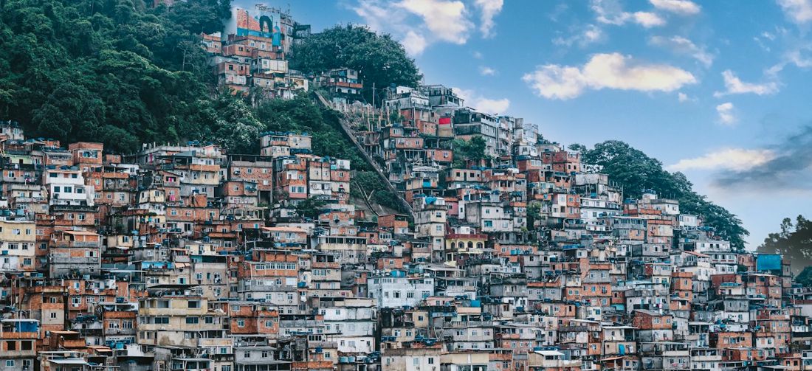
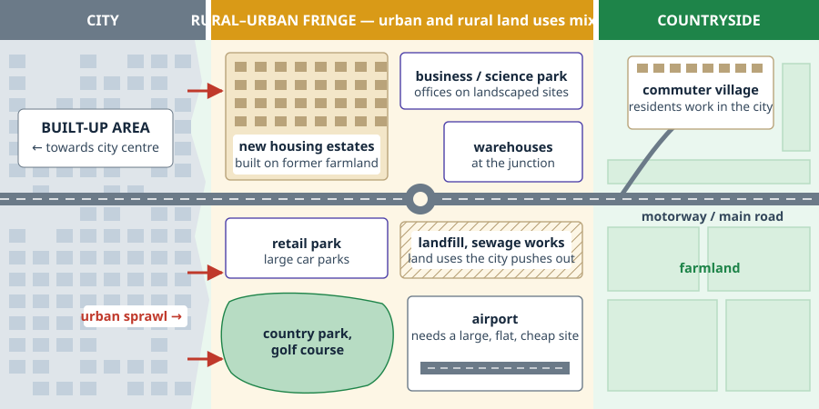

# Opportunities and challenges of urbanisation

## Specification coverage

Paper 2 — Human Geography. Source: 0976 syllabus 2027–2029, p. 21.

| Point | Section |
| --- | --- |
| 7.2.1 Opportunities of urban living, for example, culture, housing, services, leisure, consumption, economic development | 1 |
| 7.2.2 The opportunities and challenges of rapid urban growth: inequality, service provision, housing, employment, transport, waste management, unplanned settlements | 2 |
| 7.2.3 The impact of urban sprawl on the rural-urban fringe/surrounding areas | 3 |

## 1. Opportunities of urban living (7.2.1)

Cities concentrate people. A service or business needs a minimum number of customers to survive, and
only a city has enough people close together to support many of them — so choice, jobs and wages are
all greater than in rural areas.

- **Economic development** — factory, office and service jobs, higher wages than in farming, and the
  informal sector gives newcomers a first income. Firms locate in cities to be near workers, customers,
  ports and airports; cities generate about 80% of world GDP (World Bank).
- **Services** — hospitals with specialists, secondary schools and universities, banks, government
  offices: each needs a large population nearby to be worth running.
- **Housing** — a wider choice of types and prices, connected to piped water, sanitation, electricity
  and the internet.
- **Culture** — museums, theatres, festivals and places of worship for many faiths; a mix of people,
  languages and food.
- **Leisure** — stadiums, cinemas, parks, restaurants and nightlife.
- **Consumption** — shopping centres and markets give more choice, and competition keeps prices lower.

## 2. Opportunities and challenges of rapid urban growth (7.2.2)

When a city grows faster than its government can plan, build and pay for, people arrive faster than
homes, jobs, pipes, roads and bins can be provided. The same growth brings both opportunities and
challenges.

:::: definition
**Inequality** — the uneven distribution of income, services and opportunities between groups of people.

**Informal sector** — work that is not officially registered or taxed, e.g. street selling, waste picking; no contract, sick pay or pension.

**Unplanned (informal) settlement** — housing built by residents on land they do not legally own or rent, without planning permission and usually without basic services. Also called a squatter settlement, shanty town or slum.
::::

| Aspect | Opportunity | Challenge |
| --- | --- | --- |
| **Inequality** | A growing middle class; some people earn far more than they could in rural areas and escape poverty | The gap between rich and poor widens and becomes visible: gated communities beside slums; the poor get the worst access to services and jobs |
| **Service provision** | Many people close together make hospitals, schools and water networks cheaper per person to provide | Demand outruns supply: mains, sewers and power grids cannot expand fast enough — illegal connections, water bought from vendors at high prices, overcrowded schools |
| **Housing** | High demand drives construction; self-built homes are improved over time | Shortage → high rents, overcrowding and homelessness; poor build quality; people forced into unplanned settlements |
| **Employment** | New jobs in factories, construction and services; the informal sector absorbs newcomers; a large labour force attracts investors | Too few formal jobs: unemployment, underemployment and insecure, low-paid informal work with no rights |
| **Transport** | High density makes buses, metros and rail worth building | Congestion, long and costly commutes, air pollution, road accidents; overcrowded or unsafe informal minibuses |
| **Waste management** | Waste is a resource: recycling, composting and waste picking create income | Collection cannot keep up — waste is dumped or burnt, blocks drains (→ flooding) and spreads disease such as cholera |
| **Unplanned settlements** | Cheap housing near work; strong community networks; homes and businesses built up step by step | Built on hazardous land — steep slopes (landslides), floodplains, beside dumps; no legal tenure, so eviction is a constant risk; overcrowding, fire and disease |

About **1.16 billion** people — almost **one in four** urban residents — lived in slums or informal
settlements in 2024 (UN).

:::: grid

*Figure 1. An unplanned settlement, Rio de Janeiro, Brazil. Photo: Raúl Escobar, Unsplash.*

::: card | Recognising an unplanned settlement in a photo
- homes built by the residents, often of unrendered brick
- packed densely, with no planned street layout
- on land nobody else wanted — here a steep slope
- water tanks on the roofs, because the supply is intermittent
:::
::::

## 3. Urban sprawl and the rural–urban fringe (7.2.3)

:::: definition
**Urban sprawl** — the unplanned, often low-density, outward spread of a built-up area into the surrounding countryside.

**Rural–urban fringe** — the zone at the edge of a city where urban and rural land uses meet and mix.
::::

Sprawl happens because land at the edge is cheaper, firms need large sites, and roads and car
ownership make commuting possible. In LIC cities, migrants also build unplanned settlements on
unclaimed land at the edge.

*Figure 2. The rural–urban fringe: the land uses that sprawl brings.*

| | Negative impacts | Positive impacts |
| --- | --- | --- |
| **Environmental** | Loss of farmland, woodland and habitats; concrete and tarmac increase surface runoff and flood risk; more car journeys → air and noise pollution; landfill and fly-tipping | Country parks and landscaped sites can create new green space |
| **Economic** | Farmers lose land and suffer trespass and vandalism; city-centre shops lose trade to out-of-town retail parks; roads and pipes are costly to extend | New jobs in retail, business parks and warehouses; landowners sell land at high prices; more tax revenue |
| **Social** | Villages become commuter (dormitory) settlements: house prices rise beyond local young people, and village shops, buses and schools close because commuters use the city's; longer, congested journeys | Newcomers bring more housing choice and better access to city jobs and services; new schools and health centres may be built |

::: traps
Urban sprawl is not urbanisation. Sprawl is the **outward spread of the built-up area**; urbanisation is
the rising **share** of a country's people living in towns and cities.
:::
