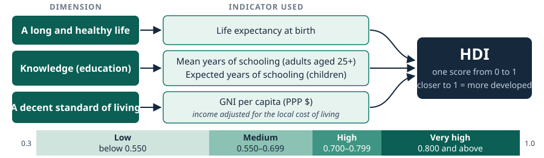
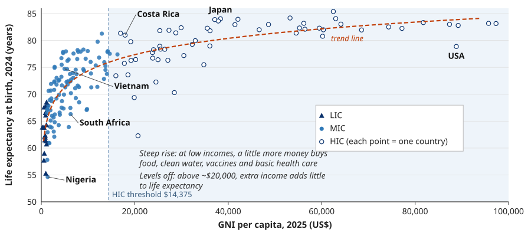
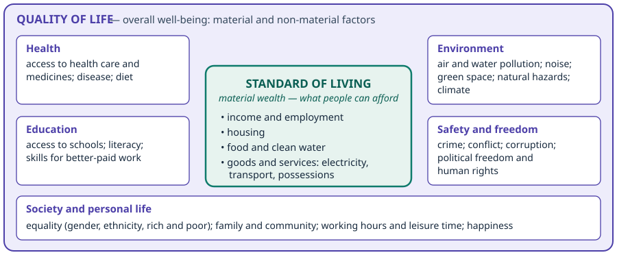

# Measuring development

## Specification coverage

| Point | Section |
| --- | --- |
| 8.1.1 Social and economic indicators of development, e.g. GNP, GDP, GNI, literacy rate, life expectancy, HDI, infant mortality rate, calorie intake, doctors per person | §1, §2 |
| 8.1.2 The use of indicators to compare countries at different levels of development and an evaluation of their usefulness | §3, §4 |
| 8.1.3 Factors affecting quality of life and standard of living | §5 |

## 1. Indicators of development

::: definition
**Development** — improvement in people's lives: more wealth (economic development) and better
health, education and freedom (social development).

**Indicator of development** — a measurable statistic used to show how developed a country is.
:::

**Economic indicators** measure wealth; **social indicators** measure how people live. Economic
totals are divided by the population (**per capita**) so that countries of different sizes can be
compared. For all but two indicators, a **higher** value means more developed.

| Indicator | Type | Definition |
| --- | --- | --- |
| GDP | Economic | gross domestic product: total value of goods and services produced **within a country** in a year |
| GNP | Economic | gross national product: total value of goods and services produced by a country's **people and firms, at home and abroad**, in a year |
| GNI | Economic | gross national income: total **income** of a country's people and firms in a year, including from abroad (almost the same as GNP); GNI per capita is the World Bank's measure for LIC/MIC/HIC |
| Literacy rate | Social | % of adults (aged 15+) who can read and write |
| Life expectancy | Social | average number of years a person born now can expect to live |
| Infant mortality rate | Social | babies who die before their first birthday, per 1,000 live births per year — **lower** = more developed |
| Calorie intake | Social | average kilocalories eaten per person per day (an adult needs roughly 2,000–2,500) |
| Doctors per person | Social | doctors per 1,000 people (or people per doctor — **lower** = more developed) |
| HDI | Composite | combines social and economic measures (§2) |

## 2. The Human Development Index (HDI)

::: definition
**Human Development Index (HDI)** — a composite indicator from 0 to 1 that combines life
expectancy, education and income into one score; the closer to 1, the more developed.
:::

*Figure 1. How the HDI is built, and the UNDP levels of human development.*

## 3. Using indicators to compare countries

| Average for income group | LIC | Lower-middle | Upper-middle | HIC |
| --- | --- | --- | --- | --- |
| GNI per capita (US$, 2025) | 810 | 2,490 | 10,940 | 52,960 |
| Life expectancy (years, 2024) | 65 | 70 | 76 | 80 |
| Infant mortality (per 1,000 live births, 2024) | 47 | 33 | 11 | 4 |
| Adult literacy (%) | 64 | 78 | 96 | 98 |
| Calorie supply (kcal per person per day, 2023) | 2,310 | 2,660 | 3,290 | 3,610 |
| Doctors per 1,000 people (2022) | 0.3 | 0.7 | 2.4 | 3.8 |

*Sources: World Bank; FAO (calories). Literacy 2024, HIC 2020.*

- Every indicator improves from LIC to HIC: social and economic indicators are **positively
  correlated**.
- Economic indicators spread countries much further apart: average HIC income is about **65 times**
  the LIC average, but life expectancy is only 15 years higher.
- The correlation is **not perfect** (Figure 2), so ranking countries by one indicator can give a
  different order from ranking by another.

*Figure 2. Life expectancy rises steeply with income in LICs and MICs, then levels off. Anomalies:
South Africa (upper-MIC, 66 years — lower than several LICs, linked to HIV/AIDS and inequality);
the USA (far richer than Japan or Costa Rica, but lower life expectancy). Vietnam (→ 8.3) lives
longer than its income predicts. Switzerland (above $100,000) not shown. Data: World Bank.*

To compare countries: use per-capita figures from the same year and source; use several
indicators, social and economic; quote the figures and the size of the difference ("65 times",
"15 years longer"); and point out anomalies, because they show what a single indicator misses.

## 4. How useful are the indicators?

| Indicator | Useful because | Limitations |
| --- | --- | --- |
| GDP, GNP, GNI per capita | easy to measure and compare; show how much a country can spend on services; basis of the World Bank's income groups | an **average** — hides inequality (rich and poor, urban and rural); misses the informal economy and subsistence farming; exchange rates ignore cost of living (PPP, purchasing power parity, corrects this); say nothing about health, education or environment |
| Single social indicators | show actual living conditions; infant mortality reflects clean water, sanitation, health care and mothers' education at once, so it is one of the best single indicators | each measures only one aspect; national averages hide regional and gender gaps; data unreliable where births and deaths are not registered; some stop varying in HICs (literacy near 100%), so cannot separate HICs |
| HDI (composite) | combines health, education and income → fuller picture; ranks every country on one scale | still national averages — hides inequality; leaves out freedom, gender equality, environment, happiness; published one to two years after the data year |

::: note | Judgement
No single indicator is enough, because a country's category can change with the measure (South
Africa, Figure 2). The most reliable picture comes from a composite index such as the HDI **plus**
several single social and economic indicators.
:::

## 5. Quality of life and standard of living

::: definition
**Standard of living** — the material wealth of a person or household: income and the goods and
services it can afford; measured objectively, e.g. by income.

**Quality of life** — a person's overall well-being, including non-material things such as health,
safety, freedom, a clean environment and happiness; partly subjective.
:::

*Figure 3. Standard of living is the material part of quality of life. Every box is a factor that
raises or lowers it.*

The two do not always move together:

- **High standard of living, lower quality of life** — a well-paid city worker with long hours, a
  long commute, air pollution and a risk of crime.
- **Low standard of living, good quality of life** — a rural family on a low income with a safe,
  clean environment and strong community support.
- Both vary **within** a country (rich and poor districts, urban and rural areas), which a national
  average hides.
