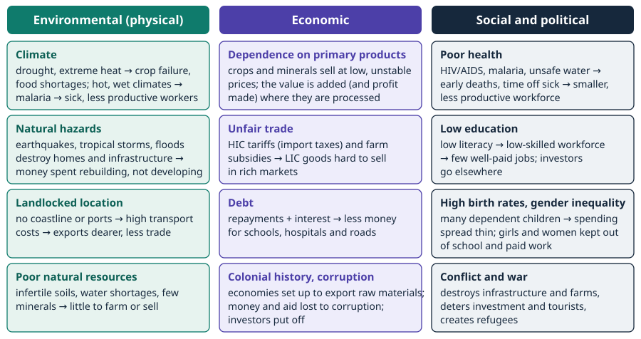
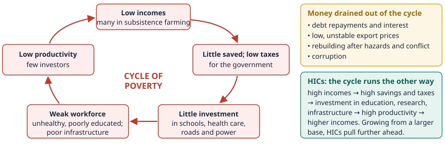
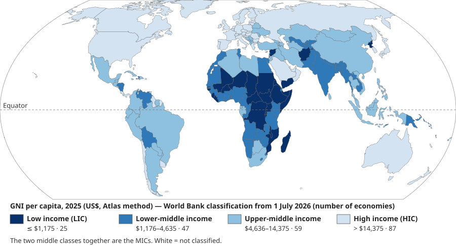

# The world is developing unevenly

## Specification coverage

| Point | Section |
| --- | --- |
| 8.2.1 Reasons for differences in levels of development and the development gap — social, economic and environmental factors | §1, §2 |
| 8.2.2 The current global pattern of LICs, MICs and HICs | §3 |

## 1. The development gap

::: definition
**Development gap** — the difference in wealth and quality of life between the most developed
(richest) and the least developed (poorest) countries.
:::

Average income in HICs is about **65 times** that of LICs (8.1). Many countries are catching up —
the share of economies classed as LICs fell from 30% in 1987 to 11% in 2026, and Asian MICs such as
China and Vietnam have grown fast — but the poorest countries grow from such a low base that the gap
in actual dollars is still widening.

## 2. Why levels of development differ

*Figure 1. Environmental, economic and social factors that slow development. Most LICs face
several at once.*

The factors reinforce each other, trapping LICs in a cycle of poverty while HICs pull further ahead —
this is why the gap persists and widens.

*Figure 2. The cycle of poverty. Strategies to break it are in 8.3.*

## 3. The current global pattern of LICs, MICs and HICs

The World Bank classifies every economy by **GNI per capita**, updating the groups each 1 July
(Figure 3).

- **LICs (25)** — concentrated in **sub-Saharan Africa** (21 of the 25): the Sahel (Niger, Chad,
  Mali), Central and East Africa (DR Congo, Ethiopia, Uganda) and the south-east (Mozambique,
  Madagascar). Outside Africa only Afghanistan, Syria, Yemen and North Korea, all affected by
  conflict or isolation.
- **MICs (106)** — the largest group, covering most of **Latin America, North Africa and the Middle
  East, South and East Asia** (India, China, Indonesia, Vietnam), Central Asia and the rest of Africa
  (Nigeria, Kenya, South Africa). Lower-middle incomes dominate South Asia (India, Pakistan,
  Bangladesh); upper-middle incomes dominate Latin America and East and South-East Asia.
- **HICs (87)** — **North America, most of Europe (including Russia), Japan, South Korea, Australia
  and New Zealand**, the oil-rich **Gulf states** (Saudi Arabia, UAE, Qatar) and a few in Latin America
  (Chile, Uruguay, Panama, Costa Rica).
- The old "rich North, poor South" idea (the Brandt line, 1980) is now too simple: there are HICs in
  the southern hemisphere (Australia, Chile, Uruguay) and most of Asia has moved into the MIC group.
  The pattern changes every year — in July 2026 Vietnam, the Philippines, Sri Lanka and Jordan moved
  up to upper-middle income, and Togo left the LIC group.

::: exam
*Describe the pattern* — name the continents or regions where each group is concentrated, give
named examples, point out exceptions, and use numbers from the key or map. Do not give reasons
unless the question asks you to *explain*.
:::

*Figure 3. World Bank income groups, July 2026 – June 2027. Data: World Bank; boundaries: Natural
Earth.*
