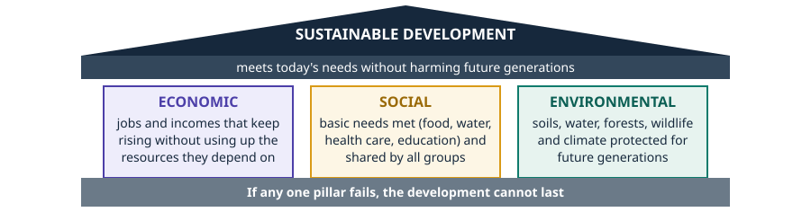
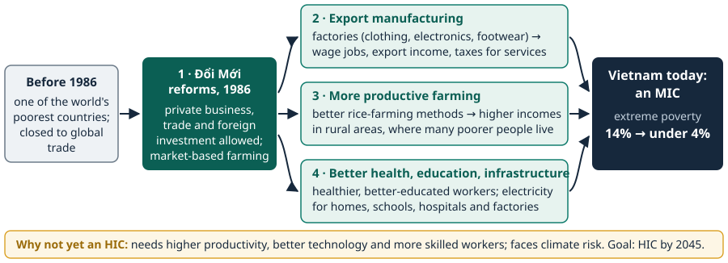

# Achieving sustainable development

## Specification coverage

| Point | Section |
| --- | --- |
| 8.3.1 Definition(s) of sustainable development | §1 |
| 8.3.2 Social, economic and environmental strategies and techniques used to try to achieve sustainable development | §2 |
| 8.3.3 An evaluation of the strategies and techniques used to try to reduce uneven development, e.g. trade, international aid, debt relief | §3 |
| 8.3.4 Detailed specific example of a named MIC or LIC: reasons for its current level of development; strategies and techniques used to raise its economic development, quality of life and standard of living | §4 (Vietnam) |

## 1. What sustainable development means

::: definition
**Sustainable development** — development that meets the needs of the present without
compromising the ability of future generations to meet their own needs (Brundtland Report, 1987).

**Sustainable development** (three-pillar definition) — development that balances economic growth,
social well-being and environmental protection, so that progress in one is not bought by damage to
another.
:::

*Figure 1. Development is sustainable only when all three pillars are met.*

## 2. Strategies and techniques for sustainable development

**Strategies** are the plans and agreements; **techniques** are the methods used to carry them out.
The global strategy is the UN **Sustainable Development Goals (SDGs)**: 17 goals agreed by all UN
members in 2015 for 2030 (e.g. end poverty, quality education, clean water, clean energy, climate
action), built into national plans and funded by governments, aid donors and NGOs.

| | Social | Economic | Environmental |
| --- | --- | --- | --- |
| Strategies (plans) | universal primary education; national health insurance and vaccination programmes | diversify the economy away from primary products; fair trade (§3) | renewable-energy targets; protected areas; sustainable-farming programmes |
| Techniques (methods) | new schools, grants for girls' education; community health workers; wells, hand pumps, latrines | **microfinance** (small loans to poor people with no savings to set up businesses); skills training; rural roads to markets | solar panels and mini-grids; rainwater harvesting and drip irrigation; tree planting and agroforestry; recycling |

Techniques last longest when they use **appropriate (intermediate) technology** — simple,
affordable technology that local people can build, run and repair with local materials and skills
(a hand pump rather than a diesel pump that needs imported fuel and parts).

| | Top-down development | Bottom-up development |
| --- | --- | --- |
| Who decides | governments, World Bank, large companies | local communities, often with NGOs |
| Typical project | large and costly: dams, highways, power stations | small and cheap: wells, clinics, co-operatives |
| Technology | high-tech; outside experts | appropriate technology; local skills |

## 3. Evaluating strategies to reduce uneven development

::: definition
**International aid** — money, goods, expertise or loans given by one country or organisation to
another to help it develop or recover from a disaster.

**Fair trade** — trade in which LIC and MIC producers are paid a guaranteed minimum price, plus a
premium for community projects, and work in safe conditions.

**Debt relief** — cancelling or reducing a country's debts, or lowering the interest, so the money
can be spent on development instead of repayments.
:::

Aid is **bilateral** (government to government), **multilateral** (through organisations such as the
World Bank or UN) or **voluntary** (NGOs funded by donations); **short-term** (emergency, after a
disaster) or **long-term** (development: schools, clinics, infrastructure). **Tied aid** must be spent
on goods or services from the donor country.

| Strategy | How it reduces the gap | Strengths | Weaknesses |
| --- | --- | --- | --- |
| **Free trade** (removing tariffs; trade agreements) | LICs sell more to rich markets → export earnings, jobs, investment | large, lasting income gains; manufacturing exports drove growth in Asian MICs (Vietnam, §4) | HICs keep farm subsidies; LIC producers face cheaper imports; profits often go to TNCs; exporting raw materials keeps prices low |
| **Fair trade** | producers get a stable, higher price | guaranteed income even when world prices fall; premium pays for schools, clinics, clean water | small share of world trade; mainly crops (coffee, cocoa, bananas), not manufacturing; certification costs; dearer for consumers |
| **Short-term aid** | food, shelter, medicine after disasters | saves lives quickly | treats symptoms, not causes; can create dependency and undercut local farmers |
| **Long-term aid, top-down** | funds large projects (dams, roads, power stations) | large gains in energy, transport and output for the whole country | may not reach the poorest; tied aid benefits donor firms; loans add to debt; can displace people and damage environments; corruption |
| **Long-term aid, bottom-up** (NGOs) | small projects with appropriate technology | targets the poorest; meets real local needs; locals maintain it, so it lasts | reaches few people; depends on donations |
| **Debt relief** | frees money from repayments for health, education, infrastructure | the HIPC Initiative (from 1996) has cancelled the debts of more than 35 poor countries, most in Africa; money can go straight into services; conditions require a poverty-reduction plan | conditions can force cuts to public spending; savings can be lost to corruption; countries may borrow again; does not raise export earnings |

::: note | Judgement
Strategies that tackle the **causes** of the gap (low export earnings, debt) last longest. Aid works
best long-term, untied, bottom-up and well governed; emergency aid saves lives but treats symptoms.
No single strategy is enough: trade raises incomes; aid and debt relief pay for health and education.
:::

## 4. Detailed specific example: Vietnam, an MIC

### Reasons for Vietnam's current level of development

*Figure 2. The Đổi Mới reforms of 1986 turned Vietnam from one of the world's poorest countries into
an MIC in one generation.*

### Strategies and techniques to raise economic development

| Strategy / technique | What was done → how it helped | Evidence |
| --- | --- | --- |
| **Đổi Mới reforms** (from 1986) | economy opened (Figure 2) → businesses and farms produce and sell more; foreign firms build factories | GDP per capita < $700 (1986) → nearly $4,500 (2023) |
| **Export-led manufacturing** | factories make goods for export → wage jobs and foreign currency; poverty falls | trade nearly 170% of GDP |
| **Local Road Asset Management Program** (2016–2024) | rural roads maintained → farmers reach markets, workers reach jobs, cheaper transport for businesses | 51,000 km; better access for 11 million+ people |
| **Viet Nam Sustainable Agriculture Transformation Project** (2015–2023) | low-emission rice-farming techniques → higher farm profits, less environmental damage | 182,000 hectares; farmers' profits up 30% |

### Strategies and techniques to raise quality of life and standard of living

| Strategy / technique | What was done → how it helped | Evidence |
| --- | --- | --- |
| **Health care and insurance** | national health insurance, grassroots health services → easier treatment; fewer babies die; longer lives | 93% insured (2023); infant mortality 32.6 → 12.1 per 1,000 live births |
| **Electricity access** | networks extended to households → lighting, study, refrigeration, health care, small businesses | 14% of households (1993) → nearly all (2019) |
| **Education** | schooling expanded → skills for higher-paid work and future growth | universal primary (early 2000s); net enrolment 95% lower-, 80% upper-secondary (2024) |
| **Can Tho Urban Development and Resilience Project** (2016–2024) | infrastructure upgraded; digital flood-risk tools → fewer homes, roads and businesses flooded | 420,000 residents protected from severe flooding |
