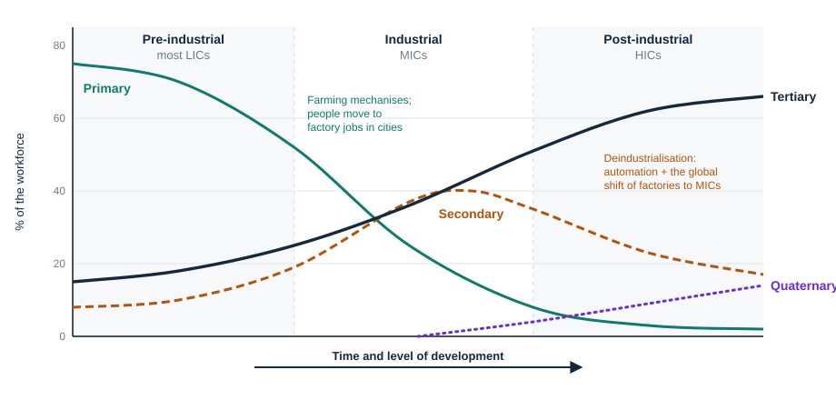

# Changing employment structures

## Specification coverage

| Point | Section |
| --- | --- |
| 9.1.1 Classification of different industries: primary, secondary, tertiary, and quaternary | 1 |
| 9.1.2 The changing employment structure of LICs, MICs and HICs | 2 |
| 9.1.3 Factors influencing the location and distribution of different types of industries: land, labour, raw materials, energy, transportation, markets, political policies, technology, communications, containerisation | 3 |

## 1. The four sectors of industry (9.1.1)

| Sector | Definition | Examples |
| --- | --- | --- |
| **Primary** | Extracting or growing raw materials directly from the land or sea | farming, fishing, forestry, mining, quarrying |
| **Secondary** | Processing or manufacturing raw materials into products; includes construction | steel making, food processing, car assembly, building |
| **Tertiary** | Providing a service to people or businesses | retail, transport, health care, education, tourism, banking |
| **Quaternary** | Knowledge-based services: research, development and handling information | scientific research, software, ICT, consultancy |

Classify the **activity**, not the company: one oil company drills (primary), refines (secondary),
sells fuel (tertiary) and researches new fuels (quaternary).

**Definition — Employment structure:** the percentage of a country's workforce employed in each
sector of industry.

## 2. How employment structure changes with development (9.1.2)

*Figure 1. The Clark–Fisher model. The line for each sector is a share of all workers, so as one
falls another must rise.*

| | Typical structure | How it is changing, and why |
| --- | --- | --- |
| **LIC** | Most people in **primary**, mainly subsistence farming; little manufacturing; tertiary jobs often **informal** (street trading, casual work) | Primary share falls slowly as some farming is mechanised and people migrate to cities. In the cities there are few factory jobs, so tertiary — much of it informal — grows faster than secondary |
| **MIC** | Primary falling fast; **secondary at or near its peak**; tertiary rising | TNCs and the state invest in factories, attracted by cheap labour, and export what they make; rural people leave farming for better-paid urban jobs; rising incomes create demand for services |
| **HIC** | Primary very small; secondary falling; **tertiary dominant**; **quaternary** growing | Farming is highly mechanised. **Deindustrialisation**: automation replaces workers and factories move to lower-wage MICs. Higher incomes and an ageing population raise demand for services; ICT, universities and investment in research create quaternary jobs |

**Definition — Deindustrialisation:** the decline of manufacturing industry in a country or region,
measured by falling employment and output in the secondary sector.

Real countries follow the model (agriculture is used for primary, industry for secondary):

| % of workforce | Ethiopia (LIC) 1991 → 2023 | China (MIC) 1991 → 2023 | UK (HIC) 1991 → 2023 |
| --- | --- | --- | --- |
| Primary | 77 → 62 | 60 → 23 | 2 → 1 |
| Secondary | 7 → 6 | 21 → 31 | 31 → 16 |
| Tertiary and quaternary | 16 → 31 | 19 → 46 | 67 → 83 |

World Bank, ILO modelled estimates. Ethiopia is moving from farming into services, not factories;
China has industrialised; the UK has deindustrialised.

## 3. Where industries locate (9.1.3)

Primary industry has no choice: it must be where the soil, fish, timber or mineral is. The other
sectors choose, weighing the factors below. An industry not tied to a raw material or energy source
is **footloose** — it can locate almost anywhere, so it chooses by labour, communications and
government incentives.

| Factor | How it influences location | Matters most to |
| --- | --- | --- |
| **Land** | Large, flat, cheap sites with room to expand, often greenfield sites at the edge of cities; fertile or mineral-rich land fixes primary industry | primary; large factories |
| **Labour** | Cheap, plentiful workers attract labour-intensive assembly (clothing, electronics); a skilled, educated workforce attracts high-tech firms | secondary; quaternary |
| **Raw materials** | Materials that are heavy, bulky or perishable, or that lose weight in processing, are processed close to where they are produced to cut transport costs | primary; heavy secondary (steel, sugar, fish processing) |
| **Energy** | Industries using huge amounts of power locate at cheap energy, e.g. aluminium smelting near hydro-electric power; less important now that grids carry electricity everywhere | heavy secondary |
| **Transportation** | Access to ports, motorways, railways and airports cuts the cost and time of moving inputs and products | secondary; tertiary |
| **Markets** | Firms locate near customers when products are fragile, perishable or gain weight in making (bottled drinks, bread); services must be where people are | tertiary; some secondary |
| **Political policies** | Tax breaks, grants, **Special Economic Zones** and **Export Processing Zones** attract investment; tariffs encourage firms to build inside a market; planning rules keep industry out of some areas | secondary, especially TNCs |
| **Technology** | Automation cuts the need for cheap labour, so some manufacturing can stay in or return to HICs; high-tech firms cluster near universities in science parks | secondary; quaternary |
| **Communications** | Fast internet and telecommunications let services be run from anywhere, e.g. call centres and software work in LICs and MICs | tertiary; quaternary |
| **Containerisation** | Goods in standard steel containers move between ship, train and lorry without unloading, so long-distance transport is fast and very cheap; factories can be far from their markets, at container ports in low-wage countries | secondary |

The result is a clear **distribution**:

- **Primary** follows physical geography — farming on fertile lowland, mining at deposits.
- **Secondary** has shifted from HICs to MICs, especially in East and South-East Asia, clustered at
  container ports and in economic zones.
- **Tertiary** is wherever people are, concentrated in cities.
- **Quaternary** clusters in HIC cities and near universities, where skilled labour is.

## Common misunderstandings

| Wrong | Right |
| --- | --- |
| A falling percentage in a sector means fewer people work in it. | It is a **share** of the workforce: primary can fall as a % while the number of farmers is steady, because the total workforce grows. |
| Mining is secondary because it uses machinery; construction is a service. | Mining and quarrying extract, so they are **primary**; construction is **secondary**. |
| LICs move straight from farming into factories. | Many LIC migrants go into **informal tertiary** work, as Ethiopia's figures show. |
