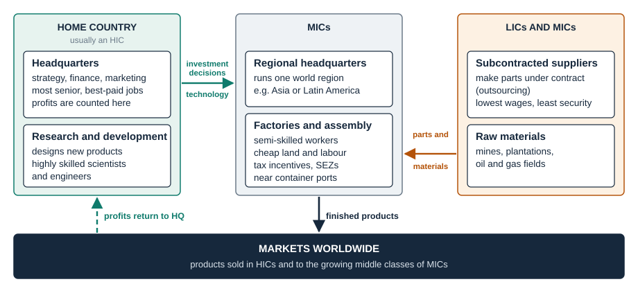
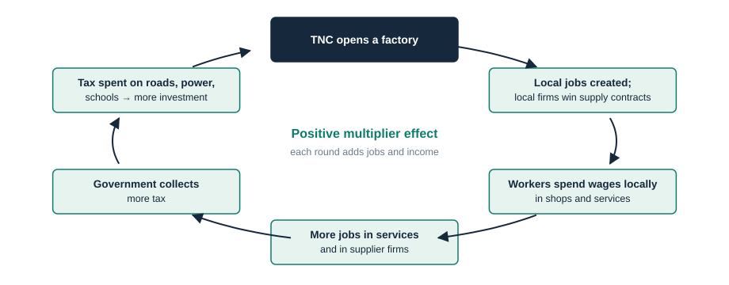
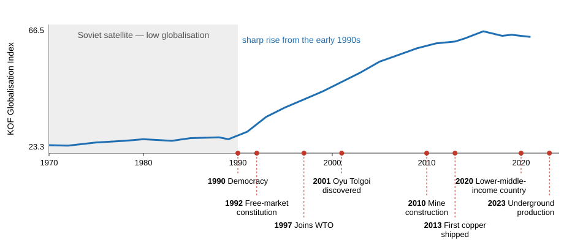

# The impact of globalisation and the role of transnational corporations

## Specification coverage

| Point | Section |
| --- | --- |
| 9.2.1 What is meant by globalisation | 1 |
| 9.2.2 The key features of globalisation | 2 |
| 9.2.3 The impacts of globalisation on trade, transport, culture, communications, and technology | 3 |
| 9.2.4 The role and global organisation of transnational corporations (TNCs) | 4 |
| 9.2.5 An evaluation of the impacts of TNCs on the countries in which they are located | 5 |
| 9.2.6 Detailed specific example of a named country or area: impacts of globalisation; impacts of a named TNC located there | 6 — Mongolia, Rio Tinto (Oyu Tolgoi) |

## 1. What globalisation means (9.2.1)

**Definition — Globalisation:** the process by which the world's economies, cultures and people
become increasingly connected and interdependent through flows of goods, services, money, people
and information.

**Definition — Interdependence:** countries relying on each other for trade, investment and
resources, so that a change in one affects the others.

It has been driven by cheaper, faster transport (containerisation, jet aircraft), cheap instant
communication (internet, mobile phones), governments removing trade barriers, and the growth of
TNCs.

## 2. Key features of globalisation (9.2.2)

- **Rapid growth in world trade**, in services as well as goods.
- **Global supply chains:** one product is designed, made from parts and assembled in several
  countries.
- **Flows of money:** **foreign direct investment (FDI)** — a company building or buying factories,
  offices or businesses it owns or controls in another country; financial markets trade 24 hours a day.
- **The growing size and power of TNCs**, some with incomes larger than many countries' economies.
- **Flows of people:** migrant workers, tourists and business travellers.
- **Flows of information and ideas**, instantly, through the internet and social media.
- **A more global culture:** the same brands, food, films and music worldwide.
- **Time–space compression:** the world "shrinks" because moving goods, people and messages takes
  far less time and costs far less.
- **International organisations and agreements** — the World Trade Organization, trade blocs such
  as the EU and ASEAN — lower barriers between countries.
- **Uneven:** cities, HICs and MICs are highly connected; many rural areas and LICs much less.

## 3. The impacts of globalisation (9.2.3)

| | Positive impacts | Negative impacts |
| --- | --- | --- |
| **Trade** | More exports bring jobs, income and foreign currency, especially to MICs; consumers get a wider choice of cheaper goods | LICs that export a few primary products depend on volatile world prices; manufacturing jobs lost in HICs; a crisis in one economy spreads to its trading partners |
| **Transport** | Container shipping and air freight make global supply chains cheap and reliable; flights make international tourism affordable | Shipping and aviation add to greenhouse gas emissions; congestion and pollution around ports and airports |
| **Culture** | Exchange of food, music, ideas and values; wider awareness of human rights | **Cultural homogenisation**: global brands and media, mostly from HICs, replace local traditions, languages and businesses |
| **Communications** | Instant, cheap contact; online trade and banking; service jobs such as call centres move to LICs and MICs | The **digital divide** excludes poorer and rural people; misinformation spreads fast; HIC service jobs are outsourced |
| **Technology** | Technology transfer raises productivity in MICs and LICs; innovations spread quickly | Automation replaces low-skilled jobs; gains go mainly to HICs and skilled workers; growing e-waste |

## 4. Transnational corporations: role and global organisation (9.2.4)

**Definition — Transnational corporation (TNC):** a company that operates in more than one country,
with its headquarters usually in the country where it began.

**Their role.** TNCs are the main agents of globalisation: they invest across borders, organise the
global supply chains that carry most world trade, create jobs where they locate, move production to
wherever costs are lowest, spread technology and brands, and can influence governments that compete
for their investment.

*Figure 1. Decisions and profits concentrate in the home country; routine production is spread to
wherever costs are lowest.*

- **Headquarters and research** stay in the home country because they need skilled graduates,
  universities, finance and access to government.
- **Factories** go where land and labour are cheapest; some are built inside large markets to avoid
  tariffs.
- **Outsourcing** — contracting other firms to make parts — cuts costs further and lets the TNC
  switch supplier easily.

## 5. An evaluation of the impacts of TNCs on host countries (9.2.5)

*Figure 2. The positive multiplier. If the TNC closes, the same chain runs in reverse: suppliers
lose orders, spending and tax fall, and jobs disappear.*

| | Benefits to the host country | Costs to the host country |
| --- | --- | --- |
| **Economic** | Jobs, often better paid than local work; FDI and tax revenue; exports earn foreign currency; local suppliers grow (multiplier); new roads, ports and power supply | Profits are sent back to the home country; wages are low by world standards and senior jobs often go to foreign staff; tax breaks cut government income; local firms are out-competed; the TNC is **footloose** and may leave |
| **Social** | Training and new skills; higher incomes raise quality of life; some TNCs provide health care or schooling | Long hours, poor safety and weak union rights, especially in subcontracted factories; cultural change |
| **Environmental** | Newer, cleaner technology than many local firms | Pollution and resource exploitation where environmental laws are weak or not enforced; land cleared for mines, plantations and factories |

**What decides the balance:**

1. **The host government's power.** A strong government can demand local suppliers, training and
   pollution control; a weak one, competing for investment, cannot.
2. **Linkages.** A plant that buys locally spreads the multiplier; one that imports its parts and
   only assembles them stays an isolated enclave.
3. **The jobs.** Skilled and management jobs transfer know-how; routine assembly does not.
4. **Permanence.** The benefits last only as long as the TNC stays.

**Judgement.** For LICs and MICs, TNCs bring investment, jobs and technology faster than the
country could create them itself, so the economic impact is usually positive on balance. But these
countries have the least power to regulate TNCs, so much of the profit leaves while the social and
environmental costs stay. TNC investment becomes lasting development only where the host government
regulates it well — which is why HIC hosts, with strong laws and skilled workforces, gain most
reliably.

## 6. Detailed specific example: globalisation and Rio Tinto in Mongolia (9.2.6)

**Mongolia** is a **landlocked** country between **Russia and China** (borders of 3485 km and
4670 km). It covers **1.5 million km²** — six times the UK — and about **80%** lies above 1000 m.
Its population is only **3.3 million**, with the **lowest population density in the world
(2.13 per km²)**. Over **1.5 million** people live in the capital, **Ulaanbaatar** — the only urban
area with over 100,000 people — an extreme case of **urban primacy** (one city with an excessive
share of the population and development). Elsewhere people are spread over vast, inaccessible
areas where **herding** is the norm, so funding infrastructure is a major development problem.

*Figure 3. Mongolia's KOF Globalisation Index (scale 1–100; measures economic, social and political
globalisation), redrawn approximately from the class textbook, with key events.*

### Impacts of globalisation on Mongolia

- **Opening up.** A communist **satellite state of the Soviet Union** until its collapse in 1989:
  globalisation stayed low because Moscow largely controlled the economy. Mongolia became a
  democracy in **1990** and adopted a **free-market** constitution in **1992**; the first years
  were hard because it had relied on Soviet economic aid.
- **International membership:** **World Trade Organization (1997)**, UN peacekeeping missions
  (from 2002), International Organization for Migration (2008).
- **Finance and aid:** stronger links with the **World Bank** and the **Asian Development Bank**
  (its largest multilateral partner — a **$38 million** loan in 2019 to develop ecotourism in two
  national parks); **Japan** is its main bilateral aid donor (e.g. a grain-storage project).
- **FDI into mining.** Growing global connections attracted **foreign direct investment**, almost
  all into **mining**. Mining transformed the economy away from herding and agriculture and is
  about **21% of GDP**. Mineral exports (copper, gold, coal, tin, molybdenum, fluorspar, uranium,
  tungsten; rare earths still undeveloped) earn the **foreign exchange** that pays for imports.
- **Development.** FDI plus government investment funded by **mineral royalties and external
  borrowing** lifted Mongolia from an **LIC to a lower-middle-income country in 2020**.
- **Uneven and contested.** Strong support for the economic opportunities, but many feel the
  country's resources are exploited with **too little benefit for Mongolians**; concern is
  strongest in **rural areas**, where the "trickle down" of wealth is weakest. There is also concern
  about the **erosion of traditional values** and the spread of the worst of Western culture.
- **Still constrained.** Mongolia remains landlocked, remote and vast, with infrastructure and
  logistics bottlenecks. It balances relations with Russia, China and the USA; the
  **China–Mongolia–Russia Economic Corridor** is part of China's **Belt and Road Initiative**.

### The TNC: Rio Tinto and the Oyu Tolgoi mine

**Rio Tinto** is a **British–Australian** TNC, the world's **second-largest metals and mining
company** (after BHP), operating in **35 countries**, with **US$54 billion** revenue in 2023.

- **Oyu Tolgoi**: one of the world's largest **copper and gold** deposits, in the **southern Gobi**
  about **80 km north of the Chinese border** — Mongolia's largest mining complex.
- **Joint venture:** Rio Tinto owns **66%**, the Mongolian government **34%**; Rio Tinto runs the
  mine for the partnership. Joint ownership is now common in Mongolia, to win a fairer share of the
  benefits. Negotiations were long and broke down several times.
- **Development:** discovered **2001** → construction **2010** → open-pit mining **2011** → copper
  concentrator (the largest industrial complex ever built in Mongolia) and first shipment **2013**
  → underground production **2023**, where most of the value lies. Peak output is expected to be
  **500,000 tonnes** of copper concentrate a year, for decades.

| Benefits to Mongolia | Problems and concerns |
| --- | --- |
| A large **share of profits** as 34% owner — Oyu Tolgoi is expected to reach up to **33% of GDP** at full production; copper demand stays strong because it is essential for decarbonisation and electrification | The economy becomes even more **dependent on mining** — and on one mine |
| **Local supply chain** focused on the southern Gobi; **"Made in Mongolia"** buying (e.g. miners' footwear) — spending in the region rose from **$0.5 million (2010) to $888 million (2021)** | Feeling that resources benefit the TNC more than **ordinary Mongolians**, especially in rural areas |
| **Cultural Heritage Management System** protects tangible and intangible heritage | Concern about the **erosion of traditional values** |
| **Block caving** technology for worker safety; one of the world's most **water-efficient** copper mines | Mining's **environmental impact** is seen as too high; hard to balance conservation with resource development |

::: note | Evaluation
Globalisation and Rio Tinto have brought Mongolia investment, export income and a rise to
lower-middle-income status, and the **joint venture** and local-supply rules keep more of the
benefit in the country than a fully foreign-owned mine would. But the gains rely on **one
industry and one mine**, are **unevenly spread** (UB and the southern Gobi rather than rural
herders), and carry environmental and cultural costs.
:::

## Common misunderstandings

| Wrong | Right |
| --- | --- |
| Globalisation is only about trade and money. | It also means flows of **people, information and culture**. |
| A company that exports is a TNC. | A TNC **operates** — produces, researches or sells through its own facilities — in more than one country. |
| TNCs are simply good or bad for a country. | The impact depends on regulation, local linkages, the kind of jobs and how long the TNC stays. |
| FDI is aid. | FDI is a **commercial investment** the company owns and expects to profit from. |
