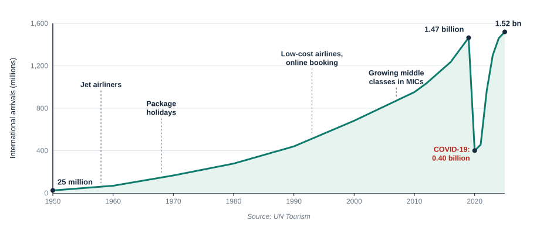
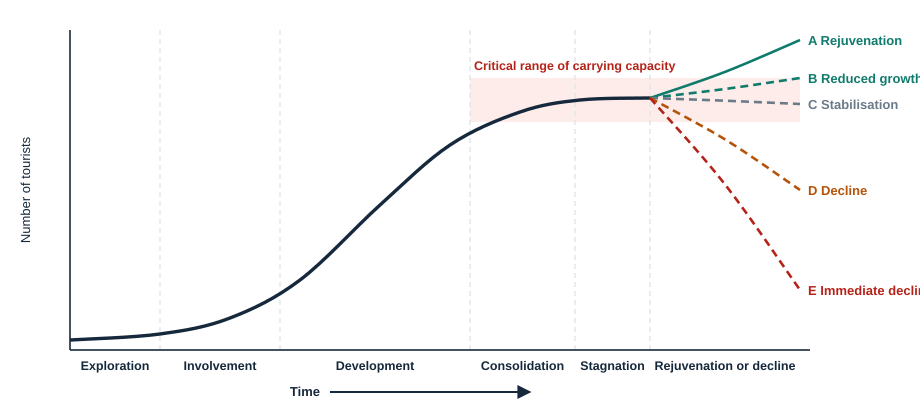

# Tourism is a growing industry

## Specification coverage

| Point | Section |
| --- | --- |
| 9.3.1 The factors that have led to the growth of tourism as an industry | 1 |
| 9.3.2 The Butler model and its strengths and limitations | 2 |
| 9.3.3 The benefits and problems caused by tourism, at a range of scales | 3 |
| 9.3.4 An evaluation of the strategies and techniques used to sustainably manage tourism, at a range of scales | 4 |
| 9.3.5 Detailed specific example of a named country or area: reasons for growth; benefits and problems; strategies and techniques to manage tourism sustainably there | 5 — **source needed** |

## 1. Why tourism has grown (9.3.1)

**Definition — Tourism:** the temporary movement of people to places outside where they normally
live and work, for leisure, business or other purposes, staying at least one night.

*Figure 1. Sixty-fold growth in 75 years. The 2020 collapse and quick recovery show how sensitive
tourism is to shocks.*

- **Economic — more people can afford it.** Rising disposable incomes, first in HICs and now among
  the middle classes of MICs, especially in Asia; package holidays and low-cost airlines cut prices.
- **Social — more people have the time and the wish.** Paid holiday entitlement and shorter working
  weeks; more healthy, well-off retired people; advertising, television and social media create the
  desire to travel.
- **Technological — travel is quicker and easier.** Larger, faster, longer-range jet aircraft; online
  booking and price comparison; more car ownership and better roads.
- **Political — fewer barriers.** Easier visas and open borders; governments promote tourism for jobs
  and foreign currency; more destinations are politically stable and safe.

## 2. The Butler model (9.3.2)

*Figure 2. The Butler model (1980) of the tourist area life cycle.*

1. **Exploration** — a few adventurous visitors; no tourist facilities; they use local services;
   little impact.
2. **Involvement** — local people start providing accommodation, food and guides; a tourist season
   develops.
3. **Development** — rapid growth; outside companies, often TNCs, build large hotels and attractions
   and take control from locals; the landscape changes.
4. **Consolidation** — growth slows; tourism dominates the local economy; some residents resent the
   visitors; facilities start to look dated.
5. **Stagnation** — peak numbers reach **carrying capacity**: congestion, pollution and a worn-out
   image; the resort relies on repeat visitors.
6. **Rejuvenation or decline** — reinvestment and new attractions or markets (A); slower growth or
   stability (B, C); a steady loss of visitors to newer destinations (D); or a sudden collapse after
   a disaster, conflict or disease (E).

**Definition — Carrying capacity:** the maximum number of visitors a place can support before its
environment, its community or the visitors' experience is damaged.

:::: grid
::: advantages | Strengths
- Simple sequence that fits many resorts, especially coastal ones.
- Links growth to carrying capacity, showing why management is needed.
- Can warn planners of stagnation, so they can act before decline.
- Shows that the future is not fixed — several outcomes are possible.
:::
::: disadvantages | Limitations
- Describes rather than predicts: a stage is hard to identify until it has passed, and stages vary
  in length.
- Not every place goes through every stage — planned resorts start at development; ecotourism
  destinations stay deliberately small.
- Uses visitor numbers only, ignoring spending, type of tourist and management choices.
- Carrying capacity is hard to measure; sudden shocks fit only outcome E.
:::
::::

## 3. Benefits and problems of tourism at a range of scales (9.3.3)

**Definition — Leakage:** the proportion of tourist spending that leaves the destination — to
foreign-owned hotels, airlines and tour operators, or to pay for imported goods.

The **multiplier effect** (9.2, Figure 2) works for tourism too: tourist spending creates jobs in
hotels, which buy from local farms and suppliers, whose workers spend in turn.

| Scale | Benefits | Problems |
| --- | --- | --- |
| **Local** | **Ec** jobs in hotels, restaurants, guiding and crafts; income for local businesses · **So** new roads, water supply and services that residents use too; pride in local culture · **En** entry fees fund conservation | **Ec** seasonal, low-paid, insecure jobs; higher prices for housing, land and food · **So** crowding, noise and litter; traditional culture changed or sold as a show; conflict with residents · **En** footpath erosion, trampled vegetation, disturbed wildlife; water shortages |
| **Regional** | **Ec** multiplier to farms, suppliers and transport firms; jobs in remote, rural and island areas with few other industries · **So** better transport links | **Ec** growth concentrated in resorts and honeypots, leaving other areas behind · **En** coastlines built over; pressure on regional water and energy supplies |
| **National** | **Ec** foreign currency, tax revenue and a large share of GDP, especially in small island states; investment in airports and infrastructure | **Ec** **leakage**; dependence on one industry that collapses after disasters, disease, terrorism or recession; public money spent on facilities for visitors, not residents |
| **Global** | **Ec** US$11.6 trillion, 9.8% of world GDP and 366 million jobs (WTTC, 2025) · **So** cultural exchange and understanding | **En** aviation's greenhouse gas emissions add to climate change · **So** spread of disease; cultural homogenisation |

**Ec** economic · **So** social · **En** environmental.

## 4. Managing tourism sustainably, at a range of scales (9.3.4)

**Definition — Sustainable tourism:** tourism that takes full account of its current and future
economic, social and environmental impacts, meeting the needs of visitors, the industry, the
environment and host communities.

**Definition — Ecotourism:** responsible, usually small-scale travel to natural areas that conserves
the environment, benefits local people and educates visitors.

*Strategies* are the plans, policies and agreements; *techniques* are the methods on the ground.

| Scale | Strategy or technique | How it works | Strength | Weakness |
| --- | --- | --- | --- | --- |
| **Global** | Global Code of Ethics for Tourism (UN Tourism, 1999) — strategy | Principles for governments, companies and tourists: respect host cultures, protect the environment, share the benefits | Sets a common standard worldwide | Voluntary; no penalties |
| | UNESCO World Heritage listing — strategy | Sites of outstanding value must have a management plan | International recognition and funding | Listing advertises the site and can attract even more visitors |
| **National** | National parks and protected-area laws — strategy | Law restricts building and controls activities | Legal force | Needs funding and enforcement |
| | Limiting numbers by price — strategy | Bhutan's "high value, low volume" policy: a Sustainable Development Fee, US$200 a night from 2022, halved to US$100 until 2027 | Fewer, higher-spending visitors; the fee funds conservation and social projects | Excludes poorer visitors; halved when visitor numbers fell — income and protection pull against each other |
| | Ecotourism and community-based tourism — strategy | Small, locally owned lodges and guides | Low leakage; local people gain, so they protect the resource | Small scale; limited income; remote sites still need flights |
| **Regional and local** | Zoning — technique | Separates busy honeypot zones from protected zones | Concentrates damage where it can be managed | Honeypots themselves can be overwhelmed |
| | Entry fees, permits, quotas and timed tickets — technique | Limit or spread visitors and raise money. Since 2024 Venice has charged day-trippers on peak days (€5, or €10 if booked late) | Raises money; can cap numbers | A fee alone deters few: on 2 May 2025 almost 25,000 day-trippers paid |
| | Footpath and site management — technique | Boardwalks, surfaced paths, fencing, re-seeding | Cheap; protects vegetation and soil at once | Treats symptoms; needs maintenance; changes the natural look |
| | Education — technique | Visitor centres, guides and codes of conduct | Cheap; changes behaviour | Relies on tourists choosing to comply |

**Judgement.** Local techniques are cheap and quick but mostly treat the *symptoms* — worn paths,
litter. National strategies that limit numbers or keep income local tackle the *causes*: too many
visitors and too much leakage. Global strategies set standards but cannot enforce them. The most
sustainable approaches combine scales, pay for themselves through fees, are enforced, and give local
people a share of the income — a community that gains from tourism has a reason to protect what
visitors come to see. Every approach trades some income for protection.

## 5. Detailed specific example — a named country or area (9.3.5)

::::: trap | ⚠ Case study source needed — Specification 9.3.5
Required detailed specific example not found in the supplied class sources.
:::::

## Common misunderstandings

| Wrong | Right |
| --- | --- |
| The Butler model predicts what will happen to a resort. | It **describes** a common sequence; after stagnation it offers several possible outcomes. |
| All the money tourists spend stays in the destination. | Much of it **leaks** to foreign-owned firms and imports. |
| Any holiday in nature is ecotourism. | Ecotourism must **conserve** the environment, **benefit** local people and **educate** visitors. |
| Sustainable tourism means less tourism. | It means managing tourism so that its benefits continue and its costs are controlled. |
