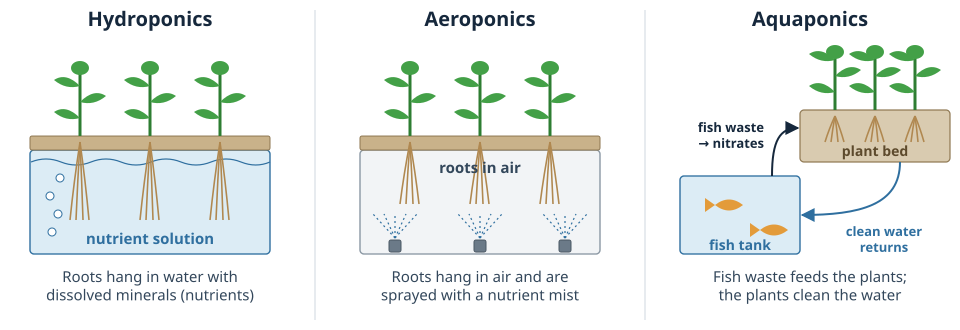
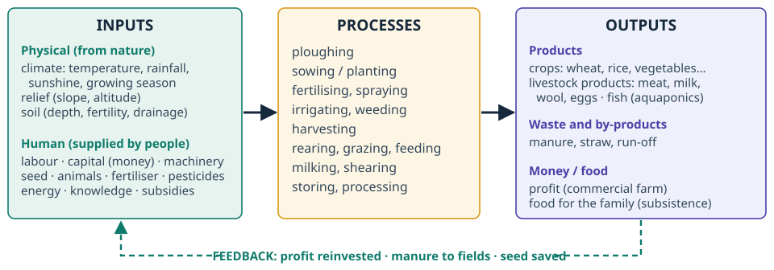

# How food is produced

## Specification coverage

| Point | Section |
| --- | --- |
| 10.1.1 Farming types: subsistence, commercial, arable, pastoral, mixed, aeroponics, aquaponics, hydroponics | 1 |
| 10.1.2 Farming systems: inputs, processes, outputs | 2 |

## 1. Farming types (10.1.1)

A farm is described by **why** it produces and **what** it produces, so one farm has two labels —
e.g. a *commercial arable* farm or a *subsistence mixed* farm.

:::: grid
::: card | Why it produces
**Subsistence farming** — producing food mainly for the farmer and their family, with little or
nothing left over to sell.

**Commercial farming** — producing crops or animals to sell for profit.
:::
::: card | What it produces
**Arable farming** — growing crops (e.g. wheat, rice, vegetables).

**Pastoral farming** — rearing animals for meat, milk, wool or eggs.

**Mixed farming** — crops and animals on the same farm.
:::
::::

**Hydroponics, aeroponics and aquaponics** grow plants **without soil**, usually indoors in
greenhouses or stacked "vertical farms", with water and nutrients recycled.

*Figure 1. The three soil-less farming types. Aquaponics is the only one with two outputs — plants and fish.*

Because conditions are controlled, they give **high yields all year**, use **far less water** than
field crops and need **no farmland**, so food can be grown in cities and deserts. But they need a
lot of **capital, energy and technical skill**, so they are almost always commercial.

## 2. Farming systems (10.1.2)

**Definition — Farming system:** a farm seen as a system in which **inputs** (what goes into the
farm) are changed by **processes** (the work done on the farm) into **outputs** (what the farm
produces).

*Figure 2. The farm as a system. Physical inputs come from nature; human inputs are supplied by people.*

| | Subsistence farm | Commercial farm |
| --- | --- | --- |
| Main inputs | family labour, simple tools, seed saved from last harvest | capital: machinery, fertiliser, pesticides, bought seed, hired labour |
| Outputs | eaten by the family; little surplus | sold for profit; high yields |

::: traps
**Harvesting, ploughing and milking are processes, not outputs.** Climate, soil and relief are
*physical* inputs; labour, machinery and fertiliser are *human* inputs. Manure is an output that
can feed back as an input.
:::
