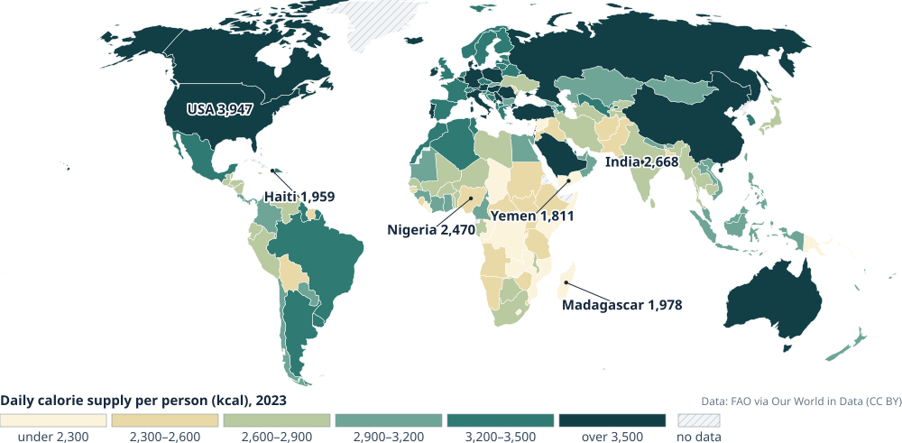

# The global patterns of food supply and demand

## Specification coverage

| Point | Section |
| --- | --- |
| 10.2.1 Global patterns of calorie intake and reasons for variations | 1 |
| 10.2.2 The reasons for the changing global production and consumption of food | 2 |
| 10.2.3 The strategies used to increase food supply | 3 |
| 10.2.4 The reasons for the globalisation of food supplies | 4 |
| 10.2.5 The impacts of the globalisation of food supplies | 5 |

## 1. Global patterns of calorie intake (10.2.1)

**Definition — Calorie intake:** the food energy available to each person per day, measured in
kilocalories (kcal). An adult needs roughly 2,000–2,500 kcal a day.

*Figure 3. Daily calorie supply per person, 2023 (FAO data via Our World in Data). Supply is food available, so it includes food later wasted.*

- **Highest (over 3,500 kcal):** North America, most of Europe, Russia, China, Australia — the
  USA is the world's highest at 3,947.
- **Lowest (under 2,300 kcal):** much of **sub-Saharan Africa** (Madagascar 1,978), plus Haiti
  (1,959) and Yemen (1,811), the world's lowest.
- The pattern broadly follows **development**: high-income countries average 3,608 kcal, low-income
  countries 2,306. The world average has risen from 2,184 kcal (1961) to 3,006 (2023).

| Reason | High-calorie countries | Low-calorie countries |
| --- | --- | --- |
| Wealth | people can buy enough food; the country can import food | poverty — people and governments cannot buy or import enough |
| Farming technology | machinery, fertiliser, irrigation, high-yielding seed → high yields | subsistence farming with few inputs → low yields |
| Physical conditions | fertile soils, reliable rainfall, few hazards | drought, poor soils, floods, pests |
| Political stability | stable, farming supported by government | conflict disrupts farming; corruption, weak policy |
| Infrastructure | good storage, roads and markets → little lost | poor storage and transport → food lost after harvest |
| Population growth | slow | rapid, so supply per person falls |

## 2. Why food production and consumption are changing (10.2.2)

:::: grid
::: card | Consumption is rising because
- **Population growth** — world population passed 8 billion in 2022.
- **Rising incomes** in emerging economies (e.g. China, India, Brazil) → more food per person and a
  shift to **meat and dairy**, which need several kilograms of crop feed per kilogram of food.
- **Urbanisation** → more bought and processed food, Western-style diets.
- **Globalisation** → demand for imported and out-of-season food (Section 4).
:::
::: card | Production is changing because
- **Rising:** new technology raises yields (Section 3); more land is farmed; commercial
  agribusiness produces for global markets.
- **Held back:** climate change and extreme weather, land degradation, conflict, farmland lost to
  urban growth and to crops grown for **biofuels** instead of food (→ 10.3.1).
:::
::::

## 3. Strategies used to increase food supply (10.2.3)

| Strategy | How it increases supply | Limitation |
| --- | --- | --- |
| **Green Revolution** (from the 1960s, mainly Asia and Latin America) | **high-yielding varieties (HYVs)** of wheat and rice with fertiliser, pesticides and irrigation → yields roughly doubled; two or three harvests a year | costly inputs → debt, helps richer farmers most; falling water tables, soil and water pollution |
| **Genetically modified (GM) crops** | genes altered for drought, pest or salt resistance or extra nutrients → crops on poorer land, fewer losses | seed must be bought each year from TNCs; public concern about safety and cross-contamination |
| **Irrigation schemes** | water from dams, rivers or wells lets dry land be farmed and adds a dry-season crop | over-abstraction; **salinisation** (salt left as water evaporates) |
| **Farming more land** | forest cleared, wetlands drained, land reclaimed → larger area | deforestation and habitat loss; best land already used |
| **Mechanisation and agribusiness** | large machine-farmed commercial farms → more output per worker | high capital cost; fewer farm jobs |
| **Aquaculture** (fish farming) | protein without depleting wild fish stocks | water pollution, disease, mangroves cleared for ponds |
| **Soil-less farming** (→ 10.1) | high yields in cities and deserts | high energy and capital cost |
| **Cutting food waste** | roughly a third of food is lost or wasted — better storage and transport increase supply | needs investment in cold chains and storage |

## 4. Why food supply has globalised (10.2.4)

**Definition — Globalisation of food supply:** the growth of trade in food between countries, so
that food is increasingly grown, processed and sold across the world rather than locally.

- **Transport:** container ships, **refrigerated** ships and lorries, and air freight move
  perishable food cheaply and quickly.
- **Communications:** computer systems let supermarkets run supply chains across continents.
- **Trade liberalisation:** the WTO and trade agreements have cut tariffs and quotas.
- **TNCs:** agribusiness companies and supermarket chains buy from wherever food is cheapest.
- **Consumer demand:** rising incomes and migration create demand for variety and for
  out-of-season food all year.
- **Lower costs abroad:** cheap land and labour and suitable climates in LICs and MICs (e.g. green
  beans and flowers from Kenya for Europe); exports earn these countries foreign currency.

## 5. Impacts of the globalisation of food supplies (10.2.5)

| | Producing (exporting) countries — often LICs/MICs | Consuming (importing) countries — often HICs |
| --- | --- | --- |
| Economic | **+** jobs, foreign currency, TNC investment · **−** low wages; profits go to TNCs abroad; income depends on volatile world prices | **+** cheaper food, choice all year · **−** local farmers undercut; reliance on imports if supply is disrupted |
| Social | **+** income for schools and health care · **−** poor working conditions; small farmers lose land; **cash crops replace food crops**, risking local food insecurity | **+** varied diet · **−** loss of local and seasonal food culture; processed Western diets spread, raising obesity (in producing countries too) |
| Environmental | **−** deforestation for soya, palm oil and beef; water used for export crops in dry areas; pesticide and fertiliser pollution; monocultures | **−** **food miles**: CO₂ from transporting food long distances; more packaging waste |
