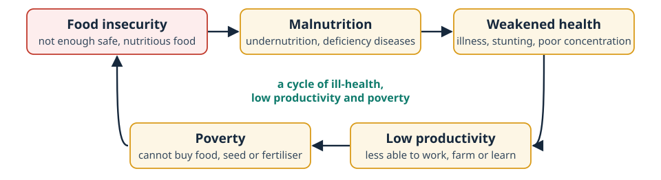
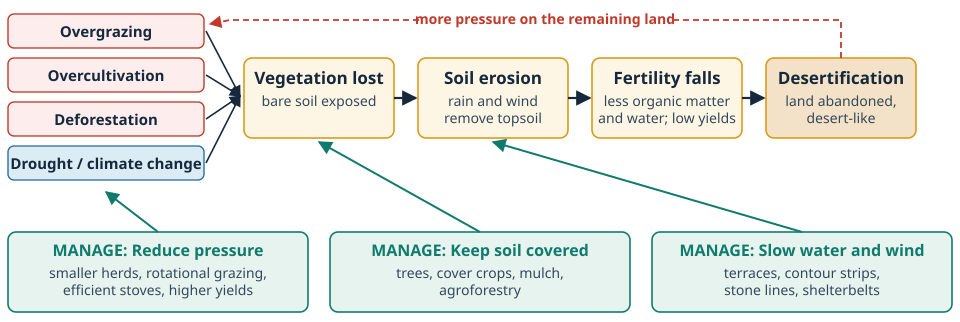
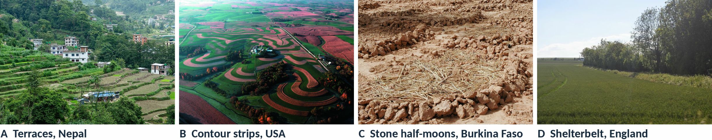
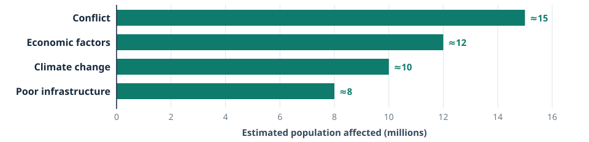

# The challenges of food supply

## Specification coverage

| Point | Section |
| --- | --- |
| 10.3.1 The human and natural factors negatively affecting food supply | 1 |
| 10.3.2 The problems caused by food insecurity in countries at different levels of development | 2 |
| 10.3.3 The strategies and techniques used to increase food supply | 3 |
| 10.3.4 An evaluation of the role of food aid in improving food security | 4 |
| 10.3.5 An evaluation of the strategies and techniques used to manage desertification and soil erosion; including sustainable | 5 |
| 10.3.6 Detailed specific example (Nigeria): factors affecting food supply; causes of food insecurity; problems caused by food insecurity; strategies and techniques used to increase food supply | 6 |

## 1. Factors negatively affecting food supply (10.3.1)

:::: grid
::: card | Natural factors
- **Drought** — crops fail, animals die of thirst or lack of pasture.
- **Floods and tropical storms** — crops, stores and soil washed away.
- **Extreme temperatures** — heatwaves and frost damage crops.
- **Pests and diseases** — locust swarms, crop blights, livestock disease.
- **Poor soils and steep slopes** — low fertility, easily eroded.
- **Climate change** — less reliable rainfall and more extreme events.
:::
::: card | Human factors
- **Conflict** — farms abandoned, people displaced, supplies blocked.
- **Poverty** — farmers cannot afford seed, fertiliser or irrigation.
- **Poor storage and transport** — food lost after harvest; farmers cannot reach markets.
- **Land degradation** — overgrazing, overcultivation and deforestation (Section 5).
- **Population growth** — land divided into ever-smaller plots.
- **Land used for other things** — urban growth, cash crops and biofuels.
- **Economic and political** — rising prices, corruption, HIC subsidies undercutting LIC farmers.
:::
::::

## 2. Problems caused by food insecurity (10.3.2)

**Definition — Food security:** when all people at all times have access to sufficient, safe,
nutritious food to maintain a healthy and active life. **Food insecurity** is when they do not —
because food is not *available*, people cannot *access* (afford or reach) it, it is not *used*
well (poor quality or preparation), or supply is not *stable* over time.

**Definition — Malnutrition:** a diet with too little, too much or the wrong balance of
nutrients. **Undernutrition** is too little food energy or nutrients.

*Figure 4. Food insecurity traps people in a cycle of ill-health, low productivity and poverty.*

| | LICs | MICs | HICs |
| --- | --- | --- | --- |
| Health | undernutrition, **stunting**, deficiency diseases (e.g. kwashiorkor — protein, rickets — vitamin D); famine and high child death rates | a **double burden**: undernutrition among the rural poor, obesity in cities | **food poverty**: cheap, energy-dense processed food → obesity, type 2 diabetes, heart disease |
| Economic | low labour productivity; dependence on food aid | money spent on food imports; lost productivity | health-care costs; families rely on **food banks** |
| Social and political | migration and refugees; conflict over land and water; children leave school | food-price protests and riots; rural–urban migration | inequality; little actual shortage because HICs can import food and have welfare systems |

## 3. Strategies and techniques to increase food supply (10.3.3)

The large-scale global strategies — Green Revolution, GM crops, irrigation schemes — are in
10.2.3. Where people are food-insecure, the aim is to help **small farmers grow more and lose less**.

:::: grid
::: card | Strategies (plans and policies)
- **Land reform / secure land rights** → farmers invest in their land.
- **Credit and microfinance** → farmers can buy seed, tools, fertiliser.
- **Agricultural education and advice** (extension services).
- **Infrastructure** — rural roads, markets, storage and processing.
- **Research** into seed suited to local conditions.
- **Fairer trade** — cutting HIC subsidies and tariffs; fair-trade prices.
:::
::: card | Techniques (practical methods)
- **Small-scale irrigation** — drip irrigation, wells and pumps, rainwater harvesting.
- **Improved seed** — high-yielding, drought- or pest-resistant.
- **Fertiliser, manure and compost**; crop rotation and intercropping with legumes.
- **Better storage** — airtight bags, metal silos → fewer losses to pests and mould.
- **Appropriate technology** — cheap, simple tools farmers can maintain.
- **Fish ponds, vegetable gardens, greenhouses** (→ 10.1 soil-less farming).
:::
::::

## 4. An evaluation of food aid (10.3.4)

**Definition — Food aid:** food, or money and vouchers to buy food, given to a country or people
facing food shortages. The UN **World Food Programme (WFP)** is the main organisation.

| Type | What it is | Strength | Weakness |
| --- | --- | --- | --- |
| **Relief (emergency) aid** | delivered directly to people in a crisis — famine, war, disaster | saves lives quickly; there is no alternative when disaster strikes | short-term only; costly to transport; may be looted or diverted in conflict |
| **Programme aid** | given government to government, to be **sold** in local markets, often with donor conditions | raises money for the government | cheap food **undercuts local farmers**, so they grow less; tied to the donor's interests |
| **Project aid** | targeted at particular groups in longer-term development work — school meals, food-for-work | improves nutrition and school attendance; food-for-work builds roads and terraces | depends on continued funding; still may replace local food |

**Wider criticisms:** aid can create **dependency** and may be unsuitable (e.g. GM rice not
approved for eating was found in aid to West Africa). NGOs such as CARE argue that donors should
buy food **locally** or give **cash** rather than ship subsidised food.

::: note | Judgement
Food aid is essential in the **short term** — it saves lives in emergencies. It does little for
**long-term** food security, because it treats the symptom (hunger) not the causes (poverty, low
yields, conflict) and can weaken local farming. It works best when bought locally and linked to
development, such as project aid.
:::

## 5. An evaluation of managing desertification and soil erosion (10.3.5)

**Definition — Soil erosion:** the removal of topsoil by water or wind faster than it forms.

**Definition — Desertification:** the degradation of land in arid and semi-arid areas until it
becomes desert-like, caused by climate (drought) and human activities.

*Figure 5. How land degrades. Management works by keeping soil covered, slowing water and wind, or reducing the pressure on land.*

*Figure 6. Techniques on the ground (photographs: Bijay Chaurasia, USDA NRCS, Botanischwili, N Chadwick — Wikimedia Commons).*

| Technique | How it works | Strengths | Limitations |
| --- | --- | --- | --- |
| **Terracing** (A) | flat steps cut into a slope hold water and soil | lets steep slopes be farmed; lasts for generations | labour to build and maintain; collapses if neglected |
| **Contour ploughing and strip cropping** (B) | furrows and strips of different crops follow the contours, stopping water running straight downhill | cheap and simple | less effective on steep slopes |
| **Stone lines, bunds and half-moons** (C) | lines or semicircles of stones along the contour slow run-off, trap soil and let water soak in | cheap local materials, built by communities; raises yields in dry areas | heavy labour carrying stones; stones not available everywhere |
| **Shelterbelts, afforestation and agroforestry** (D) | trees cut wind speed, roots bind soil, leaves add organic matter; agroforestry grows crops between trees | long-lasting; also gives fuel, fodder and timber | slow — years before benefits; takes land; seedlings die in drought |
| **Grazing control** | smaller herds, rotational grazing, better breeds and vaccination — more produce from fewer animals | tackles overgrazing directly | vaccination can raise survival and so herd size; population pressure |
| **Improved cropping** | crop rotation, cover crops, mulching, fertiliser → soil stays covered and fertile, less new land cleared | raises yields as well as protecting soil | fertiliser costs money; artificial fertiliser can harm soil |
| **Alternative fuels and efficient stoves** | less fuelwood cut, so fewer trees lost | tackles a cause of deforestation | fuels such as kerosene cost money and are non-renewable |

::: note | Judgement — including sustainable
The most **sustainable** techniques are cheap, use local materials and knowledge, are run by the
community and tackle the **cause** — pressure on the land — while raising incomes: stone lines,
agroforestry, grazing control. Costly inputs and large top-down schemes (such as tree-planting
across the Sahel in the Great Green Wall) struggle when local people do not own or maintain them.
Techniques work best combined, e.g. stone lines plus trees plus controlled grazing.
:::

## 6. Detailed specific example: food insecurity in Nigeria (10.3.6)

Nigeria is Africa's most populous country (**over 220 million**) and a **lower-middle-income**
country since 2014. Agriculture gives about **23% of GDP** and **just over 50% of jobs**, yet about
**37%** of people live below the poverty line. The government declared a **state of emergency on
food security in 2023**; in early 2024 the WFP projected **26.5 million** people would face acute
hunger in the June–August lean season.

### Factors affecting food supply

- **Physical:** periodic **floods and droughts** — floods in the 2022 rainy season damaged over
  **675,000 hectares** of farmland; **desertification** affects **15 of the 36 states**; more
  extreme weather is expected.
- **Farming and infrastructure:** yields are among the **lowest in the world**; little
  **irrigation**; poor access to markets; **post-harvest losses over 10%** for several crops;
  storage lacks capacity and quality; processing lacks automation; poor **roads** delay transport
  and reduce food safety; farming practices cause **soil degradation and erosion**.

### Causes of food insecurity

*Figure 7. The primary causes of the food crisis in Nigeria (redrawn from the class textbook).*

- **Conflict:** the long conflict in the **northeast** has displaced **over 2 million** people;
  insurgent attacks interrupt farming and destroy infrastructure; conflict has spread to the
  northwest and north-central regions. **Herder–farmer clashes** over land deter investment.
- **Economic:** high **inflation** drives up food prices, and food is about **50% of household
  spending**; widespread poverty.
- **Climate change** and **poor infrastructure** (above).

### Problems caused by food insecurity

**Malnutrition** weakens the immune system, can lead to chronic conditions such as diabetes and
heart disease, **stunts growth** and impairs brain development — effects that last into adult
life, continuing a **cycle of poverty and ill-health**. **Children** are the most vulnerable, and
malnutrition is worst in the remote, conflict-affected **northeast**, where **nutrition
stabilisation centres** have been essential to keep children alive. It puts pressure on **medical
services** and lowers **labour productivity** in farming and other sectors.

### Strategies and techniques to increase food supply

:::: grid
::: card | National strategies
- **Location-specific** interventions (problems vary between and within states).
- Modernise **infrastructure**: storage facilities and processing plants.
- More **research and development**; more **mechanisation** and modern techniques.
- **Credit and microfinance** for farmers; agricultural **education and training**.
- **Sustainable practices**; **crop diversification**; **agro-processing** to add value to exports.
- **Land tenure reform** — farmers struggle to get land, and farmland is sold for building.
:::
::: card | World Food Programme
- Specialised nutritious food for **under-fives** at risk of malnutrition.
- **Livelihood** programmes: skills and jobs in food processing, aquaculture, vegetable gardening.
- Technical help for the national **home-grown school feeding** programme.
- **Air transport** for aid workers in hard-to-reach areas; **internet links** to agricultural
  advisers.
:::
::::

**Evaluation:** sustainable progress depends on raising **smallholder incomes** and scaling up
environmentally friendly ways to raise yields, e.g. more cropping cycles a year. Many past
policies failed through **inadequate funding, poor coordination and a lack of political will**.
