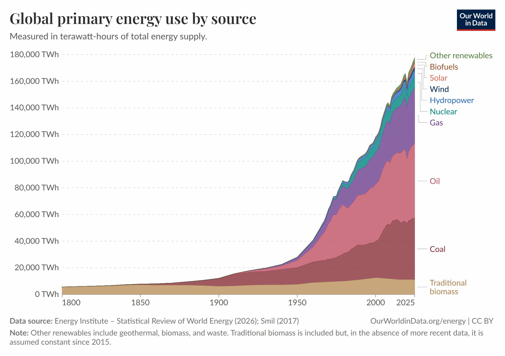
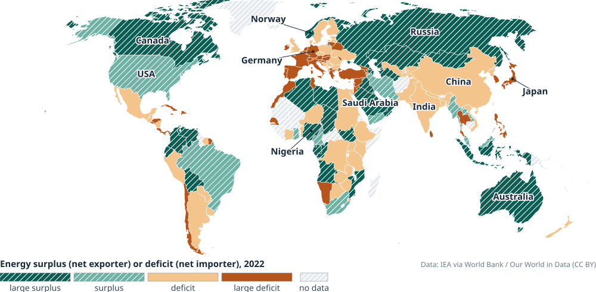
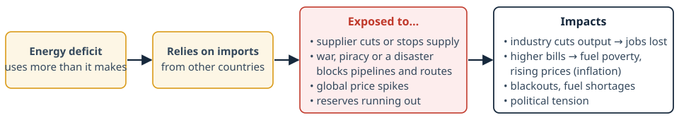

# The global patterns of energy supply and demand

## Specification coverage

| Point | Section |
| --- | --- |
| 10.5.1 Reasons for the increasing global production and consumption of energy | 1 |
| 10.5.2 The global patterns of energy surplus and deficit and the importance of energy security | 2 |
| 10.5.3 The reasons for variations in types of energy used within a country and between countries at different levels of development | 3 |

## 1. Why global energy production and consumption are increasing (10.5.1)

*Figure 9. Global energy use has risen more than six-fold since 1950; about four-fifths still comes from fossil fuels (Our World in Data, CC BY).*

:::: grid
::: card | Consumption is rising because
- **Population growth** — more people need energy.
- **Economic development and industrialisation**, especially in China and India — factories,
  construction, transport.
- **Rising incomes** → more cars, appliances, air-conditioning, flights.
- **Urbanisation** — city life uses more electricity and transport.
- **New technology** — computers, phones, data centres.
- More households in LICs **connected to electricity**.
:::
::: card | Production is rising because
- Suppliers respond to **rising demand and prices**.
- **New technology** reaches reserves that were out of reach — deep-sea drilling, fracking (→ 10.6.2).
- **Renewables have become much cheaper**, so wind and solar are built quickly.
- Governments want **energy security** (Section 2), so they develop their own sources.
:::
::::

## 2. Energy surplus and deficit, and energy security (10.5.2)

**Definition — Energy surplus:** a country produces more energy than it uses, so it can export
(a net exporter). **Energy deficit:** a country uses more than it produces, so it must import
(a net importer).

*Figure 10. Net energy exporters and importers, 2022. Large = trade over half of the energy the country uses.*

- **Surplus:** countries with large fossil-fuel reserves compared with their use — the **Middle
  East** (Saudi Arabia, Qatar, Kuwait, Iraq), **Russia** and Kazakhstan, **Norway**, **Canada**,
  **Australia**, and African oil and gas producers such as **Nigeria**, Angola and Algeria. The USA
  became a small net exporter through shale oil and gas.
- **Deficit:** industrialised countries with few reserves — most of **Europe** (Germany, Italy,
  Spain), **Japan** and **South Korea** (which import most of their energy), and fast-growing
  **China** and **India**; also many LICs without fossil fuels.

**Definition — Energy security:** the uninterrupted availability of energy at an affordable price.

*Figure 11. Why energy security matters, especially for importers.*

Example: after Russia invaded Ukraine in 2022, Russia cut gas supplies to Europe and prices
soared, raising household bills and industrial costs. Countries improve security by using several
suppliers and sources and developing their own energy (→ 10.6).

## 3. Why the types of energy used vary (10.5.3)

| | HICs | MICs (emerging economies) | LICs |
| --- | --- | --- | --- |
| Main energy used | oil, gas, nuclear, growing wind and solar; coal falling | coal and oil dominate; large HEP; renewables growing fast (China builds the most solar and wind) | **fuelwood, charcoal and dung** for most household energy; kerosene; some HEP; little electricity |
| Use per person | high | rising fast | very low |
| Why | wealth and technology to build nuclear, offshore wind and a national grid; climate targets | cheap, plentiful energy needed for industrialisation; domestic coal (China, India) | poverty — wood is free to collect; grid and appliances too expensive |

**Reasons that apply to every country:**

- **Physical resources** — fossil-fuel reserves; rivers and relief for HEP; geothermal heat near
  plate boundaries (Iceland, Kenya); sunshine, wind, tidal range.
- **Government policy** — climate targets, subsidies, taxes; public opinion (Germany closed its
  last nuclear power stations in 2023).

**Within a country:** cities have grid electricity and bottled gas, while rural areas of LICs rely
on fuelwood, kerosene or off-grid solar; richer households use more and cleaner energy; energy is
produced where the resource is — HEP in mountains, coal near coalfields, wind on coasts and uplands.
