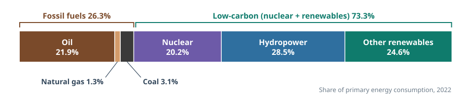

# The impacts of energy production

## Specification coverage

| Point | Section |
| --- | --- |
| 10.6.1 The advantages and disadvantages of different energy sources, including renewable and non-renewable | 1 |
| 10.6.2 The strategies and techniques used to increase energy supplies | 2 |
| 10.6.3 An evaluation of the strategies and techniques used to manage energy supplies; including sustainable | 3 |
| 10.6.4 Detailed specific example of a named country: the energy mix; impacts of the types of energy used; strategies and techniques to manage energy supplies, including sustainable | 4 |

## 1. Advantages and disadvantages of energy sources (10.6.1)

In general, **non-renewables** are reliable and cheap to use but finite and polluting;
**renewables** are clean and will not run out, but many are **intermittent** (not always
available), suit only certain sites and cost a lot to install.

| Source | Advantages | Disadvantages |
| --- | --- | --- |
| **Coal** | large reserves; cheap; reliable, steady supply | most CO₂ per unit of energy → climate change; air pollution and acid rain; mining scars land |
| **Oil** | energy-dense; easy to transport; fuels most transport | CO₂; oil spills; reserves concentrated in few countries → price and supply risk |
| **Gas** | about half the CO₂ of coal; power stations start quickly | still a fossil fuel; methane leaks; often piped from other countries |
| **Nuclear** | almost no CO₂; very reliable; little fuel needed | radioactive waste dangerous for thousands of years; accident risk (Chernobyl 1986, Fukushima 2011); very expensive, slow to build |
| **Biomass** | renewable; uses waste; roughly carbon-neutral if replanted | land competes with food crops (→ 10.3.1); air pollution when burned |
| **Fuelwood** | free to collect; no technology needed | deforestation → soil erosion; indoor smoke → lung disease; hours spent collecting |
| **Geothermal** | reliable; low CO₂; small land area | only near plate boundaries; costly drilling |
| **HEP** | reliable, low CO₂; reservoir also supplies water and controls floods | dam floods land and displaces people; very expensive; traps sediment; output falls in drought |
| **Solar** | free fuel; works off-grid in remote areas; low maintenance | none at night, less when cloudy; solar farms take land; storage costly |
| **Wind** | now one of the cheapest sources; low CO₂ | intermittent; visual impact and noise; bird deaths |
| **Tidal** | tides are predictable | barrages very expensive; damage estuary habitats; few suitable sites |
| **Wave** | large potential on exposed coasts | technology still costly and unproven; storms damage equipment |

## 2. Strategies and techniques to increase energy supplies (10.6.2)

:::: grid
::: card | Strategies (plans and policies)
- **National energy plans** that diversify the energy mix.
- **Subsidies and guaranteed prices** for renewable electricity.
- Licences and investment for **exploration**.
- **Import deals**, pipelines and electricity links with other countries.
:::
::: card | Techniques (practical methods)
- **Exploit new reserves:** deep-sea and Arctic drilling; **fracking** — water, sand and chemicals
  pumped at high pressure crack shale rock to release gas and oil; oil sands.
- **Build new capacity:** wind and solar farms, HEP dams, geothermal and nuclear power stations.
- **Get more from existing sources:** better recovery from old oil fields; energy storage
  (batteries, pumped storage) so renewable output is not wasted.
- **Small-scale supply in LICs:** off-grid solar, micro-hydro, biogas from dung.
:::
::::

## 3. An evaluation of managing energy supplies (10.6.3)

Managing energy supplies means matching supply to demand in a way that is **secure, affordable and
sustainable** — by changing supply *and* by reducing demand.

| Strategy or technique | What it achieves | Costs and limits | Sustainable? |
| --- | --- | --- | --- |
| **Expanding renewables** | low-carbon, will not run out, home-produced → more secure | intermittent — needs storage or back-up; high set-up cost | **yes** |
| **Fracking and new fossil-fuel reserves** | quick rise in supply and security (made the USA a net exporter) | CO₂; risk of water contamination and small earthquakes; only delays running out | **no** |
| **Nuclear power** | large, reliable, low-carbon supply | waste, accident risk, cost; uranium is finite | partly |
| **Diversifying sources and suppliers** | less exposed to one supplier or one source failing | costly new infrastructure | mostly |
| **Energy efficiency and conservation** — insulation, LED lighting, efficient appliances, smart meters, public transport | the cheapest option; cuts bills, emissions and imports | depends on people changing behaviour; up-front cost for households | **yes** — tackles demand |
| **Pricing and regulation** — carbon taxes, emissions targets, grants for electric cars | pushes users and firms towards clean energy | unpopular; higher prices hit the poor (fuel poverty) | yes, if fair |
| **Appropriate technology in LICs** — efficient cookstoves, biogas, solar lanterns | cheap; less fuelwood cut and less indoor smoke | small scale; needs maintenance | **yes** |

::: note | Judgement — including sustainable
The most sustainable management **reduces demand** (efficiency, conservation) and meets the rest
from **renewables with storage**. Fracking and new fossil-fuel reserves raise supply fastest but
increase emissions and only delay running out. The best mix suits each country's resources and
wealth — an LIC gains most from cheap off-grid solar and cookstoves, an HIC from efficiency and
large-scale renewables.
:::

## 4. Detailed specific example: energy in Sweden (10.6.4)

Sweden is a large, elongated Nordic country stretching from about **55°N to 69°N**, beyond the
Arctic Circle. Few countries use more energy per person, because of its **northerly location** and
the **high average income** of its people. It has **no significant fossil-fuel reserves**, yet its
carbon emissions are very low because so much of its energy is renewable: it has the **second
lowest CO₂ emissions per unit of GDP and per person** among IEA members.

### The energy mix

*Figure 12. Sweden's primary energy consumption, 2022 (redrawn from the class textbook). Nuclear and hydropower together produce 80% of its electricity.*

- Electricity use **peaked in 2001** and has fallen since. Energy use per person fell from
  **229.8 GJ (2010) to 215.7 GJ (2022)**, mainly through **energy efficiency** — better insulation,
  appliances and lighting.

### Impacts of the types of energy used

| Energy type | Impact in Sweden |
| --- | --- |
| **Hydropower** | a top renewable — **high-volume, fast-flowing rivers** give ideal conditions; with nuclear, 80% of electricity |
| **Bioenergy** (electricity and gas from biomass) | forests cover **63%** of the land, so a strong resource base; heats homes and **district heating**, produces electricity, supplies industry; **biofuels in transport** rising rapidly; combined heat and power (CHP) plants, mainly biofuel-powered, give **9%** of electrical output |
| **Nuclear** | **3 power stations, 8 reactors**; a **controversial** subject in Sweden |
| **Wind** | about **11%** of electricity, set to rise sharply |
| **Solar** | limited by the **northerly latitude**, but growing with government funding: grid-connected PV systems **+50%** (2019–2020); **1,090 MW** installed by the end of 2020 |
| **Heat pumps** | sharp rise since the 1990s; move heat mainly **from the ground**, reducing demand for grid electricity |

Most electricity is produced in the **north**, but most people live in the **south**, so
efficient **transmission corridors** are needed to use the resources fully.

### Strategies and techniques to manage energy supplies, including sustainable

Long-term policy: a controlled transition to an **entirely renewable electricity** system, aiming for
**ecological sustainability, competitiveness and security of supply**; as an **EU member**, Sweden's
policy follows the EU's broad objectives.

- **Carbon tax** (since **1991**) on all fossil fuels in proportion to their carbon content — the
  **"polluter pays"** principle; cuts emissions in the most cost-effective way and encourages new,
  clean technology.
- **Electricity certificates** — retailers must buy a share of **"green electricity"**; producers
  receive certificates for the renewable energy they generate.
- **District heating** — about **500** local systems use excess heat to warm homes, steam piped to
  houses (since the **late 1940s**).
- **Energy efficiency** — insulation, appliances, lighting; target of **50% more efficient energy
  use by 2030**.
- **Energy security** — electricity links with **Norway, Poland and Germany**; natural gas by
  pipeline from **Denmark**.
- **Energy storage** — aims to lead in storage because of large **seasonal variations in demand**.
- **Targets:** **100% renewable electricity by 2040**; a **zero-carbon economy by 2045**.

::: note | Evidence that the strategies work
The carbon tax "has proved effective" in changing energy use and raising efficiency. Compared with
the 1980s, Sweden has **25% more people** and **double the GDP**, yet uses **less energy and
electricity**.
:::
