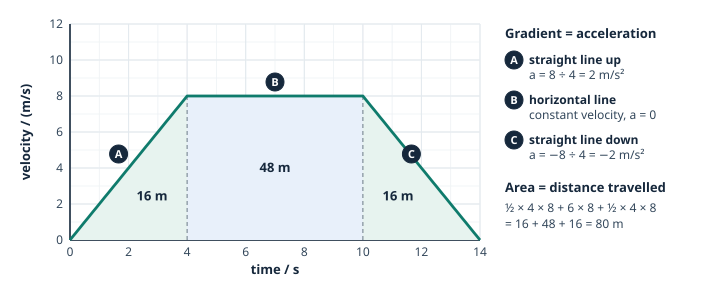

# Movement and position

## Specification coverage

| Point | Section |
| --- | --- |
| 1.3 plot and explain distance−time graphs | 2 |
| 1.4 know and use average speed = distance moved ÷ time taken | 1 |
| 1.5 practical: investigate the motion of everyday objects such as toy cars or tennis balls | 6 |
| 1.6 know and use acceleration = change in velocity ÷ time taken, a = (v − u)/t | 3 |
| 1.7 plot and explain velocity−time graphs | 4 |
| 1.8 determine acceleration from the gradient of a velocity−time graph | 4 |
| 1.9 determine the distance travelled from the area between a velocity−time graph and the time axis | 4 |
| 1.10 use v² = u² + (2 × a × s) | 5 |
| Both papers; no `P` statements. Recall 1.4 and 1.6 (Appendix 7); 1.10 is not on the recall list, so it is given. Source: specification Issue 4, Sept 2024, p. 11 | — |

## 1. Average speed (1.4)

::: note | Equation — recall
**average speed = distance moved ÷ time taken**

speed in m/s · distance in m · time in s
:::

"Average" because the speed may change during the journey: use the **total** distance and the
**total** time. Rearranged: distance = speed × time; time = distance ÷ speed.

*Example.* A car travels 3.0 km in 2.0 minutes. Average speed = 3000 m ÷ 120 s = **25 m/s**.

## 2. Distance–time graphs (1.3)

*Figure 1. One journey on a distance–time graph.*

The **gradient** of a distance–time graph is the **speed** (gradient = change in distance ÷
change in time), so a steeper line means a greater speed. The average speed for the whole journey
in Figure 1 is 64 m ÷ 16 s = 4 m/s.

::: note | Plotting a graph (1.3, 1.7)
- Time on the *x*-axis. Label each axis with quantity and unit, e.g. *distance / m*.
- Choose an even scale (1, 2, 5 or 10 per square) so the points fill more than half the grid.
- Plot each point accurately as a small cross.
- Draw **one** line of best fit — a ruled straight line or a smooth curve, not dot-to-dot.
:::

## 3. Acceleration (1.6)

::: definition
**Acceleration** — the rate of change of velocity: the change in velocity divided by the time
taken.
:::

::: note | Equation — recall
**acceleration = change in velocity ÷ time taken**

**_a_ = (_v_ − _u_) / _t_**

*a* acceleration (m/s²) · *v* final velocity (m/s) · *u* initial velocity (m/s) · *t* time taken (s)
:::

Velocity is speed in a stated direction (→ 1.13). An acceleration of 5 m/s² means the velocity
increases by 5 m/s every second. A **negative** acceleration is a **deceleration** (slowing down).

*Examples.* 5 m/s → 25 m/s in 4.0 s: *a* = (25 − 5) ÷ 4.0 = **5 m/s²**.
Braking from 20 m/s to rest in 5.0 s: *a* = (0 − 20) ÷ 5.0 = **−4 m/s²**, a deceleration of 4 m/s².

## 4. Velocity–time graphs (1.7–1.9)

*Figure 2. Gradient gives acceleration; area gives distance.*

- **Gradient = acceleration (1.8)** (gradient = change in velocity ÷ time), so a steeper line
  means a greater acceleration.
- A **curved** line means the acceleration is changing: a curve that gets less steep shows the
  acceleration decreasing (a falling object approaching terminal velocity, → 1.21).
- **Area under the line = distance travelled (1.9)**, because distance = velocity × time. Split
  the area into rectangles (base × height) and triangles (½ × base × height). For a curved line,
  count the squares under it (count a square if more than half of it is under the line) and
  multiply by the distance one square represents.

## 5. Final speed from acceleration and distance (1.10)

::: note | Equation — given in the exam
**(final speed)² = (initial speed)² + (2 × acceleration × distance moved)**

**<em>v</em>² = <em>u</em>² + (2 × <em>a</em> × <em>s</em>)**

*v*, *u* in m/s · *a* in m/s² · *s* in m. Use it when the time is not known and the acceleration
is constant.
:::

*Example 1.* A ball is dropped from rest and falls 5.0 m (*a* = 10 m/s²):
*v*² = 0² + 2 × 10 × 5.0 = 100, so *v* = √100 = **10 m/s**.

*Example 2.* A car at 20 m/s brakes to rest with a deceleration of 4.0 m/s² (*a* = −4.0 m/s²):
0 = 20² + 2 × (−4.0) × *s*, so *s* = 400 ÷ 8.0 = **50 m**.

## 6. Practical: motion of everyday objects (1.5)

**Speed (toy car).** Measure a distance on the ramp with a metre rule or tape measure; release the
car from rest (do not push it) and time it over that distance; speed = distance ÷ time. Repeat
and take the mean.

**Timing.** A stopwatch adds your **reaction time** (about 0.2 s), a large error when the time is
short. Better: use a longer distance, or **light gates** — the card cuts the beam and the data
logger records the time automatically.

- speed at a gate = length of card ÷ time the beam is blocked;
- acceleration = (speed at gate 2 − speed at gate 1) ÷ time between the gates.

*Figure 3. Two ways to measure motion.*

**Tennis ball.** Film it falling beside a metre rule; step through the video frame by frame,
reading the position against the rule. The time between frames is 1 ÷ frame rate (1/50 s at
50 frames per second). Plot distance–time or velocity–time graphs from the readings.

**Fair test.** When investigating a factor (e.g. ramp height → speed), change only that factor;
keep the car, release point, distance and surface the same.

## Common traps

- A **horizontal** line means **stationary** on a distance–time graph but **constant velocity**
  on a velocity–time graph — check the axis label first.
- The area under a **distance**–time graph means nothing; only a **velocity**–time area gives
  distance.
- *v*² = *u*² + 2*as* gives *v*² — take the square root at the end.
- For a question asking for the **deceleration**, give the positive number (4 m/s², not −4 m/s²).
