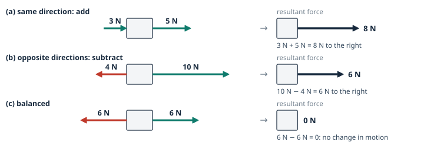
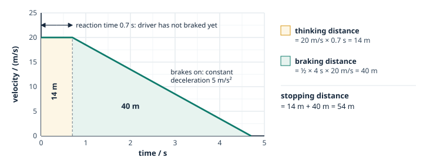
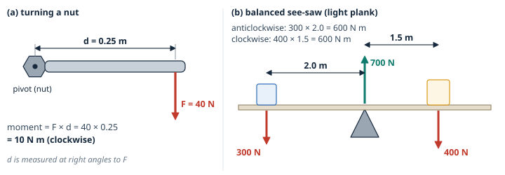

# Forces, movement, shape and momentum

## Specification coverage

| Point | Section |
| --- | --- |
| 1.11 describe the effects of forces between bodies such as changes in speed, shape or direction | 1 |
| 1.12 identify different types of force such as gravitational or electrostatic | 1 |
| 1.13 understand how vector quantities differ from scalar quantities | 2 |
| 1.14 understand that force is a vector quantity | 2 |
| 1.15 calculate the resultant force of forces that act along a line | 3 |
| 1.16 know that friction is a force that opposes motion | 1 |
| 1.17 know and use force = mass × acceleration, F = m × a | 4 |
| 1.18 know and use weight = mass × gravitational field strength, W = m × g | 5 |
| 1.19 stopping distance = thinking distance + braking distance | 6 |
| 1.20 describe the factors affecting stopping distance: speed, mass, road condition, reaction time | 6 |
| 1.21 describe the forces on falling objects and explain why they reach a terminal velocity | 7 |
| 1.22 practical: how extension varies with applied force for springs, metal wires and rubber bands | 8 |
| 1.23 the initial linear region of a force–extension graph is associated with Hooke's law | 9 |
| 1.24 elastic behaviour: recovering the original shape when the deforming forces are removed | 9 |
| 1.25P know and use momentum = mass × velocity, p = m × v | 10 |
| 1.26P use the idea of momentum to explain safety features | 12 |
| 1.27P use conservation of momentum to calculate mass, velocity or momentum | 11 |
| 1.28P use force = change in momentum ÷ time taken, F = (mv − mu)/t | 12 |
| 1.29P demonstrate an understanding of Newton's third law | 13 |
| 1.30P know and use moment = force × perpendicular distance from the pivot | 14 |
| 1.31P the weight of a body acts through its centre of gravity | 14 |
| 1.32P use the principle of moments for parallel forces in one plane | 14 |
| 1.33P how the upward forces on a light beam supported at its ends vary with the position of a heavy object on it | 15 |
| 1.25P–1.33P are Paper 2 only. Recall F = ma, W = mg, p = mv and moment = F × d (Appendix 7); F = (mv − mu)/t is given. Source: specification Issue 4, Sept 2024, pp. 12–13 | — |

## 1. Forces and what they do (1.11, 1.12, 1.16)

A force is a push or a pull that one body exerts on another, measured in **newtons (N)**. A force
can change an object's **speed** (speed it up or slow it down), its **direction** of motion, or its
**shape** (stretch, squash, bend or twist it).

| Force | Acts |
| --- | --- |
| gravitational (weight) | between any two masses, without contact; the Earth pulls objects towards its centre |
| electrostatic | between charged objects, without contact; like charges repel, unlike charges attract |
| magnetic | between magnets, or a magnet and a magnetic material, without contact |
| friction | where two surfaces slide, or try to slide, over each other |
| air resistance (drag) | on an object moving through air or a liquid; increases as speed increases |
| tension | in a stretched string, rope, wire or spring |
| normal contact (reaction) force | a surface pushing on an object resting on it, at right angles to the surface |
| upthrust | a liquid or gas pushing up on an object in it |
| thrust | an engine or rocket pushing a vehicle forwards |

**Friction is a force that opposes motion (1.16):** it always acts in the opposite direction to
the movement (or attempted movement). Air resistance is friction with the air.

## 2. Scalars and vectors (1.13, 1.14)

::: definition
**Scalar** — a quantity that has size (magnitude) only.

**Vector** — a quantity that has both size and direction.
:::

| Scalar | Vector |
| --- | --- |
| distance | displacement (distance in a stated direction) |
| speed | velocity (speed in a stated direction) |
| mass, time, energy | force (including weight), acceleration, momentum |

**Force is a vector (1.14)**: its effect depends on its direction as well as its size. Draw a
force as an arrow — the length shows the size, the arrowhead shows the direction. In calculations
choose one direction as positive; forces (or velocities) the other way are negative.

## 3. Resultant force (1.15)

The **resultant force** is the single force that has the same effect as all the forces acting on
an object together.

*Figure 1. Forces along a line: add those in the same direction, subtract those in opposite directions.*

- **Resultant = 0 (balanced forces):** no change in motion — a stationary object stays still; a
  moving object keeps the **same speed in the same direction**.
- **Resultant ≠ 0 (unbalanced):** the object **accelerates in the direction of the resultant** —
  it speeds up, slows down or changes direction.

## 4. Force, mass and acceleration (1.17)

::: note | Equation — recall
**force = mass × acceleration**

**_F_ = _m_ × _a_**

*F* resultant (unbalanced) force (N) · *m* mass (kg) · *a* acceleration (m/s²)
:::

For the same resultant force, a larger mass has a smaller acceleration.

*Example.* A 1200 kg car has a driving force of 3000 N and resistive forces of 600 N.
Resultant = 3000 − 600 = 2400 N; *a* = *F* ÷ *m* = 2400 ÷ 1200 = **2.0 m/s²**.

## 5. Weight (1.18)

::: definition
**Weight** — the gravitational force on an object. It acts downwards through the object's centre
of gravity (→ 1.31P).
:::

::: note | Equation — recall
**weight = mass × gravitational field strength**

**_W_ = _m_ × _g_**

*W* weight (N) · *m* mass (kg) · *g* gravitational field strength (N/kg); on Earth *g* = 10 N/kg
:::

**Mass** (kg) is the amount of matter in an object: a scalar, the same everywhere. **Weight** (N)
is a force, a vector, and changes with *g* — on the Moon, *g* is smaller, so the same mass weighs
less. A 60 kg person on Earth: *W* = 60 × 10 = **600 N**.

## 6. Stopping distance (1.19, 1.20)

::: definition
**Stopping distance = thinking distance + braking distance**

**Thinking distance** — the distance travelled during the driver's reaction time, before the
brakes are applied (the car is still at full speed).

**Braking distance** — the distance travelled while the brakes slow the car to a stop.
:::

*Figure 2. Thinking and braking distances are areas under the velocity–time graph (→ 1.9).*

| Factor | Changes | Why |
| --- | --- | --- |
| **higher speed** | thinking **and** braking distance | more distance covered during the reaction time; more speed to lose while braking — from *v*² = *u*² + 2*as*, doubling the speed makes the braking distance **four times** as long (same deceleration) |
| **greater mass** (passengers, load) | braking distance | the same braking force gives a smaller deceleration (*a* = *F* ÷ *m*) |
| **road condition** (wet, icy, oily, loose gravel) | braking distance | less friction between tyres and road, so a smaller deceleration; the car may skid |
| worn tyres or brakes | braking distance | less friction, so a smaller deceleration |
| **longer reaction time** (tiredness, alcohol, drugs, distractions such as a phone) | thinking distance | the car travels further at full speed before braking starts |

## 7. Falling objects and terminal velocity (1.21)

Two forces act on a falling object (Figure 3): its **weight** (downwards, constant) and **air resistance**
(upwards, increasing as the speed increases).

1. At the start the speed is zero, so there is no air resistance; the resultant force is the
   weight, and the object accelerates downwards (at 10 m/s²).
2. As the speed increases, the air resistance increases, so the resultant (downward) force
   decreases and the acceleration decreases.
3. Eventually the air resistance equals the weight: the resultant force is **zero**, so the
   acceleration is zero and the object falls at a constant velocity — its **terminal velocity**.

Opening a parachute (stages 4–5) increases the surface area, so the air resistance becomes greater than the
weight. The resultant force is upwards, so the skydiver **decelerates**; as the speed falls, the
air resistance decreases until it equals the weight again, giving a new, **lower** terminal
velocity.

*Figure 3. Forces and velocity of a falling skydiver.*

## 8. Practical: force and extension (1.22)

*Figure 4. Measuring extension for a spring or rubber band (a) and a metal wire (b).*

**Method (spring or rubber band)**

1. Hang the spring from the clamp; fix a pointer to its bottom end. Read the pointer's position
   on the metre rule with no load — the original length.
2. Add a 100 g mass (weight 1 N) and read the new position, with your eye level with the pointer.
3. **Extension = new length − original length.** Keep adding masses in equal steps, recording
   each force and extension.
4. Remove the masses one at a time to check whether it returns to its original length.
5. Plot a graph of extension against force.

**Metal wire.** The extension is very small, so use a **long, thin** wire (about 2 m) along a
bench over a pulley, and measure how far a tape marker on the wire moves along a fixed ruler.

**Control variables:** the same spring (or wire or band) throughout; for a wire, the same length
and thickness. **Safety:** wear eye protection (a wire or band may snap); keep feet clear of the
masses.

*Figure 5. Typical results.*

## 9. Hooke's law and elastic behaviour (1.23, 1.24)

::: definition
**Hooke's law** — the extension is directly proportional to the applied force, up to the limit
of proportionality. It is the **initial linear region** of a force–extension graph: a straight
line through the origin (double the force, double the extension).

**Elastic behaviour** — the ability of a material to recover its original shape after the forces
causing deformation have been removed.
:::

Stretched too far, a spring or wire is **permanently** deformed — it no longer returns to its
original shape. A rubber band behaves elastically (it returns to shape) but does **not** obey
Hooke's law: its graph is curved.

## 10. Momentum — Paper 2 only (1.25P)

::: note | Equation — recall
**momentum = mass × velocity**

**_p_ = _m_ × _v_**

*p* momentum (kg m/s) · *m* mass (kg) · *v* velocity (m/s)
:::

Momentum is a **vector**, in the direction of the velocity: if right is positive, an object moving
left has negative momentum. A 0.16 kg ball at 25 m/s: *p* = 0.16 × 25 = **4.0 kg m/s**.

## 11. Conservation of momentum — Paper 2 only (1.27P)

::: definition
**Conservation of momentum** — in a collision or explosion, the total momentum before equals the
total momentum after, provided no external force acts.
:::

**Method:** choose a positive direction → total momentum before → total after (unknown as a
symbol) → set them equal and solve. If everything starts at rest the total is zero, so the two
parts move off in opposite directions with equal-sized momenta.

*Figure 6. Total momentum before = total momentum after.*

## 12. Force and change in momentum; safety features — Paper 2 only (1.28P, 1.26P)

::: note | Equation — given in the exam
**force = change in momentum ÷ time taken**

**_F_ = (_mv_ − _mu_) / _t_**

*F* force (N) · *mv* final momentum and *mu* initial momentum (kg m/s) · *t* time taken (s)
:::

A force is needed to change momentum, and the **shorter the time** for a given change, the
**larger the force**.

*Example.* A 70 kg passenger moving at 15 m/s is stopped. Change in momentum = 70 × 15 =
1050 kg m/s. Stopped in 0.02 s by hitting the dashboard: *F* = 1050 ÷ 0.02 = 52 500 N. Stopped in
0.30 s by an airbag: *F* = 1050 ÷ 0.30 = **3500 N**.

*Figure 7. How safety features work (1.26P).*

Features that work this way: **crumple zones** (the front and back of the car crumple), **seat
belts** (stretch slightly), **airbags** (inflate and cushion), **cycle helmets** (foam liner
crushes), crash mats and soft playground surfaces.

## 13. Newton's third law — Paper 2 only (1.29P)

::: definition
**Newton's third law** — when body A exerts a force on body B, body B exerts a force on body A
that is **equal in size and opposite in direction**.
:::

The two forces of a pair are the **same type** of force and act on **different bodies**, so they
never cancel each other out.

In Figure 8(b) the book's weight and the table's upward push are equal and opposite, but they are
**not** a third-law pair: both act on the **same body** (the book) and are different types of
force. They are balanced forces. The partner of the book's weight is the book pulling the Earth
upwards.

*Figure 8. Third-law pairs.*

## 14. Moments and centre of gravity — Paper 2 only (1.30P–1.32P)

::: note | Equation — recall
**moment = force × perpendicular distance from the pivot**

moment (N m) · force (N) · distance (m), measured at right angles to the line of the force
:::

A **moment** is the turning effect of a force, **clockwise** or **anticlockwise** about a pivot. A
larger force, or the same force further from the pivot, gives a larger moment — so a long spanner
turns a nut more easily.

::: definition
**Centre of gravity** — the point through which the whole weight of a body acts (1.31P). For a
uniform beam it is at the middle.

**Principle of moments** — for a body in equilibrium, the sum of the clockwise moments about a
pivot equals the sum of the anticlockwise moments about the same pivot (1.32P).
:::

*Figure 9. The moment of a force, and a balanced see-saw.*

In equilibrium the resultant force is also zero, so the upward force at the pivot equals the total
downward force (700 N in Figure 9b).

*Example with the beam's own weight.* A uniform metre rule of weight 1.0 N is pivoted at the
30 cm mark. What weight *W* hung at the 0 cm end balances it? The rule's weight acts at its centre
of gravity (50 cm), 0.20 m from the pivot. Clockwise: 1.0 × 0.20 = 0.20 N m. Anticlockwise:
*W* × 0.30. So *W* = 0.20 ÷ 0.30 = **0.67 N**.

## 15. A light beam on two supports — Paper 2 only (1.33P)

For a light beam (weight negligible) resting on two supports:

- the two upward forces add up to the weight of the object: *R*A + *R*B = *W*;
- take moments about one support to find the force at the other. In Figure 10a, about A:
  *R*B × 4.0 = 800 × 1.0, so *R*B = **200 N** and *R*A = 800 − 200 = **600 N**;
- moving the object towards B increases the force at B and decreases the force at A in step
  (Figure 10b): half each in the middle, all of it on a support the object is directly over.

*Figure 10. The support nearer the load takes more of its weight.*

## Common traps

- **Weight is a force, in N; mass is in kg.** "Weight = 60 kg" is wrong.
- **Balanced forces do not mean stationary** — the object may be moving at a constant velocity
  (e.g. at terminal velocity).
- In *F* = *ma*, *F* is the **resultant** force: subtract the resistive forces first.
- Thinking distance depends on the **driver** (reaction time) and speed; mass, road and tyres
  affect only the **braking** distance.
- Extension = new length − **original** length, not the total length.
- Momentum and velocity are vectors: give the moving-left object a **negative** velocity.
- A third-law pair acts on **two different bodies**; two forces on the same object are never a pair.
- Moments use the **perpendicular** distance from the **pivot**, in m (convert cm).
