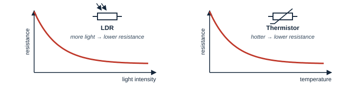

# Energy and voltage in circuits

## Specification coverage

| Point | Section |
| --- | --- |
| 2.7 why series or parallel suits particular applications, including domestic lighting | 10 |
| 2.8 current in a series circuit depends on the applied voltage and the number and nature of components | 8 |
| 2.9 how current varies with voltage for wires, resistors, filament lamps and diodes; how to investigate it | 5, 6 |
| 2.10 qualitative effect of changing resistance on the current | 4 |
| 2.11 LDR resistance with illumination; thermistor resistance with temperature | 7 |
| 2.12 lamps and LEDs indicate a current | 7 |
| 2.13 V = I × R (recall) | 4 |
| 2.14 current is the rate of flow of charge | 2 |
| 2.15 Q = I × t (recall) | 2 |
| 2.16 current in solid metals is a flow of negatively charged electrons | 2 |
| 2.17 why current is conserved at a junction | 9 |
| 2.18 the voltage across two components in parallel is the same | 9 |
| 2.19 calculate currents, voltages and resistances of two resistive components in series | 8 |
| 2.20 voltage is the energy transferred per unit charge; the volt is a joule per coulomb | 3 |
| 2.21 E = Q × V (recall) | 3 |
| Both papers; no `P` statements. Symbols: specification Appendix 8 | 1 |

## 1. Circuit symbols

![Circuit symbols used in 4PH1 papers: cell (the long line is the positive terminal), battery of cells, open switch, lamp (circle with a cross), fixed resistor (rectangle), variable resistor (rectangle with a diagonal arrow), ammeter (A in a circle, connected in series), voltmeter (V in a circle, connected in parallel), diode (triangle against a bar; conducts only in the direction the triangle points), LED (diode with two arrows pointing out), LDR (rectangle with two arrows pointing in), thermistor (rectangle crossed by a line with a short flat end).](assets/fig_symbols.svg)

*Figure 1. The symbols used in this topic.*

An **ammeter** goes **in series** — the current must pass through it. A **voltmeter** goes **in
parallel**, across the component.

## 2. Current, charge and electrons (2.14–2.16)

::: definition
**Current** — the rate of flow of charge.
:::

::: note | Equation — recall
**charge = current × time**  *Q* = *I* × *t*

*Q* in coulombs (C) · *I* in amperes (A) · *t* in seconds (s).
:::

::: note | Worked example
A current of 0.40 A flows for 2.0 minutes: *Q* = 0.40 × 120 = **48 C**.
:::

In a **solid metal** the current is a flow of free **electrons**, which are **negatively charged**.
They drift from the **negative** terminal towards the **positive** terminal — the opposite way to the
conventional current (+ to −) shown on circuit diagrams (Figure 2 in 2(b)).

## 3. Voltage: energy per unit charge (2.20, 2.21)

::: definition
**Voltage** — the energy transferred per unit charge passed. So **the volt is a joule per coulomb**:
1 V = 1 J/C.
:::

::: note | Equation — recall
**energy transferred = charge × voltage**  *E* = *Q* × *V*

*E* in joules (J) · *Q* in coulombs (C) · *V* in volts (V).
:::

Each coulomb leaving a 12 V battery carries 12 J; a lamp with 3 V across it takes 3 J from every
coulomb that passes through it.

::: note | Worked example
30 C passes through a 9.0 V battery: *E* = 30 × 9.0 = **270 J**.

Putting *Q* = *I* × *t* into *E* = *Q* × *V* gives *E* = *I* × *V* × *t* (2.5).
:::

## 4. Resistance (2.10, 2.13)

For the same voltage, a **bigger resistance gives a smaller current**, and a smaller resistance a
bigger current.

::: note | Equation — recall
**voltage = current × resistance**  *V* = *I* × *R*

*V* in volts (V) · *I* in amperes (A) · *R* in ohms (Ω). Rearranged: *R* = *V* ÷ *I*, *I* = *V* ÷ *R*.
:::

::: note | Worked example
A lamp has 6.0 V across it and a current of 0.25 A: *R* = 6.0 ÷ 0.25 = **24 Ω**.
:::

## 5. Current–voltage graphs (2.9)

*Figure 2. How current varies with voltage.*

- **Wire or resistor** (constant temperature): current is **directly proportional** to voltage, so
  the resistance is **constant**; the same in both directions.
- **Filament lamp:** a bigger current makes the filament **hotter**. Its ions vibrate more, the
  electrons collide with them more, so the **resistance increases** and the graph gets less steep.
- **Diode:** current flows in **one direction only**. In reverse its resistance is **very high**
  (no current); forwards there is almost no current until about 0.6 V, then it rises steeply.

## 6. Practical: investigating current and voltage (2.9)

*Figure 3. Circuit for obtaining an I–V graph.*

1. Set up Figure 3 with the wire, resistor, lamp or diode as the component.
2. Adjust the variable resistor; record the voltmeter and ammeter readings. Take at least six pairs
   over the whole range, repeating each and taking a mean.
3. Reverse the connections to the supply and repeat, to get negative values.
4. Plot current (*y*-axis) against voltage (*x*-axis) and draw a line or curve of best fit.

**Variables:** independent — voltage; dependent — current; control — the temperature of a wire or
resistor (use small currents and switch off between readings so it does not heat up).
**Diode:** put a fixed resistor in series to stop the forward current getting too big.
**Safety:** a lamp filament gets hot — do not touch it.

## 7. LDRs, thermistors, lamps and LEDs (2.11, 2.12)

*Figure 4. Resistance of an LDR and a thermistor.*

- **Light-dependent resistor (LDR):** resistance **decreases** as the light intensity **increases**.
- **Thermistor:** resistance **decreases** as the temperature **increases**.

So with a fixed supply voltage, brighter light on an LDR, or a hotter thermistor, gives a bigger
current.

**Indicators.** A **lamp** or an **LED** lights only while a current flows through it, so it shows
whether there is a current. An LED is a diode: it lights only when the current flows in its forward
direction.

## 8. Series circuits (2.8, 2.19)

*Figure 5. Current and voltage in series and parallel circuits.*

In series:

- the **same current** flows through every component;
- the supply voltage is **shared**: *V* = *V*₁ + *V*₂ — each coulomb transfers all the energy it
  gained from the supply;
- the total resistance is **R = R₁ + R₂**.

**What sets the current (2.8).** *I* = supply voltage ÷ total resistance, so:

- a **bigger applied voltage** gives a bigger current;
- **more components** in series means more total resistance and a **smaller current** — adding a
  lamp makes all the lamps dimmer;
- the **nature** of a component matters: a bigger resistance cuts the current more; a lamp's
  resistance rises as it heats up; a diode the wrong way round stops the current; an LDR or thermistor
  changes it with light or temperature.

::: note | Worked example — two resistors in series (2.19)
**Figure 5, left.** *R* = 4.0 + 8.0 = 12 Ω; *I* = 6.0 ÷ 12 = **0.50 A** through both;
*V*₁ = 0.50 × 4.0 = **2.0 V**; *V*₂ = 0.50 × 8.0 = **4.0 V**; check: 2.0 + 4.0 = 6.0 V.
The bigger resistor takes the bigger share of the voltage.

**Finding an unknown.** A 10 Ω resistor and resistor *X* are in series across 9.0 V; a voltmeter
across the 10 Ω reads 3.0 V. *I* = 3.0 ÷ 10 = 0.30 A; voltage across *X* = 9.0 − 3.0 = 6.0 V;
*R*ₓ = 6.0 ÷ 0.30 = **20 Ω**.
:::

## 9. Parallel circuits (2.17, 2.18)

- The **voltage across each of two components in parallel is the same** (6.0 V in Figure 5): both are
  connected between the same two points, so each coulomb transfers the same energy whichever branch
  it takes.
- The current **splits at a junction**, and the branch currents add up to the current before it:
  *I* = *I*₁ + *I*₂ (0.20 A + 0.30 A = 0.50 A).
- **Why current is conserved at a junction:** charge is not used up, created or stored there, so the
  charge flowing into a junction each second equals the charge flowing out each second.

## 10. Choosing series or parallel (2.7)

| | Series | Parallel |
| --- | --- | --- |
| One lamp breaks | circuit broken — **all go out** | the others **stay on** |
| Switching | one switch controls everything | each branch can have **its own switch** |
| Voltage across each lamp | a **share** of the supply | the **full** supply voltage |
| Adding another lamp | all lamps get **dimmer** | the others are **unchanged** |
| Typical use | a switch or fuse in series with what it controls | **domestic lighting** and sockets |

**Domestic lighting is wired in parallel** so that every lamp gets the full mains voltage (full
brightness), each can be switched on and off by itself, and one lamp failing does not put out the rest.

::: traps
| Wrong | Right |
| --- | --- |
| Components use up the current. | The current is the **same** all round a series circuit; **energy** is transferred, charge is not used up. |
| "The voltage through the lamp." | Voltage is **across** a component; current flows **through** it. |
| The resistance is the gradient of the *I*–*V* graph. | *R* = *V* ÷ *I*, using the values at that point. |
:::
