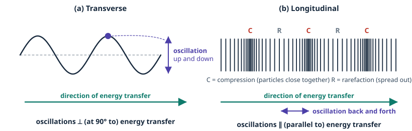
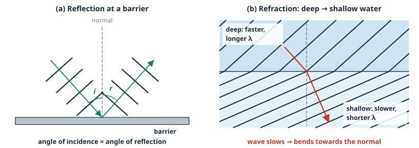

# Properties of waves

## Specification coverage

| Point | Section |
| --- | --- |
| 3.2 explain the difference between longitudinal and transverse waves | 1 |
| 3.3 know the definitions of amplitude, wavefront, frequency, wavelength and period of a wave | 2 |
| 3.4 know that waves transfer energy and information without transferring matter | 1 |
| 3.5 know and use the relationship v = f × λ | 3 |
| 3.6 use the relationship f = 1/T | 3 |
| 3.7 use the above relationships in different contexts, including sound waves and electromagnetic waves | 3 |
| 3.8 explain why there is a change in the observed frequency and wavelength of a wave when its source is moving relative to an observer and that this is known as the Doppler effect | 4 |
| 3.9 explain that all waves can be reflected and refracted | 5 |

## 1. Transverse and longitudinal waves (3.2, 3.4)

A wave is an oscillation that travels. **Waves transfer energy and information without
transferring matter** (3.4): the particles of the medium only oscillate about fixed positions. A
cork on a ripple bobs up and down but does not travel with the wave; air molecules near a
loudspeaker vibrate back and forth, but the air itself does not flow to your ear.

*Figure 1. The two wave types. Examples: transverse — all electromagnetic waves (including
light), ripples on water, waves on a string; longitudinal — sound.*

::: definition
**Transverse wave** — the oscillations are **perpendicular** (at 90°) to the direction of energy
transfer.

**Longitudinal wave** — the oscillations are **parallel** to the direction of energy transfer; the
wave is a series of **compressions** (particles closer together) and **rarefactions** (particles
further apart).
:::

## 2. Describing a wave (3.3)

*Figure 2. Amplitude and wavelength from a snapshot (a), period from one point over time (b),
wavefronts from above (c).*

::: definition
**Amplitude** — the maximum displacement of a point on the wave from its rest (undisturbed)
position.

**Wavelength (λ)** — the distance from a point on one wave to the same point on the next wave,
e.g. crest to crest. Unit: m.

**Frequency (*f*)** — the number of waves passing a point (or produced by the source) each
second. Unit: Hz.

**Period (*T*)** — the time taken for one complete wave to pass a point. Unit: s.

**Wavefront** — a line joining points on a wave that are at the same stage of their oscillation,
e.g. all along one crest. Wavefronts drawn crest to crest are one wavelength apart.
:::

## 3. Wave equations (3.5, 3.6, 3.7)

::: note | Equation — must be recalled
**wave speed = frequency × wavelength  *v* = *f* × λ**

*v* in m/s · *f* in Hz · λ in m
:::

::: note | Equation — given in the exam
**frequency = 1 ÷ time period  *f* = 1/*T***

*f* in Hz · *T* in s
:::

The same equations apply to **every** wave (3.7). The speed depends on the wave and the medium:

- **sound** in air: about 330–340 m/s (use the value in the question);
- **electromagnetic waves** in a vacuum (free space): 3.0 × 10⁸ m/s — very nearly the same in air.

::: note | Worked examples
**Electromagnetic.** A radio station broadcasts at 98 MHz. Find the wavelength.
λ = *v*/*f* = 3.0 × 10⁸ ÷ (98 × 10⁶) = **3.1 m**

**Sound.** A note has a period of 2.5 ms. Speed of sound = 340 m/s. Find *f* and λ.
*f* = 1/*T* = 1 ÷ (2.5 × 10⁻³) = **400 Hz**; λ = *v*/*f* = 340 ÷ 400 = **0.85 m**
:::

## 4. The Doppler effect (3.8)

*Figure 3. Wavefronts from a moving source.*

Why the observed frequency and wavelength change when the **source moves relative to the
observer**:

1. The source emits wavefronts at its normal frequency. Each spreads out from the point where the
   source **was** when it emitted it.
2. Between one wavefront and the next, the source moves forward. So wavefronts are **closer
   together in front** of the source and **further apart behind** it.
3. The wave speed does not change. So an observer the source is moving **towards** receives a
   **shorter wavelength** and more waves per second — a **higher frequency** (*f* = *v*/λ). An
   observer it is moving **away from** receives a **longer wavelength** and a **lower frequency**.

This change in observed frequency and wavelength is the **Doppler effect**. An ambulance siren
sounds higher-pitched as it approaches and lower-pitched after it passes. For light it causes
red-shift (→ 8.15P).

## 5. Reflection and refraction (3.9)

**All waves** — transverse and longitudinal — can be **reflected** and **refracted** (Figure 4).

- **Reflection:** a wave hitting a boundary bounces back, with angle of incidence = angle of
  reflection (→ 3.15). Examples: echoes (sound), mirrors (light).
- **Refraction:** a wave changes **speed** when it passes into a different medium (water waves
  slow down in shallower water; light slows down in glass). The **frequency stays the same** (it is
  set by the source), so the **wavelength changes** (*v* = *f*λ).

*Figure 4. (a) Reflection. (b) Refraction: slower in shallow water, so shorter wavelength and a
change of direction.*

**Why refraction changes direction.** When wavefronts meet the boundary **at an angle**, one end
of each wavefront enters the new medium first and changes speed first, while the other end is
still travelling at the old speed. The wavefront therefore turns:

- wave **slows down** → bends **towards** the normal;
- wave **speeds up** → bends **away from** the normal;
- wave travels **along the normal** (wavefronts parallel to the boundary) → speed and wavelength
  change, but **no change of direction**.

::: traps
| Wrong | Right |
| --- | --- |
| Amplitude = height from trough to crest. | Rest position to crest — **half** the trough-to-crest height. |
| Wavelength = crest to trough. | Crest to **crest** (one complete wave). |
| In the Doppler effect the wave speeds up or slows down. | The **speed is unchanged**; the observed wavelength and frequency change. |
| Refraction changes the frequency. | Frequency is constant; **speed and wavelength** change. |
:::
