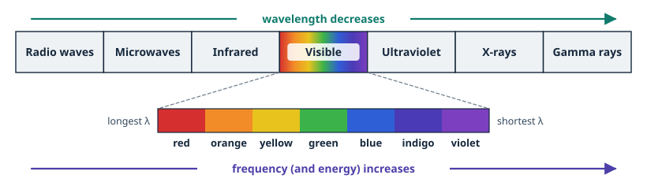

# The electromagnetic spectrum

## Specification coverage

| Point | Section |
| --- | --- |
| 3.10 know that light is part of a continuous electromagnetic spectrum that includes radio, microwave, infrared, visible, ultraviolet, x-ray and gamma ray radiations, and that all these waves travel at the same speed in free space | 1 |
| 3.11 know the order of the electromagnetic spectrum in terms of decreasing wavelength and increasing frequency, including the colours of the visible spectrum | 1 |
| 3.12 explain some of the uses of electromagnetic radiations (all seven bullets) | 2 |
| 3.13 explain the detrimental effects of excessive exposure of the human body to electromagnetic waves (microwaves, infrared, ultraviolet, gamma rays) and describe simple protective measures | 3 |

## 1. The spectrum and its order (3.10, 3.11)

Light is one small part of the **electromagnetic (EM) spectrum**. The spectrum is **continuous**:
there are no gaps, and each named region merges into the next. All EM waves are transverse and
**all travel at the same speed in free space** (a vacuum): 3.0 × 10⁸ m/s.

*Figure 1. The order to learn, including the visible colours. Every EM wave has the same speed,
so by v = fλ a shorter wavelength means a higher frequency.*

::: pagebreak
:::

## 2. Uses (3.12)

Each use depends on how that radiation behaves — what it passes through, what absorbs it, or
what emits it.

| Radiation | Use | Why it is suitable |
| --- | --- | --- |
| Radio waves | **broadcasting** (radio, TV) and **communications** | travel long distances through air and pass through walls; the wave carries the signal (information) |
| Microwaves | **cooking** | absorbed by **water molecules** in food, which gain energy, so the food heats up |
| | **satellite transmissions** | pass through the atmosphere to satellites in space and back |
| Infrared | **heaters** | hot objects emit a lot of infrared; skin and objects absorb it and warm up |
| | **night vision equipment** | warm bodies emit more infrared than cooler surroundings; the equipment detects it and forms an image in the dark |
| Visible light | **optical fibres** | light is totally internally reflected along a thin glass fibre, carrying information (→ 3.20) |
| | **photography** | a camera focuses visible light from the scene onto a sensor or film to record an image |
| Ultraviolet | **fluorescent lamps** | the gas in the tube emits UV; a coating inside the tube absorbs the UV and emits visible light |
| X-rays | **observing internal structure** — broken bones, airport luggage checks, cracks in metal | pass through low-density material (soft tissue) but are absorbed by dense material (bone, metal), making a shadow image on a detector |
| Gamma rays | **sterilising** food and medical equipment | high energy — kills bacteria and other microorganisms; penetrates packaging, so items can be sterilised after sealing |

## 3. Dangers and protection (3.13)

EM radiation harms the body when **large amounts are absorbed** by it. The effect depends on
where it is absorbed and on its energy: the **higher the frequency, the more energy** it carries.

| Radiation | Harmful effect | Why | Simple protection |
| --- | --- | --- | --- |
| Microwaves | **internal heating of body tissue** | absorbed by the water in body tissue, heating it from inside | the **metal case and metal mesh door** of a microwave oven keep the microwaves in |
| Infrared | **skin burns** | absorbed by the skin, which heats up | keep a safe **distance** from very hot objects; wear **heat-resistant gloves/clothing** |
| Ultraviolet | **damage to surface cells** (sunburn, skin cancer) and **blindness** | absorbed by skin cells and the eyes; its high energy damages the cells | **sunscreen**, cover the skin, **UV-blocking sunglasses/goggles**, limit time in strong sun |
| Gamma rays (also X-rays) | **cancer, mutation** | very penetrating — pass deep into the body and damage the DNA in cells, causing mutations that can lead to cancer | **lead shielding**; keep exposure **time short** and **distance large** |

::: traps
| Wrong | Right |
| --- | --- |
| Higher-frequency EM waves travel faster. | **All** EM waves have the same speed in free space. |
| Red light has the highest frequency of visible light. | Red has the **longest** wavelength and **lowest** frequency; violet the highest frequency. |
| Radio waves are sound waves. | Radio waves are **EM waves**; a radio converts the signal they carry into sound. |
| Gamma-sterilised food becomes radioactive. | It does not; the gamma rays only kill the microorganisms. |
:::
