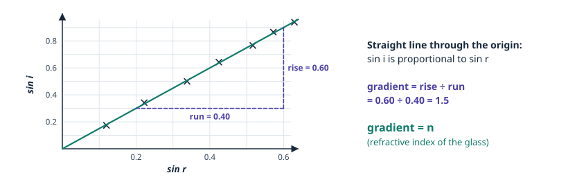
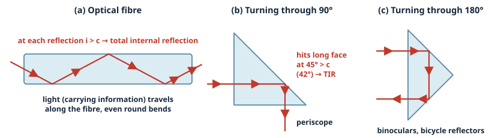
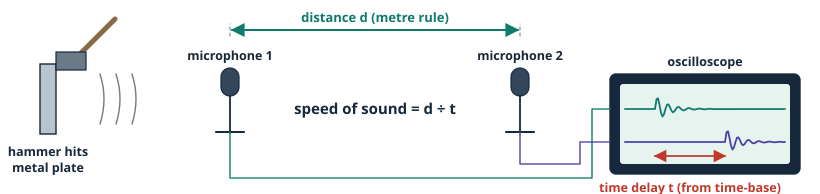
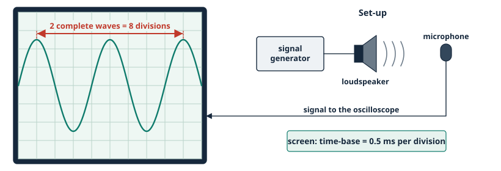
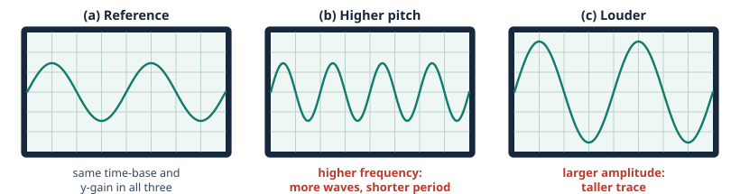

# Light and sound

## Specification coverage

| Point | Section |
| --- | --- |
| 3.14 know that light waves are transverse waves and that they can be reflected and refracted | 1 |
| 3.15 use the law of reflection (the angle of incidence equals the angle of reflection) | 1 |
| 3.16 draw ray diagrams to illustrate reflection and refraction | 1 |
| 3.17 practical: investigate the refraction of light, using rectangular blocks, semi-circular blocks and triangular prisms | 2 |
| 3.18 know and use the relationship n = sin i / sin r | 3 |
| 3.19 practical: investigate the refractive index of glass, using a glass block | 3 |
| 3.20 describe the role of total internal reflection in transmitting information along optical fibres and in prisms | 4 |
| 3.21 explain the meaning of critical angle c | 4 |
| 3.22 know and use the relationship sin c = 1/n | 4 |
| 3.23 know that sound waves are longitudinal waves that can be reflected and refracted | 5 |
| 3.24P know that the frequency range for human hearing is 20–20 000 Hz | 8 |
| 3.25P practical: investigate the speed of sound in air | 6 |
| 3.26P understand how an oscilloscope and microphone can be used to display a sound wave | 7 |
| 3.27P practical: investigate the frequency of a sound wave using an oscilloscope | 7 |
| 3.28P understand how the pitch of a sound relates to the frequency of vibration of the source | 8 |
| 3.29P understand how the loudness of a sound relates to the amplitude of vibration of the source | 8 |

## 1. Reflection and refraction of light (3.14, 3.15, 3.16)

Light waves are **transverse** (they are electromagnetic waves) and can be **reflected** and
**refracted**. A **ray** is a line showing the direction the light travels.

*Figure 1. The two basic ray diagrams. The normal is drawn dashed, at 90° to the surface where
the ray meets it.*

::: definition
**Law of reflection** — the angle of incidence equals the angle of reflection, *i* = *r*, both
measured from the **normal**.
:::

**Refraction of light.** Light slows down in glass, water or Perspex, so it bends **towards** the
normal on entering and **away from** it on leaving (Figure 1b). A ray travelling **along** the
normal does not change direction.

**Drawing ray diagrams (3.16).** Use a ruler and a sharp pencil. Draw rays as straight lines
with **arrows** showing the direction; draw the **normal** at 90° to the surface at the point
where the ray meets it; mark *i* and *r* **between the ray and the normal**. For reflection make
*i* = *r*; for refraction bend the ray the correct way.

## 2. Practical: refraction in blocks and prisms (3.17)

::: note | Method
1. In a darkened room, place the block on paper and draw round it.
2. Shine a narrow ray from a **ray box** at the block.
3. Mark the incident and emerging rays with **two crosses each**, far apart.
4. Remove the block. Join the crosses; join the entry and exit points to show the ray inside.
5. Draw the normals and measure the angles with a **protractor**.
:::

What each shape shows:

- **Rectangular block** — bends towards the normal on entering and away on leaving; emerges
  parallel to the incident ray (Figure 1b).
- **Semi-circular block** — aim the ray at the **centre of the flat face** through the curved
  side. It enters along a radius, which is a normal, so it does not bend there; it refracts only at
  the flat face (Figure 2a). Increasing the angle shows the critical angle and total internal
  reflection (section 4).
- **Triangular prism** — the ray refracts at both faces and is turned towards the base. White
  light is split into the colours of the spectrum, because each colour is refracted by a slightly
  different amount (red least, violet most) (Figure 2b).

*Figure 2. Refraction in a semi-circular block and a triangular prism.*

## 3. Refractive index (3.18, 3.19)

::: note | Equation — must be recalled
**refractive index = sin (angle of incidence) ÷ sin (angle of refraction)  *n* = sin *i* / sin *r***

*i* = angle in **air**, *r* = angle in the **material**, both from the normal. *n* has **no unit**
and is greater than 1; the larger *n*, the more the light slows and bends.
:::

::: note | Worked example
A ray in air hits glass at *i* = 40° and refracts at *r* = 25°.
*n* = sin 40° ÷ sin 25° = 0.643 ÷ 0.423 = **1.52**
:::

**Practical: refractive index of a glass block (3.19).** Use the method in section 2 with a
rectangular block. Measure *r* for about six values of *i* (e.g. 10°–70°). Either calculate *n*
for each pair and take the mean, or plot **sin *i* against sin *r*** and find the gradient
(Figure 3).

*Figure 3. Typical results for a glass block.*

For accurate angles: a **narrow** ray, crosses **far apart**, a sharp pencil, the protractor
centred on the point where the ray meets the block, and repeat readings.

## 4. Critical angle and total internal reflection (3.20, 3.21, 3.22)

Light passing from glass into air bends **away** from the normal (a little is also reflected).
Increasing the angle of incidence bends the refracted ray further, until it runs **along the
surface** (Figure 4).

*Figure 4. Increasing the angle of incidence inside glass.*

::: definition
**Critical angle (*c*)** — the angle of incidence, in the denser material (e.g. glass), at which
the angle of refraction is **90°**.

**Total internal reflection (TIR)** — all the light is reflected back inside the material. It
happens only when light travels from a **denser** material to a **less dense** one (higher *n* to
lower *n*, e.g. glass → air) **and** the angle of incidence is **greater than the critical angle**.
:::

::: note | Equation — must be recalled
**sin *c* = 1 / *n***
:::

::: note | Worked example
Glass has *n* = 1.5. sin *c* = 1 ÷ 1.5 = 0.667, so *c* = sin⁻¹ 0.667 = **42°**.
:::

**The role of TIR (3.20)** (Figure 5):

- **Optical fibres.** Light in a thin glass fibre meets the side at an angle **greater than the
  critical angle**, so it is **totally internally reflected** — again and again, even round bends.
  The light and the **information** it carries (communications signals, endoscope images) reach
  the far end with very little lost.
- **Prisms.** In a right-angled 45° glass prism, light enters a short face along the normal and
  meets the long face at **45°, greater than the critical angle of glass (about 42°)**, so it is
  totally internally reflected. One reflection turns the light through **90°** (periscope); two
  turn it through **180°** (binoculars, bicycle reflectors).

*Figure 5. Total internal reflection in an optical fibre and in prisms.*

## 5. Sound waves (3.23)

Sound waves are **longitudinal**: the particles of the medium vibrate **parallel** to the
direction the sound travels, making compressions and rarefactions (→ 3.2). Like all waves,
sound can be:

- **reflected** — an **echo** is reflected sound;
- **refracted** — sound changes speed when it passes into a different medium, so it changes
  direction at the boundary.

## 6. Practical: speed of sound in air (3.25P) — Paper 2 only

Sound travels about 340 m in one second, so the method must stop human **reaction time
(about 0.2 s)** swamping the time being measured.

*Figure 6. Two-microphone method: speed = d / t.*

- **Two microphones.** Place two microphones a measured distance *d* apart (metre rule) in line
  with the source. Make a sharp sound. The oscilloscope (or an electronic timer) shows the time
  *t* between the sound reaching each microphone. Speed = *d* / *t*. Repeat for several distances.
- **Echo.** Stand a measured distance *d* (at least 50 m, trundle wheel) from a large wall. Clap
  so each clap coincides with the echo of the last; time **20 claps** with a stopwatch. The sound
  travels to the wall and back, so speed = 2*d* ÷ (total time ÷ 20). Timing many intervals reduces
  the effect of reaction time.

Expected result: about **330–340 m/s**.

## 7. Displaying sound waves with a microphone and oscilloscope (3.26P, 3.27P) — Paper 2 only

A **microphone** converts sound into an electrical signal: the pressure changes of the sound
make it vibrate, producing an alternating **voltage** with the **same frequency** as the sound, and
a larger amplitude for a louder sound. An **oscilloscope** plots this voltage (vertical) against
**time** (horizontal).

- **Time-base** — time per horizontal division (e.g. ms/div).
- **Y-gain** — voltage per vertical division.

The trace looks like a transverse wave, but it is a **graph of voltage against time**; the sound
itself is longitudinal.

*Figure 7. Measuring the frequency of a sound.*

**Practical: frequency of a sound (3.27P).** Connect a **signal generator** to a **loudspeaker**
(or use a tuning fork) and hold a microphone connected to the oscilloscope in front of it. Adjust
the time-base until a few complete waves fit the screen. Measure the horizontal length of
**several** complete waves and divide by the number of waves (more accurate than one wave).
Then *T* = divisions per wave × time-base, and *f* = 1/*T*.

::: note | Worked example
In Figure 7, 2 waves span 8 divisions, so 1 wave = 4 divisions; time-base = 0.5 ms/div.
*T* = 4 × 0.5 = 2.0 ms = 2.0 × 10⁻³ s; *f* = 1/*T* = **500 Hz**.
:::

## 8. Pitch, loudness and hearing range (3.24P, 3.28P, 3.29P) — Paper 2 only

*Figure 8. Pitch and loudness on an oscilloscope.*

- **Pitch depends on frequency.** The **higher the frequency of vibration of the source**, the
  **higher the pitch**. On the screen: more waves across it (shorter period).
- **Loudness depends on amplitude.** The **larger the amplitude of vibration of the source**, the
  **louder** the sound. On the screen: a taller trace.
- **Human hearing range: 20 Hz to 20 000 Hz** (20 kHz).

::: traps
| Wrong | Right |
| --- | --- |
| *n* = sin *r* / sin *i*, or *i* measured in the glass. | *n* = sin *i* / sin *r*, with *i* in **air**; *n* > 1. |
| The critical angle is an angle of refraction. | It is the angle of **incidence** (in the denser material) that gives *r* = 90°. |
| TIR can happen as light goes from air into glass. | Only from the **denser** material to the less dense one, with *i* > *c*. |
| Echo method: speed = *d* / *t*. | The sound goes there **and back**: speed = 2*d* / *t*. |
| The oscilloscope trace shows sound is transverse. | It is a **voltage–time graph**; sound is longitudinal. |
:::
