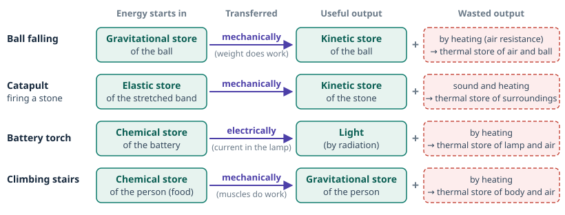
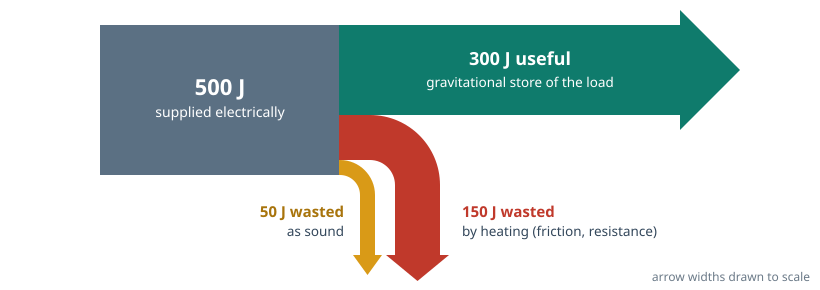
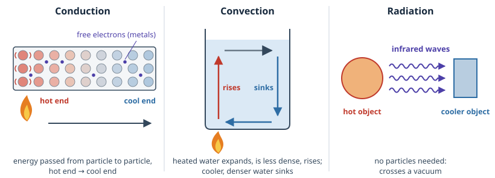
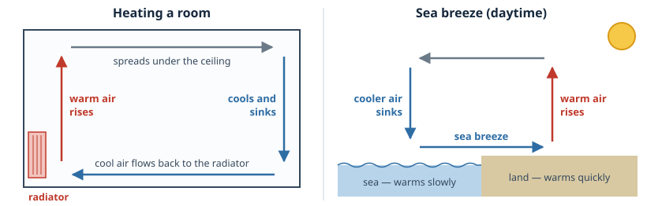
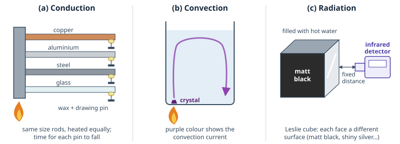
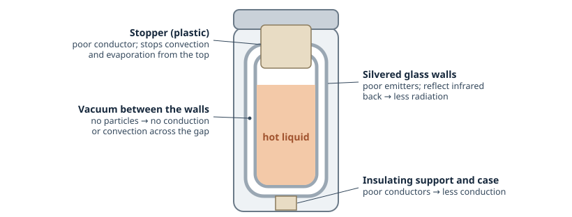

# Energy transfers

## Specification coverage

| Point | Section |
| --- | --- |
| 4.2 describe energy transfers involving energy stores (8 stores; 4 transfer pathways) | §1 |
| 4.3 use the principle of conservation of energy | §2 |
| 4.4 know and use efficiency = useful energy output / total energy output × 100% | §3 |
| 4.5 describe devices and situations in terms of energy transfers, including Sankey diagrams | §4 |
| 4.6 describe thermal energy transfer by conduction, convection and radiation | §5 |
| 4.7 explain the role of convection in everyday phenomena | §6 |
| 4.8 explain how emission and absorption of radiation are related to surface and temperature | §7 |
| 4.9 practical: investigate thermal energy transfer by conduction, convection and radiation | §8 |
| 4.10 explain ways of reducing unwanted energy transfer, such as insulation | §9 |

## 1. Energy stores and transfers (4.2)

Energy is held in **stores** and moves between them by **transfers**.

| Store | Energy held by… | Example |
| --- | --- | --- |
| chemical | substances that can react and release energy | fuel, food, a battery |
| kinetic | a moving object | a moving car |
| gravitational | an object raised in a gravitational field | water in a high reservoir |
| elastic | an object that is stretched, squashed or bent | a stretched spring |
| thermal | an object because of its temperature | hot water |
| magnetic | magnets or magnetic materials attracting or repelling | two magnets pushed together, like poles facing |
| electrostatic | charges attracting or repelling | a charged thundercloud |
| nuclear | the nuclei of atoms | uranium fuel |

The four ways energy is transferred:

- **mechanically** — a force moves an object (work is done → 4.11);
- **electrically** — an electric current flows;
- **by heating** — from a hotter object to a cooler one (§5);
- **by radiation** — as waves: light and sound.

To describe a transfer, name the store the energy starts in, how it is transferred, and the store it
ends up in — including the wasted part.

*Figure 1. Store → transfer → store. Every chain ends with some energy in the thermal store of the
surroundings.*

## 2. Conservation of energy (4.3)

::: definition
**Principle of conservation of energy** — energy cannot be created or destroyed; it can only be
transferred from one store to another, so the total amount of energy stays the same.
:::

For any device: **total energy input = useful energy output + wasted energy output**
(Figure 2: 500 J = 300 J + 150 J + 50 J).

Wasted energy is not destroyed: it spreads out (**dissipates**), mostly into the thermal store of
the surroundings, where it is too spread out to be useful.

## 3. Efficiency (4.4)

::: note | Equation — recall
**efficiency = (useful energy output ÷ total energy output) × 100%**

Both energies in J. Total energy output = total energy input (conservation), so either can be
used. Efficiency has no unit; give it as a percentage or a decimal (60% = 0.60).
:::

- No real device is 100% efficient — some energy is always wasted, usually by heating (friction,
  electrical resistance).
- The same ratio works with powers: useful power output ÷ total power input × 100%.
- Rearranged: useful energy output = efficiency × total energy input.

**Worked example.** A kettle is supplied with 200 000 J; 170 000 J goes to the thermal store of the
water. Efficiency = 170 000 ÷ 200 000 × 100% = **85%**.

## 4. Devices and Sankey diagrams (4.5)

A **Sankey diagram** shows the energy transfers of a device to scale:

- arrow width is proportional to the energy (or power);
- input on the left; useful output goes straight on; wasted output bends away;
- the output widths add up to the input width (conservation);
- efficiency = useful width ÷ input width.

*Figure 2. Electric motor lifting a load: 500 J in, 300 J useful, so efficiency = 300 ÷ 500 × 100% = 60%.*

| Device / situation | Input | Useful output | Main waste |
| --- | --- | --- | --- |
| filament lamp | electrically | light (radiation) | heating the surroundings — most of the input |
| LED lamp | electrically | light | heating — much less, so far more efficient |
| electric motor | electrically | kinetic store (mechanically) | heating (friction, resistance), sound |
| loudspeaker | electrically | sound (radiation) | heating |
| car engine | chemical store of fuel | kinetic store of the car | heating the engine, exhaust and surroundings; sound |
| bouncing ball | gravitational store | kinetic → elastic → kinetic → gravitational store | heating the ball and ground, and sound, at every bounce — so each bounce is lower |

## 5. Conduction, convection and radiation (4.6)

*Figure 3. The three ways thermal energy is transferred.*

**Conduction** — mainly in solids. Particles at the hot end vibrate more and pass energy on to
neighbouring particles, so energy travels towards the cooler end. Metals conduct best because they
also have **free electrons** that move through the metal and carry energy quickly. Non-metals are
poor conductors (**insulators**); gases, with particles far apart, are the poorest.

**Convection** — only in fluids (liquids and gases). The heated fluid expands, becomes **less
dense** and rises; cooler, denser fluid sinks to take its place and is heated in turn. This
circulation is a **convection current**: the fluid itself moves, carrying the energy.

**Radiation** — transfer by **infrared** waves (electromagnetic). It needs no medium, so it crosses a
vacuum — this is how energy reaches the Earth from the Sun.

## 6. Convection in everyday phenomena (4.7)

*Figure 4. Warm air rises because it is less dense; cooler, denser air moves in to replace it.*

- **Heating a room** — air heated by the radiator expands, becomes less dense and rises; it
  cools under the ceiling, becomes denser and sinks, then flows back to the radiator. The
  circulation heats the whole room.
- **Kettle** — the element is at the **bottom** so the heated water rises and cooler water sinks
  to the element; all the water is heated.
- **Fridge** — the cooling unit is at the **top**: air cooled there becomes denser and sinks, and
  warmer air rises to be cooled, so the whole inside is cooled.
- **Sea breeze (daytime)** — the land warms faster than the sea, so the air over the land is
  heated and rises; cooler, denser air from over the sea flows in to replace it.

## 7. Emission and absorption of radiation (4.8)

All objects emit **and** absorb infrared radiation all the time.

**Temperature.** The hotter an object, the more infrared it emits per second.

- Hotter than its surroundings → emits more than it absorbs → cools down.
- Cooler than its surroundings → absorbs more than it emits → warms up.
- Emits at the same rate as it absorbs → temperature stays constant.

**Surface.**

| Surface | Emitter | Absorber | Reflector |
| --- | --- | --- | --- |
| dark, matt (dull) | best | best | poorest |
| light, shiny (silvered) | poorest | poorest | best |

A larger surface area also emits and absorbs more per second (e.g. the fins on a heat sink).
Uses: solar water-heating panels are matt black (absorb well); a vacuum flask's walls are silvered
(emit and absorb poorly); buildings in hot countries are painted white (reflect).

## 8. Practical: investigating thermal energy transfer (4.9)

*Figure 5. (a) rods of different materials; (b) potassium manganate(VII) crystal in water;
(c) Leslie cube and infrared detector.*

| | Conduction | Convection | Radiation |
| --- | --- | --- | --- |
| Set-up | rods of different materials, drawing pin fixed to the far end of each with wax; near ends heated together | one crystal of potassium manganate(VII) (permanganate) at the bottom edge of a beaker of cold water; heat gently beneath it | Leslie cube (each face a different surface) filled with hot water; infrared detector facing one face |
| Change (independent) | material of the rod | — (observe) | type of surface |
| Measure (dependent) | time for each pin to fall | path of the purple colour | detector reading for each face |
| Keep the same | rod length and thickness; amount of wax; distance from the flame | — | distance from detector to face; same detector; take readings quickly as the water cools |
| Result | copper first, then aluminium, then steel; glass barely changes → metals conduct best | colour rises above the flame, spreads across the top, sinks on the cooler side → convection current | matt black highest, shiny silver lowest → dark matt surfaces are the best emitters |

Absorption can be tested the same way: identical cans painted matt black and shiny silver, equal
volumes of cold water, same distance from a heater — the water in the black can warms faster.
Safety: potassium manganate(VII) is harmful and stains — move it with tweezers, use one small
crystal; the Leslie cube and rods get hot.

## 9. Reducing unwanted energy transfer (4.10)

To keep something hot (or cold), reduce every route:

- **conduction** — use insulators, especially **trapped air** (a very poor conductor);
- **convection** — trap air in small pockets so it cannot circulate; cover or seal the container;
- **radiation** — use light, shiny surfaces that emit and absorb poorly and reflect infrared.

*Figure 6. A vacuum flask reduces all three transfers.*

| House method | How it reduces energy loss |
| --- | --- |
| loft insulation (mineral wool) | traps air: poor conductor, and trapped air cannot convect → less conduction and convection through the roof |
| cavity wall insulation | foam fills the gap between the two walls, stopping convection currents in it; the trapped air reduces conduction |
| double glazing | a thin layer of air (or a vacuum) between two panes reduces conduction; the gap is too narrow for much convection |
| draught excluders | stop warm air escaping through gaps → less convection |
| reflective foil behind radiators | reflects infrared back into the room → less radiation into the wall |

In machines, **lubricating** moving parts reduces friction, so less energy is wasted by heating.

## Common traps

| Wrong | Right |
| --- | --- |
| "Heat rises." | Heated **fluid** rises because it expands and becomes less dense. |
| Particles get bigger when heated. | Particles move faster and further apart; they do not expand. |
| Convection in a solid. | Convection happens only in liquids and gases. |
| Radiation needs air to travel. | Infrared crosses a vacuum. |
| Shiny surfaces emit well. | Light, shiny surfaces are poor emitters **and** poor absorbers. |
| Energy is "used up" or "lost". | It is transferred — usually dissipated to the thermal store of the surroundings. |
| Efficiency of 120%, or with a unit. | Always below 100%; no unit. |
| Insulation stops heat, or "lets cold in". | Insulation **reduces the rate** of transfer; energy always flows from hotter to cooler. |
