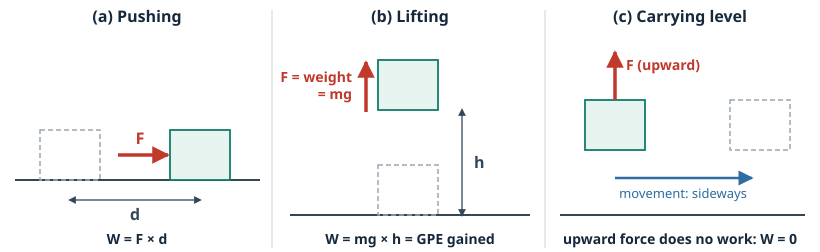
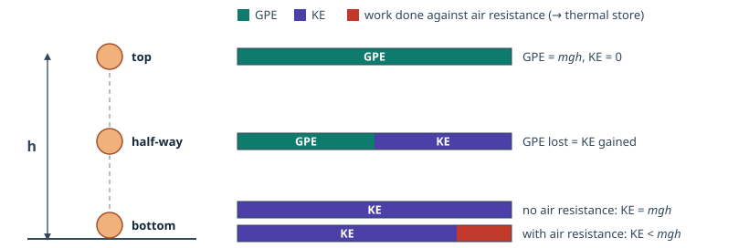

# Work and power

## Specification coverage

| Point | Section |
| --- | --- |
| 4.11 know and use work done = force × distance moved, W = F × d | §1 |
| 4.12 know that work done is equal to energy transferred | §1 |
| 4.13 know and use GPE = m × g × h | §2 |
| 4.14 know and use KE = ½ × m × v² | §3 |
| 4.15 understand how conservation of energy links GPE, KE and work | §4 |
| 4.16 describe power as the rate of transfer of energy or the rate of doing work | §5 |
| 4.17 use power = work done ÷ time taken, P = W / t | §5 |

## 1. Work done (4.11, 4.12)

::: note | Equation — recall
**work done = force × distance moved**  *W* = *F* × *d*

*W* in J, *F* in N, *d* in m — the distance moved **in the direction of the force**.
:::

*Figure 1. Only movement along the line of the force counts.*

::: definition
**Work done = energy transferred.** When a force moves an object, energy is transferred
mechanically; the work done in joules equals the energy transferred in joules.
:::

- Pushing a box at steady speed against friction: the work done is transferred to the **thermal
  store** of the box and floor (they warm up).
- Lifting a box: the work done is transferred to its **gravitational store**.

**Worked example.** A 40 N force pushes a box 3.0 m along the floor.
*W* = 40 × 3.0 = **120 J**, so 120 J of energy is transferred.

## 2. Gravitational potential energy (4.13)

::: note | Equation — recall
**gravitational potential energy = mass × gravitational field strength × height**
GPE = *m* × *g* × *h*

GPE in J, *m* in kg, *g* in N/kg (on Earth use the value given, usually 10 N/kg), *h* = **vertical**
height change in m.
:::

Lifting at steady speed needs an upward force equal to the weight, *mg*, over a vertical distance
*h*: work done = *mg* × *h* — the GPE gained. Only vertical height counts: pushing a trolley up a
ramp gives it the same GPE as lifting it straight up to the same height.

**Worked example.** A 2.0 kg book is lifted 1.5 m onto a shelf.
GPE = 2.0 × 10 × 1.5 = **30 J**.

## 3. Kinetic energy (4.14)

::: note | Equation — recall
**kinetic energy = ½ × mass × speed²**  KE = ½ × *m* × *v*²

KE in J, *m* in kg, *v* in m/s. Only the speed is squared: doubling the speed makes KE four times
bigger.
:::

**Worked example.** A 1200 kg car travels at 15 m/s.
KE = 0.5 × 1200 × 15² = **135 000 J** (135 kJ).

**Finding speed.** Rearrange: *v* = √(2 × KE ÷ *m*).
A 0.50 kg ball has 16 J of KE: *v* = √(2 × 16 ÷ 0.50) = √64 = **8.0 m/s**.

## 4. Linking GPE, KE and work (4.15)

Conservation of energy (→ 4.3) means energy lost from one store equals energy gained by others.
Work done is how the energy moves.

*Figure 2. A falling ball: GPE lost = KE gained, unless work is done against air resistance.*

| Situation | Energy equation |
| --- | --- |
| falling (or sliding down), no resistance | GPE lost = KE gained: *mgh* = ½*mv*² |
| thrown upwards, to the top | KE lost = GPE gained |
| falling or sliding **with** friction / air resistance | GPE lost = KE gained + work done against resistance (→ thermal store) |
| braking to a stop | KE lost = work done by the braking force: ½*mv*² = *F* × *d* |

**Worked example 1 — no resistance.** A ball is dropped from 5.0 m.
½*mv*² = *mgh*, so *v* = √(2*gh*) = √(2 × 10 × 5.0) = **10 m/s** (the mass cancels).

**Worked example 2 — with resistance.** A 60 kg skier drops 30 m in height down a 200 m slope,
starting from rest and reaching 20 m/s.

- GPE lost = 60 × 10 × 30 = 18 000 J
- KE gained = 0.5 × 60 × 20² = 12 000 J
- work done against friction and air resistance = 18 000 − 12 000 = **6000 J**
- average resistive force = *W* ÷ *d* = 6000 ÷ 200 = **30 N**

**Worked example 3 — braking.** A 1000 kg car at 20 m/s stops in 40 m.
KE = 0.5 × 1000 × 20² = 200 000 J = work done by the brakes, so
braking force = 200 000 ÷ 40 = **5000 N**. The energy ends up in the thermal store of the brakes.

## 5. Power (4.16, 4.17)

::: definition
**Power** — the rate of transfer of energy, or the rate of doing work.
:::

::: note | Equation — given in the exam, but use it fluently
**power = work done ÷ time taken**  *P* = *W* / *t*

*P* in watts (W), *W* in J, *t* in s. 1 W = 1 J/s. Work done = energy transferred, so also
*P* = energy transferred ÷ time.
:::

A more powerful device transfers the same energy in less time.

**Worked example.** A 50 kg student runs up stairs with a vertical height of 3.0 m in 4.0 s.
Work done = GPE gained = 50 × 10 × 3.0 = 1500 J; *P* = 1500 ÷ 4.0 = **375 W**.

**Rearranged.** Energy transferred = *P* × *t*: a 2.0 kW heater running for 5.0 minutes transfers
2000 × 300 = **600 000 J**.

## Common traps

| Wrong | Right |
| --- | --- |
| Using the length of a ramp or slope as *h*. | *h* is the **vertical** height change. |
| Squaring the whole of ½*mv*. | Only *v* is squared. |
| Forgetting the square root when finding *v* from KE. | *v* = √(2 × KE ÷ *m*). |
| Work done lifting = force × horizontal distance. | Use the distance moved **in the direction of the force**. |
| Power = energy. | Power = energy transferred **per second**. |
| Assuming no resistance when the question gives friction or a final speed. | GPE lost − KE gained = work done against resistance. |
