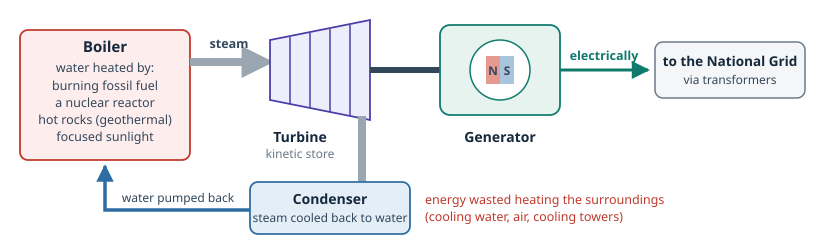
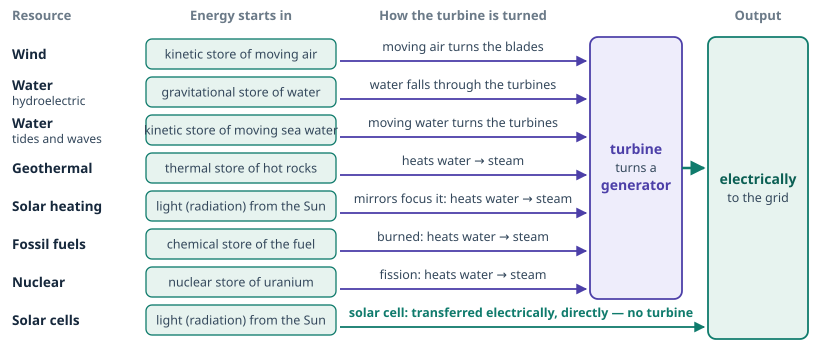

# Energy resources and electricity generation

## Specification coverage

| Point | Section |
| --- | --- |
| 4.18P describe the energy transfers in generating electricity using wind, water, geothermal resources, solar heating systems, solar cells, fossil fuels, nuclear power | §1, §2 |
| 4.19P describe the advantages and disadvantages of large-scale electricity production from renewable and non-renewable resources | §3 |

## 1. Turbine and generator — Paper 2 only

Every method except solar cells spins a **turbine** connected to a **generator**, which transfers
energy from its kinetic store electrically to the grid (how a generator works → 6.16).

In a **thermal power station** — fossil fuels, nuclear fuel (fission → 7.18), geothermal heat or
focused sunlight — the energy source boils water and high-pressure steam turns the turbine.

*Figure 1. A thermal power station.*

## 2. Energy transfers for each resource (4.18P) — Paper 2 only

*Figure 2. Where the energy starts and how it reaches the generator.*

- **Water** — *hydroelectric*: water stored high up behind a dam flows down through turbines;
  *tidal*: a barrage traps water at high tide and lets it out through turbines; *waves*: the
  up-and-down motion of waves drives a generator.
- **Geothermal** — water pumped down to hot rocks deep underground returns as steam.
- **Solar heating systems** — sunlight is absorbed to heat water. In a solar power station, curved
  mirrors focus it onto a boiler to make steam; roof panels only heat water for the building.

## 3. Advantages and disadvantages (4.19P) — Paper 2 only

::: definition
**Renewable resource** — one that is replaced naturally as fast as it is used, so it will not run
out: wind, water (hydroelectric, tidal, waves), geothermal, solar.

**Non-renewable resource** — a finite supply that will run out: fossil fuels (coal, oil, natural
gas) and nuclear fuels (uranium, plutonium).
:::

| Method | Advantages | Disadvantages |
| --- | --- | --- |
| **Fossil fuels** (coal, oil, gas) | reliable — output on demand, day and night; large output from one site; gas stations start up quickly | non-renewable; burning releases **carbon dioxide** (greenhouse gas → climate change); coal and oil also release **sulfur dioxide** (acid rain) |
| **Nuclear** | no carbon dioxide while running; reliable, very large output; a small mass of fuel releases a huge amount of energy | non-renewable; **radioactive waste** stays dangerous for thousands of years; risk of an accident releasing radioactive material; very expensive to build and decommission; slow to start up |
| **Wind** | renewable; no fuel cost; no carbon dioxide while running | unreliable — no output when the wind is too weak or too strong; many turbines needed for a large output; noisy and visible in the landscape |
| **Hydroelectric** | renewable; reliable; can increase output within minutes when demand rises; no carbon dioxide while running | the dam floods a large area (habitats, homes, farmland); needs a suitable valley; high building cost |
| **Tidal** | renewable; predictable — the tides are known years ahead; no carbon dioxide while running | few suitable estuaries; the barrage changes habitats and blocks shipping; output depends on the state of the tide; high building cost |
| **Waves** | renewable; no fuel cost; no carbon dioxide while running | unreliable — depends on the waves; small output; equipment can be damaged in storms |
| **Geothermal** | renewable; reliable — hot rocks are always there; very little carbon dioxide | only where hot rocks are near the surface (volcanic areas); deep drilling is expensive |
| **Solar cells** | renewable; no carbon dioxide while running; no moving parts, so little maintenance; useful in remote places | no output at night and less when cloudy; small output per square metre, so large areas are needed; high initial cost |
| **Solar heating systems** | renewable; free energy source; no carbon dioxide while running | only practical in sunny places; no output at night; large area of mirrors needed |

## Common traps

| Wrong | Right |
| --- | --- |
| Nuclear power stations release carbon dioxide or cause acid rain. | No carbon dioxide while running; the problem is **radioactive waste** and accident risk. |
| Solar cells heat water or drive a turbine. | Solar cells transfer light energy electrically **directly**. |
| Nuclear is renewable because so little fuel is used. | Uranium is finite — non-renewable. |
| Renewable means no environmental impact. | Dams flood valleys, barrages change estuaries, wind farms alter landscapes. |
