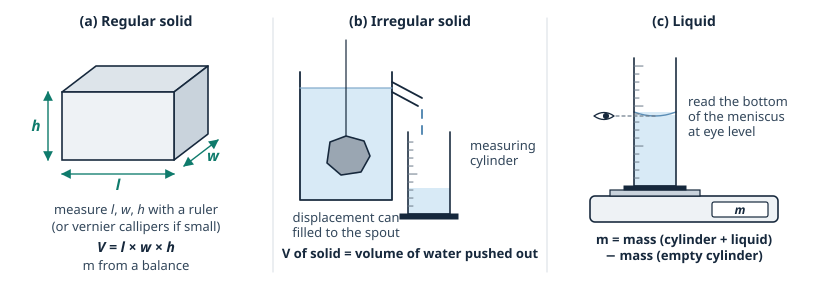
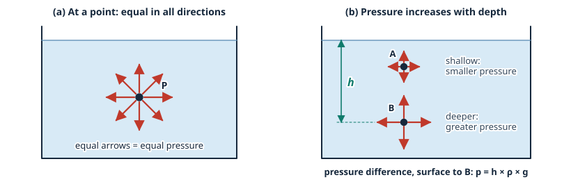

# Density and pressure

## Specification coverage

| Field | Value |
| --- | --- |
| Paper notes | Both papers; no `P` statements |
| Equations | ρ = *m*/*V*, *p* = *F*/*A* and *p* = *h* × ρ × *g* are all on the Appendix 7 list: **not given in the exam — recall them** |
| Source | 4PH1 specification, Issue 4, September 2024, p. 21; Appendix 7 |

| Point | Section |
| --- | --- |
| 5.3 know and use the relationship between density, mass and volume: density = mass/volume, ρ = m/V | 1 |
| 5.4 practical: investigate density using direct measurements of mass and volume | 2 |
| 5.5 know and use the relationship between pressure, force and area: pressure = force/area, p = F/A | 3 |
| 5.6 understand how the pressure at a point in a gas or liquid at rest acts equally in all directions | 4 |
| 5.7 know and use the relationship for pressure difference: pressure difference = height × density × gravitational field strength, p = h × ρ × g | 4 |

## 1. Density (5.3)

::: definition
**Density** — mass per unit volume.
:::

```
density = mass ÷ volume          ρ = m / V          recall — not given
ρ in kg/m³ (or g/cm³)    m in kg (or g)    V in m³ (or cm³)
```

Rearranged: *m* = ρ × *V* and *V* = *m* ÷ ρ. Density is a property of the **material**: half a
block has half the mass and half the volume, so the same density.

*Example.* A block 0.20 m × 0.10 m × 0.05 m has a mass of 2.7 kg.
*V* = 0.20 × 0.10 × 0.05 = 0.001 m³, so ρ = 2.7 ÷ 0.001 = **2700 kg/m³**.

## 2. Practical: investigating density (5.4)



*Figure 1. Measuring the mass and volume of (a) a regular solid, (b) an irregular solid, (c) a liquid.*

1. **Mass:** zero the balance, then weigh the object (for a liquid, use the difference in Figure 1c).
2. **Volume:**
    - regular solid — measure each dimension, at several places, and average; *V* = *l* × *w* × *h*;
    - irregular solid — fill the displacement can until water drips from the spout and stops; place
      an empty measuring cylinder under the spout; lower the object in fully on a thread; the volume
      of water collected = volume of the object. (If the object fits in a measuring cylinder:
      *V* = reading with object − reading without.)
    - liquid — read the volume from the measuring cylinder.
3. Calculate ρ = *m*/*V*.

Accuracy: read the **bottom of the meniscus at eye level**; lower the object gently so no water
splashes out; use the narrowest measuring cylinder that works (finer scale); repeat and average.

## 3. Pressure (5.5)

::: definition
**Pressure** — force per unit area, the force acting at right angles to the surface.
:::

```
pressure = force ÷ area          p = F / A          recall — not given
p in Pa (= N/m²)    F in N    A in m²
```

Same force, **smaller area → larger pressure** (a knife edge or pin point cuts or pierces);
**larger area → smaller pressure** (wide tyres and snowshoes do not sink into soft ground).

*Example.* A box of weight 120 N rests on a base 20 cm × 30 cm.
*A* = 600 cm² = 600 ÷ 10 000 = 0.060 m², so *p* = 120 ÷ 0.060 = **2000 Pa**.

## 4. Pressure in liquids and gases (5.6, 5.7)

**Equal in all directions (5.6).** The particles of a liquid or gas at rest move randomly in all
directions, so they hit a surface placed at any point equally from every direction. So the pressure
at a point is the **same in all directions** — sideways and upwards as well as downwards — and it
pushes at right angles on any surface it touches.



*Figure 2. (a) Pressure at a point acts equally in all directions. (b) Pressure increases with depth.*

**Increases with depth (5.7).** The deeper the point, the greater the weight of fluid above each
square metre, so the greater the pressure.

```
pressure difference = height × density × gravitational field strength
p = h × ρ × g                                          recall — not given
p in Pa    h = vertical height (depth) difference in m
ρ = density of the FLUID in kg/m³    g in N/kg (10 N/kg unless told otherwise)
```

- *p* depends only on the **vertical depth** and the fluid's density — not on the shape or width of
  the container.
- *h*ρ*g* is the pressure **due to the liquid**. The total pressure at depth *h* = pressure at the
  surface (atmospheric pressure) + *h*ρ*g*.

*Example.* A diver is 12 m below the surface of seawater (ρ = 1030 kg/m³).
*p* = 12 × 1030 × 10 = 123 600 Pa ≈ **1.2 × 10⁵ Pa** due to the water; with atmospheric pressure
(1.0 × 10⁵ Pa) the total is about **2.2 × 10⁵ Pa**.

## Common traps

| Wrong | Right |
| --- | --- |
| Area in cm² put straight into *p* = *F*/*A* | convert to m² first (÷ 10 000) |
| *h* measured along a slope or a pipe | *h* is the **vertical** depth |
| Using the density of the object in *p* = *h*ρ*g* | ρ is the density of the **liquid or gas** |
| "Pressure in a liquid only acts downwards" | at a point it acts **equally in all directions** |
