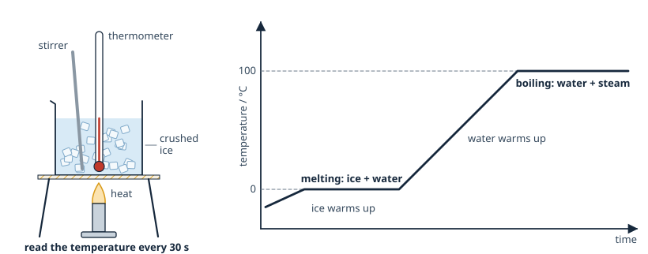
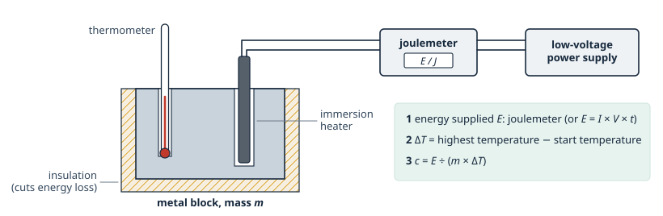

# Change of state

## Specification coverage

| Field | Value |
| --- | --- |
| Paper notes | **Every point is a `P` statement: Paper 2 only** |
| Equations | Δ*Q* = *m* × *c* × Δ*T* is not on the Appendix 7 list, so it is **given** in the exam; you must use and rearrange it |
| Source | 4PH1 specification, Issue 4, September 2024, p. 22; Appendix 7 |

| Point | Section |
| --- | --- |
| 5.8P explain why heating a system will change the energy stored within the system and raise its temperature or produce changes of state | 2 |
| 5.9P describe the changes that occur when a solid melts to form a liquid, and when a liquid evaporates or boils to form a gas | 3 |
| 5.10P describe the arrangement and motion of particles in solids, liquids and gases | 1 |
| 5.11P practical: obtain a temperature–time graph to show the constant temperature during a change of state | 2 |
| 5.12P know that specific heat capacity is the energy required to change the temperature of an object by one degree Celsius per kilogram of mass (J/kg °C) | 4 |
| 5.13P use the equation: change in thermal energy = mass × specific heat capacity × change in temperature, ΔQ = m × c × ΔT | 4 |
| 5.14P practical: investigate the specific heat capacity of materials including water and some solids | 5 |

## 1. Particles in solids, liquids and gases (5.10P) — Paper 2 only

| | Solid | Liquid | Gas |
| --- | --- | --- | --- |
| Arrangement | regular pattern | irregular | random |
| Spacing | very close, touching | close, mostly touching | far apart |
| Motion | vibrate about fixed positions | move around and slide past each other | move quickly and randomly in all directions |
| Forces between particles | hold particles in fixed positions | keep particles close but let them move | almost none |


*Figure 1. The three states and the changes between them.*

## 2. Heating: temperature rise or change of state (5.8P, 5.11P) — Paper 2 only

Heating a system transfers energy to it, so the **energy stored by its particles increases**.
That energy does one of two things:

- **no change of state** — the particles' **kinetic energy** increases (they vibrate or move
  faster), so the **temperature rises**. Temperature is a measure of the average kinetic energy of
  the particles.
- **during a change of state** — the energy **weakens or breaks the forces (bonds) between the
  particles**, increasing their potential energy, not their kinetic energy. So the **temperature
  stays constant** until the change of state is complete.



*Figure 2. Obtaining a temperature–time graph for water, starting as ice.*

::: note | Practical — temperature–time graph (5.11P)
1. Put crushed ice (from a freezer, below 0 °C) in a beaker with a thermometer.
2. Heat gently, stirring so the temperature is the same throughout; read the thermometer every
   30 s until the water has boiled for a few minutes.
3. Plot temperature (y-axis) against time (x-axis).

The graph is **flat at 0 °C while the ice melts** and **flat at 100 °C while the water boils**.
A cooling version (molten stearic acid left to cool) gives a flat section at its melting point as it
freezes.
:::

## 3. Melting, evaporating and boiling (5.9P) — Paper 2 only

- **Melting** (solid → liquid) — at the melting point the particles vibrate enough to **overcome
  some of the forces** holding them in fixed positions. They leave the regular pattern and can move
  past each other, but stay close together.
- **Boiling** (liquid → gas) — at the boiling point, particles gain enough energy to **overcome the
  forces between them completely**: they become far apart and move freely, forming bubbles of gas
  inside the liquid.
- **Evaporating** (liquid → gas) — the **fastest-moving particles at the surface** have enough
  energy to escape. The particles left behind have a lower average kinetic energy, so the **liquid
  cools**.

| | Evaporation | Boiling |
| --- | --- | --- |
| Where | at the surface only | throughout the liquid (bubbles) |
| Temperature | any temperature | only at the boiling point |
| Effect on the liquid | cools it | stays at the boiling point while heated |

The reverse changes — **condensing** and **freezing** — transfer energy **out** as the forces pull
the particles closer; the temperature is again constant during the change.

## 4. Specific heat capacity (5.12P, 5.13P) — Paper 2 only

::: definition
**Specific heat capacity** — the energy required to change the temperature of an object by one
degree Celsius per kilogram of mass. Unit: **J/kg °C**.
:::

```
change in thermal energy = mass × specific heat capacity × change in temperature
ΔQ = m × c × ΔT                                        given in the exam
ΔQ in J    m in kg    c in J/kg °C    ΔT in °C (a change of 1 °C = a change of 1 K)
rearranged:  c = ΔQ ÷ (m × ΔT)      ΔT = ΔQ ÷ (m × c)      m = ΔQ ÷ (c × ΔT)
```

A **large *c*** means a lot of energy is needed for each kilogram to warm by 1 °C, so the material
warms up — and cools down — slowly. Water: 4200 J/kg °C; aluminium: about 900 J/kg °C.

*Example.* Heating 0.50 kg of water from 20 °C to 80 °C:
Δ*Q* = 0.50 × 4200 × 60 = **126 000 J** (126 kJ).

## 5. Practical: investigating specific heat capacity (5.14P) — Paper 2 only



*Figure 3. Measuring the specific heat capacity of a metal block.*

1. Measure the mass *m* of the block on a balance.
2. Put the heater and thermometer in the holes (a drop of water in the thermometer hole improves
   thermal contact) and wrap the block in insulation.
3. Record the start temperature, zero the joulemeter and switch on for about 10 minutes.
4. Switch off and record the **highest** temperature reached — it keeps rising briefly as energy
   spreads through the block.
5. Calculate *c* as in Figure 3. Repeat for other solids (e.g. copper, iron). For **water**, use a
   known mass of water in an insulated beaker with a lid, and stir before each reading.

**Main error:** energy is lost to the surroundings, so the temperature rise is smaller than it
should be and the calculated *c* is **too high**. Insulation (and a lid for water) reduces this.

*Example.* A 1.0 kg aluminium block: joulemeter 18 000 J, temperature 20 °C → 38 °C.
*c* = 18 000 ÷ (1.0 × 18) = **1000 J/kg °C** — above the true value (about 900 J/kg °C) because
some energy was lost to the surroundings.

## Common traps

| Wrong | Right |
| --- | --- |
| "The temperature rises while the ice melts" | temperature is **constant** during a change of state |
| Using the final temperature as Δ*T* | Δ*T* = final − start temperature |
| Mass in grams in Δ*Q* = *m* × *c* × Δ*T* | mass in **kg** |
