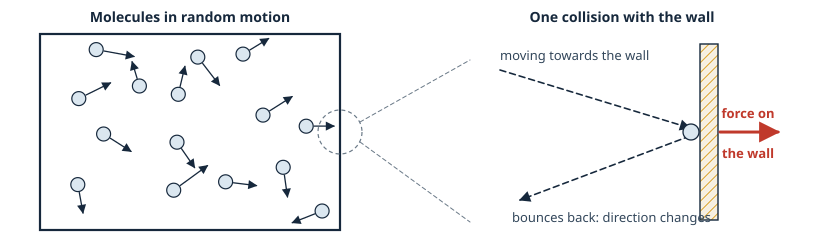

# Ideal gas molecules

## Specification coverage

| Field | Value |
| --- | --- |
| Paper notes | Both papers; no `P` statements |
| Equations | *p*₁/*T*₁ = *p*₂/*T*₂ and *p*₁*V*₁ = *p*₂*V*₂ are not on the Appendix 7 list, so they are **given** in the exam; you must use and rearrange them |
| Source | 4PH1 specification, Issue 4, September 2024, p. 22; Appendix 7 |

| Point | Section |
| --- | --- |
| 5.15 explain how molecules in a gas have random motion and that they exert a force, and hence a pressure, on the walls of a container | 1 |
| 5.16 understand why there is an absolute zero of temperature, which is –273 °C | 3 |
| 5.17 describe the Kelvin scale of temperature and be able to convert between the Kelvin and Celsius scales | 3 |
| 5.18 understand why an increase in temperature results in an increase in the average speed of gas molecules | 2 |
| 5.19 know that the Kelvin temperature of a gas is proportional to the average kinetic energy of its molecules | 2 |
| 5.20 explain, for a fixed amount of gas, the qualitative relationship between: pressure and volume at constant temperature; pressure and Kelvin temperature at constant volume | 4, 5 |
| 5.21 use the relationship between the pressure and Kelvin temperature of a fixed mass of gas at constant volume: p₁/T₁ = p₂/T₂ | 5 |
| 5.22 use the relationship between the pressure and volume of a fixed mass of gas at constant temperature: p₁V₁ = p₂V₂ | 4 |

## 1. How a gas exerts pressure (5.15)

- Gas molecules move **randomly**: in all directions, at a range of speeds, changing direction
  whenever they collide with each other or the walls.
- When a molecule hits a wall it bounces back, so its direction changes. The wall exerts a force on
  the molecule, and the molecule exerts an **equal and opposite force on the wall**.
- Huge numbers of molecules hit every part of the walls every second. The total force on each unit
  of area is the **gas pressure** (*p* = *F*/*A*). Because the motion is random, the pressure is the
  same on every wall.



*Figure 1. Random motion, and the force from one collision.*

## 2. Temperature and molecular speed (5.18, 5.19)

::: definition
**The Kelvin temperature of a gas is proportional to the average kinetic energy of its
molecules.** Double the temperature in K → double the average kinetic energy.
:::

Heating a gas gives its molecules more kinetic energy. Kinetic energy = ½ × mass × speed², and the
mass of a molecule does not change, so more kinetic energy means a **higher average speed**. So a
higher temperature means the molecules move faster on average.

## 3. Absolute zero and the Kelvin scale (5.16, 5.17)

**Why there is an absolute zero (5.16).** As a gas is cooled its molecules slow down: their kinetic
energy falls, and so does the pressure they exert. Kinetic energy cannot fall below zero, so there is
a **lowest possible temperature**, **absolute zero = −273 °C**, where the molecules have no kinetic
energy (they stop moving) and a gas would exert no pressure.

**The Kelvin scale (5.17)** starts at absolute zero (0 K), so it has no negative temperatures. A
step of 1 K is the same size as a step of 1 °C.

```
Kelvin temperature = Celsius temperature + 273          T = θ + 273
Celsius temperature = Kelvin temperature − 273          θ = T − 273
e.g.  27 °C = 300 K        400 K = 127 °C        0 K = −273 °C
```


*Figure 2. Extending the pressure–temperature line finds absolute zero.*

## 4. Pressure and volume at constant temperature (5.20, 5.22)


*Figure 3. Squashing a fixed mass of gas at constant temperature.*

**Explanation.** Smaller volume at constant temperature → the molecules' average speed is
unchanged, but the same molecules are in a smaller space → they **hit each unit area of the walls
more often** → greater force per unit area → **pressure increases**.

```
p₁ × V₁ = p₂ × V₂          fixed mass of gas, constant temperature      given in the exam
any units, as long as p₁ and p₂ match and V₁ and V₂ match
```

*Example.* 150 cm³ of gas at 100 kPa is compressed slowly (constant temperature) to 60 cm³.
*p*₂ = *p*₁*V*₁ ÷ *V*₂ = 100 × 150 ÷ 60 = **250 kPa**.

## 5. Pressure and temperature at constant volume (5.20, 5.21)

**Explanation.** Raise the temperature at constant volume → the molecules move **faster** → they hit
the walls **more often** and **harder** (a bigger force in each collision) → the **pressure
increases**. Pressure is proportional to the **Kelvin** temperature (the line in Figure 2 reaches
zero at 0 K).

```
p₁ / T₁ = p₂ / T₂          fixed mass of gas, constant volume      given in the exam
T MUST be in kelvin (K);  p₁ and p₂ in the same unit
```

*Example.* A tyre at 240 kPa warms from 17 °C to 47 °C (constant volume): *T*₁ = 290 K,
*T*₂ = 320 K, so *p*₂ = 240 × 320 ÷ 290 = **265 kPa**.

## Common traps

| Wrong | Right |
| --- | --- |
| Putting °C into *p*₁/*T*₁ = *p*₂/*T*₂ | convert to **K** first (+ 273) |
| "20 °C → 40 °C doubles the pressure" | only doubling the **Kelvin** temperature does (293 K → 313 K is small) |
| "Squashed molecules hit the walls harder" (constant *T*) | same speed — they hit **more often** |
