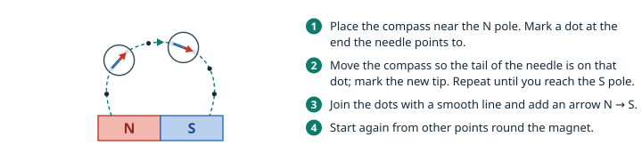

# Magnetism

## Specification coverage

| Point | Section |
| --- | --- |
| 6.2 magnets repel and attract other magnets and attract magnetic substances | 1 |
| 6.3 properties of magnetically hard and soft materials | 2 |
| 6.4 the term 'magnetic field line' | 3 |
| 6.5 magnetism is induced in some materials placed in a magnetic field | 1 |
| 6.6 practical: field pattern for a bar magnet and between two bar magnets | 4 |
| 6.7 using two permanent magnets to produce a uniform field | 5 |
| No `P` statements; no equations | — |

## 1. Forces between magnets; induced magnetism (6.2, 6.5)

*Figure 1. Forces between two magnets, and between a magnet and a piece of iron.*

- A magnet has a **north (N)** and a **south (S)** pole. **Like poles repel; unlike poles attract.**
- A magnet **attracts magnetic substances** — **iron, steel, nickel and cobalt** — with either
  pole. Other materials (copper, aluminium, plastic, wood) are not attracted.

::: definition
**Induced magnetism** — a magnetic material placed in a magnetic field becomes a magnet itself.
The end nearest the magnet becomes the **opposite** pole, so the material is **attracted**.
:::

Induced magnetism always gives attraction, so **only repulsion proves that an object is a magnet**.

## 2. Magnetically hard and soft materials (6.3)

| | Magnetically **soft** — e.g. iron | Magnetically **hard** — e.g. steel |
| --- | --- | --- |
| Magnetising | **easy** to magnetise | **hard** to magnetise |
| When the field is removed | **loses** its magnetism easily — a temporary magnet | **keeps** its magnetism — a permanent magnet |
| Used for | cores of electromagnets and transformers (→ 6.9, 6.17) | permanent magnets, e.g. in motors and loudspeakers |

## 3. Magnetic field lines (6.4)

::: definition
**Magnetic field** — the region around a magnet where a magnetic material or another magnet
experiences a force.

**Magnetic field line** — a line showing the direction of the force on a **north pole** placed at
that point: the direction a plotting compass needle points.
:::

- Outside a magnet, field lines go **from N to S**.
- The **closer together** the lines, the **stronger** the field — strongest at the poles.
- Lines **never cross**: the field has only one direction at each point.

## 4. Practical: plotting field patterns (6.6)

*Figure 2. Plotting a field line with a plotting compass.*

For two magnets, place them a few centimetres apart with the poles facing and plot the same way.

**Iron filings** are quicker: lay paper over the magnet, sprinkle filings and tap the paper gently.
The filings line up along the field lines and show the whole pattern at once, but **not the
direction** — add the arrows with a compass.

*Figure 3. The field patterns you should be able to draw.*

## 5. A uniform magnetic field (6.7)

A **uniform** field has the same strength and direction everywhere, so its field lines are
**straight, parallel and equally spaced**.

To produce one, place two permanent magnets with **opposite poles facing** (N facing S),
**close together**, with their **flat pole faces parallel** (Figure 3b). The field in the gap is
uniform; it bulges outwards only at the edges.

::: traps
- "Soft" and "hard" describe **magnetic** behaviour, not how hard the metal is.
- A plotting compass shows the **direction** of the field; iron filings show only the **pattern**.
:::
