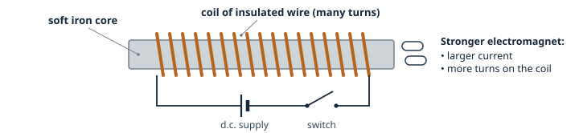

# Electromagnetism

## Specification coverage

| Point | Section |
| --- | --- |
| 6.8 a current in a conductor produces a magnetic field around it | 1 |
| 6.9P construction of electromagnets | 3 |
| 6.10P draw field patterns for a straight wire, a flat circular coil and a solenoid | 2 |
| 6.11P force on a charged particle moving in a magnetic field, unless parallel to the field | 4 |
| 6.12 why a current-carrying wire in a field feels a force; d.c. motors and loudspeakers | 4, 7, 8 |
| 6.13 left-hand rule for the direction of the force | 5 |
| 6.14 how the force changes with the size and direction of the field and current | 6 |
| 6.9P, 6.10P, 6.11P are Paper 2 only; no equations | — |

## 1. The magnetic field of a current (6.8)

A current in any conductor produces a **magnetic field around it**. The field disappears when the
current stops, reverses when the current reverses, and is stronger when the current is larger.

## 2. Field patterns of a wire, a coil and a solenoid (6.10P) — Paper 2 only

In diagrams, **⊙** is a current coming **out of** the page and **⊗** a current going **into** it.

*Figure 1. Magnetic fields of a current-carrying wire, flat coil and solenoid.*

- **Straight wire:** concentric circles, further apart further from the wire (weaker field).
  **Right-hand grip rule:** thumb along the current; your fingers curl the way the field goes.
- **Flat circular coil:** through the centre the lines all point the same way.
- **Solenoid** (a long coil): the end the field lines come out of is the **N pole**; reversing
  the current swaps the poles.

## 3. Electromagnets (6.9P) — Paper 2 only

An electromagnet is a **coil of insulated wire** (a solenoid) wrapped round a **soft iron core**,
connected to a **d.c. supply** through a **switch**.

- **Insulated** wire, so the current flows round every turn instead of across touching turns.
- **Soft iron** core: magnetised strongly by the coil's field, making the magnet much stronger,
  and it **loses its magnetism when the current is switched off** (→ 6.3). A steel core would
  stay magnetised.

*Figure 2. Construction of an electromagnet.*

## 4. Why there is a force: moving charges in a field (6.11P, 6.12)

**6.11P — Paper 2 only.** A charged particle moving through a magnetic field feels a **force**,
as long as its motion is **not parallel** to the field. The force is largest when it moves at
right angles to the field and zero when it moves along the field lines.

**6.12.** A current is a flow of charged particles (electrons in a metal, → 2.16), so a
current-carrying wire in a magnetic field feels a force — the **motor effect**:

1. the current produces its own **circular magnetic field** around the wire;
2. this field **interacts** with the field of the magnet — on one side of the wire the two fields
   are in the same direction and **add** (strong field), on the other side they are opposite and
   **partly cancel** (weak field);
3. the wire is pushed from the **strong** side towards the **weak** side — a force at right
   angles to both the field and the current.

*Figure 3. The combined field pushes the wire (a); the left-hand rule gives the direction (b).*

## 5. Direction of the force: the left-hand rule (6.13)

Hold the thumb, first finger and second finger of your **left** hand at right angles
(Figure 3b): **F**irst finger = **F**ield (N to S), se**C**ond finger = **C**urrent (+ to −),
thu**M**b = **M**otion (the force).

*Example:* field pointing down the page (N above, S below), current flowing left to right across
it → the force is **into the page**.

## 6. Size and direction of the force (6.14)

| Change | Effect on the force |
| --- | --- |
| larger current | larger force |
| stronger magnetic field | larger force |
| reverse the current **or** reverse the field | force reverses |
| reverse **both** | force in the original direction |
| current parallel to the field | no force (largest when at right angles) |

## 7. The d.c. motor (6.12)

- The two sides of the coil carry current in **opposite directions**, so one side is pushed **up**
  and the other **down** (Figure 4a) → a **turning effect** → the coil on its axle rotates.
- After half a turn the forces would turn the coil back. The **split-ring commutator** reverses
  the current in the coil **every half turn**, so the side on the left always has current in the
  same direction and the coil keeps turning the **same way**. **Brushes** press on the
  commutator to keep contact as it spins.
- **Faster** motor: larger current, stronger magnetic field, more turns on the coil.
- **Reverse** the rotation: reverse the current or the field.

*Figure 4. A simple d.c. motor.*

## 8. The loudspeaker (6.12)

*Figure 5. A loudspeaker.*

A **larger** current gives larger vibrations → a **louder** sound; a **higher-frequency** a.c.
gives a **higher-pitched** sound.

::: traps
- Use the **left** hand for the force (motor effect). The **right**-hand grip rule is only for the
  field direction around a current.
- The second finger is the current from **+ to −**, not the direction electrons move.
:::
