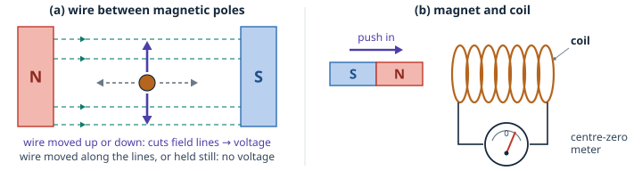
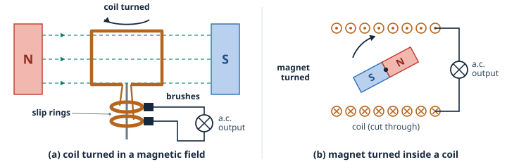

# Electromagnetic induction

## Specification coverage

| Point | Section |
| --- | --- |
| 6.15 voltage induced when a conductor moves through a field or the field through a coil changes; factors affecting its size | 1 |
| 6.16 generation by rotating a magnet in a coil and a coil in a field; factors affecting the voltage | 2 |
| 6.17P structure of a transformer; different numbers of turns change the size of an alternating voltage | 3 |
| 6.18P step-up and step-down transformers in large-scale generation and transmission | 5 |
| 6.19P *V*p/*V*s = *N*p/*N*s | 4 |
| 6.20P input power = output power, *V*p*I*p = *V*s*I*s for 100% efficiency | 4 |
| 6.17P–6.20P are Paper 2 only; both equations must be recalled | — |

## 1. Inducing a voltage (6.15)

::: definition
**Electromagnetic induction** — a voltage is induced across a conductor when it **moves through a
magnetic field** (cutting field lines) or when the **magnetic field through a coil changes**. If
the conductor is part of a complete circuit, the induced voltage drives a current.
:::

A voltage is induced **only while** field lines are being cut or the field is changing. Reversing
the motion or the field reverses the voltage.

::: note | Size of the induced voltage — increase it by
- moving the conductor or magnet **faster**, so field lines are cut or the field changes more
  quickly;
- a **stronger** magnet (stronger magnetic field);
- **more turns** on the coil.
:::

*Figure 1. Two ways to induce a voltage.*

| What you do (Figure 1b) | Meter |
| --- | --- |
| push the N pole into the coil | deflects one way |
| hold the magnet still inside the coil | **zero** — nothing is changing |
| pull the N pole out | deflects the **other** way |
| push the S pole in | deflects the other way |
| push the N pole in **faster** | **larger** deflection |

## 2. Generators (6.16)

- **Coil turned in a magnetic field (a):** the sides of the coil cut the field lines, inducing a
  voltage. Every half turn each side moves the opposite way through the field, so the voltage
  **reverses** — the output is **alternating** (a.c.). **Slip rings** and **brushes** connect the
  turning coil to the circuit without twisting the wires.
- **Magnet turned inside a coil (b):** the field through the fixed coil keeps changing and reverses
  every half turn, so an alternating voltage is induced in the coil.

*Figure 2. Two generators: coil turned in a field (a); magnet turned in a coil (b).*

*Figure 3. Generator output voltage against time.*

The **same three factors** increase a generator's voltage. Turning faster also raises the
**frequency** (Figure 3).

## 3. Transformers: structure and action (6.17P) — Paper 2 only

A transformer is two coils of insulated wire — the **primary** (input) and the **secondary**
(output) — wound on the same **soft iron core**. The coils are **not connected** to each other;
energy is passed by the changing magnetic field in the core. Soft iron is used because it
magnetises and demagnetises easily as the field reverses.

- **Step-up:** more turns on the secondary (*N*s > *N*p) → output voltage
  **larger** than input.
- **Step-down:** fewer turns on the secondary (*N*s < *N*p) → output voltage
  **smaller**.

A transformer only works with **a.c.** A direct current gives a steady field in the core, which
induces no voltage in the secondary.

*Figure 4. A transformer and how it works.*

## 4. Transformer equations (6.19P, 6.20P) — Paper 2 only

::: note | Equations — recall both; they are not given in the exam
***V*p / *V*s = *N*p / *N*s** — input (primary) voltage ÷ output (secondary) voltage = primary turns ÷ secondary turns

***V*p × *I*p = *V*s × *I*s** — input power = output power (for 100% efficiency)

*V*p, *V*s = primary and secondary voltages (V) · *N*p,
*N*s = numbers of turns (no unit) · *I*p, *I*s = primary and
secondary currents (A). Keep primary over secondary on **both** sides.
:::

::: note | Worked example
A transformer changes 230 V to 11.5 V. The primary has 2000 turns and the secondary current is
4.0 A.

- Secondary turns: *N*s = *N*p × *V*s ÷ *V*p
  = 2000 × 11.5 ÷ 230 = **100 turns**
- Primary current: *I*p = *V*s*I*s ÷ *V*p
  = 11.5 × 4.0 ÷ 230 = **0.20 A**
:::

Power in = power out, so if a transformer **raises the voltage it lowers the current** by the same
factor. It cannot give out more power than it takes in.

## 5. Transformers in transmission (6.18P) — Paper 2 only

1. A **step-up** transformer at the power station raises the voltage to a very high value.
2. For the same power (*P* = *V* × *I*), a higher voltage means a **smaller current** in the cables.
3. A smaller current **heats the cables less**, so **less energy is wasted** during transmission.
4. A **step-down** transformer near homes lowers the voltage to a **safe** value (230 V mains).

*Figure 5. Transformers between the power station and homes.*
