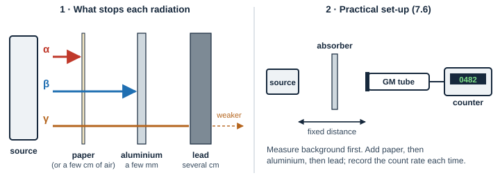
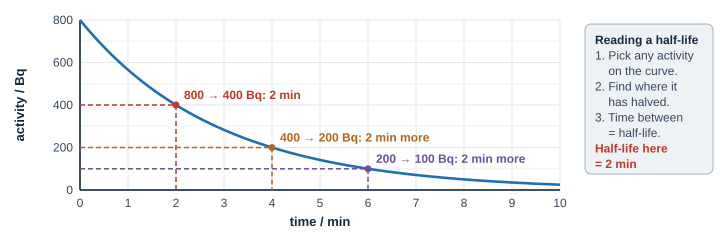

# Radioactivity

## Specification coverage

| Point | Section |
| --- | --- |
| 7.2 structure of the atom; symbols such as 146C | 1 |
| 7.3 atomic (proton) number, mass (nucleon) number, isotope | 1 |
| 7.4 α, β⁻, γ are ionising radiations emitted from unstable nuclei in a random process | 2 |
| 7.5 nature of α, β⁻, γ; distinguished by penetrating power and ionising ability | 3 |
| 7.6 practical: penetration powers, with sources or simulations | 4 |
| 7.7 effect of α, β, γ and neutron emission on atomic and mass numbers | 5 |
| 7.8 balance nuclear equations in terms of mass and charge | 5 |
| 7.9 photographic film or a Geiger–Müller detector detect ionising radiation | 6 |
| 7.10 sources of background radiation from Earth and space | 6 |
| 7.11 activity decreases with time; measured in becquerels | 7 |
| 7.12 definition of half-life; different for different isotopes | 7 |
| 7.13 half-life calculations on activity, including graphical methods | 7 |
| 7.14 uses in industry and medicine | 8 |
| 7.15 contamination vs irradiation | 9 |
| 7.16 dangers: mutations; damage to cells and tissue; disposal of waste and reducing the risks | 10 |
| No `P` statements; no equations to recall | — |

## 1. Atoms, nuclei and isotopes (7.2, 7.3)

*Figure 1. The structure of an atom, and how its nucleus is written.*

| Particle | Where | Relative mass | Relative charge |
| --- | --- | --- | --- |
| proton | nucleus | 1 | +1 |
| neutron | nucleus | 1 | 0 |
| electron | orbiting the nucleus | very small (about 1/2000) | −1 |

A neutral atom has **equal numbers of protons and electrons**. The nucleus is tiny compared with
the atom but holds almost all its mass.

::: definition
**Atomic (proton) number, Z** — the number of protons in the nucleus.

**Mass (nucleon) number, A** — the total number of protons **and** neutrons in the nucleus.

**Isotopes** — atoms of the **same element** (same number of protons) with **different numbers of
neutrons**, so different mass numbers.
:::

Carbon-12 (126C: 6 protons, 6 neutrons) and carbon-14
(146C: 6 protons, 8 neutrons) are isotopes of carbon. The proton number
decides which element it is; the neutron number can vary.

## 2. Radioactive decay (7.4)

Some nuclei are **unstable**. An unstable nucleus becomes more stable by **emitting radiation**:
**alpha (α) particles**, **beta (β⁻) particles** or **gamma (γ) rays**. All three are
**ionising** — they knock electrons out of atoms they pass, turning them into ions.

Decay is **random**: you cannot predict **which** nucleus will decay next or **when**, and nothing
outside (temperature, pressure, chemical change) alters the rate. So counts fluctuate — measure over
a long time and repeat, then average.

## 3. Alpha, beta and gamma (7.5)

| | Alpha (α) | Beta (β⁻) | Gamma (γ) |
| --- | --- | --- | --- |
| **Nature** | **2 protons + 2 neutrons** (a helium nucleus) | a **high-speed electron** emitted **from the nucleus** | **electromagnetic wave** of very high frequency |
| **Charge** | +2 | −1 | 0 |
| **Mass** | 4 (relative) | very small | none |
| **Symbol** | 42He or 42α | 0−1e or 0−1β | γ |
| **Ionising power** | **strong** | moderate | **weak** |
| **Penetrating power** | **weak** — stopped by paper, skin or a few cm of air | moderate — stopped by a few mm of aluminium | **strong** — only reduced by several cm of lead or thick concrete |

**Why the order reverses.** Alpha ionises most strongly, so it gives up its energy in the shortest
distance and penetrates least. Gamma ionises weakly, so it travels furthest.

*Figure 2. How far each radiation penetrates, and the practical used to show it.*

## 4. Practical: penetrating power (7.6)

1. Measure the **background count** with no source present (section 6).
2. Place the source a **fixed distance** from the GM tube (Figure 2); record the count over a fixed
   time with no absorber.
3. Repeat with **paper**, then **aluminium** of increasing thickness, then **lead** between them.
4. **Subtract background** from every count. Repeat and average — decay is random.

**Interpreting.** Corrected count rate falls to about zero with **paper** → α; paper makes no
difference but **a few mm of aluminium** stops it → β; only **lead** reduces it, and not to zero → γ.

Independent variable: absorber (material and thickness). Dependent: count rate. Control: distance,
source, counting time. A **simulation** is used the same way when sources are not available.

**Safety:** handle the source with **tongs**, point it away from people, keep **exposure time
short** and **distance large**, and return it to its **lead-lined box** straight after use.

## 5. What each emission does to the nucleus (7.7, 7.8)

| Emission | What leaves the nucleus | Mass number A | Atomic number Z |
| --- | --- | --- | --- |
| alpha | 2 protons + 2 neutrons | **−4** | **−2** (new element) |
| beta⁻ | an electron — a **neutron turns into a proton** | unchanged | **+1** (new element) |
| gamma | energy only | unchanged | unchanged |
| neutron | one neutron | **−1** | unchanged (an isotope of the same element) |

**Balancing a nuclear equation.** The **top numbers** (mass) and the **bottom numbers** (charge) must
each add up to the same total on both sides.

*Figure 3. Balancing mass (top numbers) and charge (bottom numbers).*

::: note | Worked example
Radium-226 (Z = 88) emits an alpha particle. Find the daughter nucleus.

Mass: 226 − 4 = **222**. Charge: 88 − 2 = **86**. So the product is 22286X —
element 86, radon.
:::

## 6. Detecting radiation; background radiation (7.9, 7.10)

**Detectors.** A **Geiger–Müller (GM) tube** connected to a counter records each ionising event,
giving a count or count rate. **Photographic film** darkens where radiation strikes it — the more
radiation, the darker (used in badges worn by workers).

**Background radiation** is the low level of ionising radiation around us all the time.

- **From Earth:** **radon gas**, which seeps out of rocks such as granite and collects in buildings,
  where it is breathed in — the largest source; radioactive isotopes in **rocks, soil and building
  materials**; and in **food and drink**, so inside our bodies.
- **From space:** **cosmic rays** — high-energy particles from the Sun and beyond. The atmosphere
  absorbs most of them, so the dose is **higher at altitude** and on flights.
- Smaller man-made contributions: medical X-rays and the nuclear industry.

Always measure the background count rate first and **subtract it** from every reading.

## 7. Activity and half-life (7.11–7.13)

The **activity** of a source is the number of nuclei that decay each second, in **becquerels
(Bq)**. As unstable nuclei decay, fewer are left to decay, so the **activity decreases** over time.

::: definition
**Half-life** — the time taken for **half the unstable nuclei** in a sample to decay, or for the
**activity** (count rate) of a sample to **fall to half** its initial value.
:::

Each isotope has its **own** half-life — from fractions of a second to thousands of millions of
years. The half-life is constant: every halving takes the same time, whatever the starting activity.

*Figure 4. Finding a half-life from a decay curve (graphical method).*

::: note | Method
After **n half-lives** the activity is the starting value halved **n** times: 1/2, 1/4, 1/8, 1/16 …
Halve step by step and count the steps.

**Example 1.** Activity falls from 640 Bq to 40 Bq in 32 days. 640 → 320 → 160 → 80 → 40 is
**4 half-lives** in 32 days, so the half-life = 32 ÷ 4 = **8 days**.

**Example 2 — with background.** Measured count rate 1650 counts/min; background 50 counts/min;
half-life 6 h. Find the measured count rate 18 h later.

- Corrected rate: 1650 − 50 = **1600** counts/min.
- 18 h ÷ 6 h = **3 half-lives**: 1600 → 800 → 400 → **200** counts/min.
- Add the background back for the reading you would see: 200 + 50 = **250 counts/min**.
:::

## 8. Uses in industry and medicine (7.14)

The choice of radiation depends on **how far it must penetrate**; the choice of isotope depends on
its **half-life**.

| Use | Radiation | Why this choice |
| --- | --- | --- |
| **Radiotherapy** — killing cancer cells | γ | beams from outside the body penetrate to the tumour; aimed from several directions so the tumour gets the largest dose |
| **Medical tracer** — injected or swallowed to image an organ | γ, **short half-life** (hours) | passes out of the body to a detector (gamma camera); activity dies away quickly, limiting the dose |
| **Sterilising** medical equipment and food | γ | kills bacteria even through sealed packaging; the object does **not** become radioactive |
| **Thickness gauging** of paper or metal foil | β | partly absorbed, so the count rate through the sheet changes with its thickness and the rollers are adjusted; **long half-life** so the count does not drift |
| **Leak detection** in underground pipes | γ, short half-life | passes up through the soil; the count rises where tracer escapes |
| **Smoke detectors** | α | ionises the air in a gap so a small current flows; smoke absorbs the α, the current falls and the alarm sounds; **long half-life** |

## 9. Contamination and irradiation (7.15)

| | **Irradiation** | **Contamination** |
| --- | --- | --- |
| What happens | the object is **exposed to radiation** from a source **outside** it | **radioactive material** gets **onto or into** the object |
| Does the object become radioactive? | **no** | yes — it carries the radioactive atoms |
| When does exposure stop? | as soon as the source is **removed or shielded** | only when the material is **removed** or has **decayed** — it may keep irradiating for a long time |

## 10. Dangers of ionising radiation (7.16)

- **Mutations.** Ionising radiation can damage the **DNA** in cells, causing **mutations**; these
  can make cells divide uncontrollably — **cancer**.
- **Damage to cells and tissue.** Large doses **kill cells** or damage tissue (radiation burns,
  radiation sickness).
- **Inside or outside the body.** Outside, **β and γ** are the danger because they penetrate skin; α
  is stopped by the skin. **Inside** (breathed in or swallowed), **α is the most dangerous**: it is
  strongly ionising and all its energy is absorbed by nearby cells.

**Radioactive waste.** Used fuel and waste from reactors and hospitals stays radioactive for
**thousands of years** (long half-lives) and must not reach **water supplies**, people or the food
chain. The risks are reduced by:

- sealing high-level waste in **glass and steel containers** and storing it **deep underground** in
  geologically stable rock, **shielded** and **monitored** for leaks;
- packing low-level waste (gloves, clothing) into sealed containers in secure disposal sites;
- keeping it **secure** so it cannot be stolen or misused.

::: traps
| Wrong | Right |
| --- | --- |
| Beta particles come from the electron shells. | A β⁻ particle is an electron made in the **nucleus** when a neutron turns into a proton. |
| Isotopes have different numbers of protons. | Same protons (same element), **different neutrons**. |
| In beta decay the mass number falls by 1. | Mass number **unchanged**; atomic number **+1**. |
| Halving from the raw count rate. | **Subtract background first**, then halve. |
| Half-life is half the time the sample lasts. | It is the time for the **activity (or number of undecayed nuclei) to halve** — the sample never decays to exactly zero. |
| An irradiated object becomes radioactive. | Only **contamination** makes it radioactive. |
| α is the least dangerous in every case. | Outside the body, yes; **inside**, α is the **most** dangerous. |
:::
