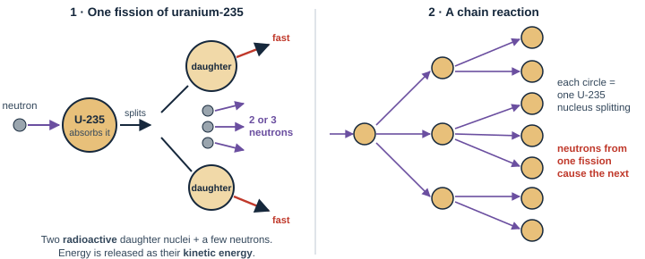
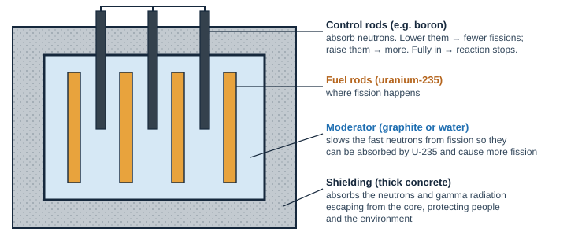

# Fission and fusion

## Specification coverage

| Point | Section |
| --- | --- |
| 7.17 fission, fusion and radioactive decay can be a source of energy | 1 |
| 7.18 U-235 split by collision with a neutron; energy released as kinetic energy of the fission products | 2 |
| 7.19 fission of U-235 gives two radioactive daughter nuclei and a small number of neutrons | 2 |
| 7.20 chain reaction when neutrons from one fission strike other U-235 nuclei | 2 |
| 7.21 role of control rods and moderator | 3 |
| 7.22 role of shielding around a reactor | 3 |
| 7.23 difference between fusion and fission | 5 |
| 7.24 fusion: larger nuclei made from smaller ones, loss of mass, release of energy | 4 |
| 7.25 fusion is the energy source for stars | 4 |
| 7.26 fusion needs high temperature and pressure because of electrostatic repulsion of protons | 4 |
| No `P` statements; no equations to recall | — |

## 1. Nuclear reactions release energy (7.17)

Three kinds of nuclear reaction release energy: **fission** (a large nucleus splits), **fusion**
(small nuclei join) and **radioactive decay** (Topic 7(b)). Fission is used in nuclear power
stations (Topic 4); fusion powers the stars.

## 2. Fission and the chain reaction (7.18–7.20)

*Figure 1. Fission of one U-235 nucleus, and how its neutrons set up a chain reaction.*

1. A **neutron** collides with a **uranium-235** nucleus and is absorbed; the nucleus becomes unstable.
2. It **splits** into **two smaller daughter nuclei**, which are **radioactive**, and releases a
   small number of **neutrons** (usually 2 or 3).
3. The energy released is carried as **kinetic energy of the fission products** — the daughter
   nuclei and neutrons fly apart at high speed.

**Chain reaction.** The neutrons released can strike **other U-235 nuclei** and make them split,
each releasing more neutrons, and so on. If, on average, **one** neutron from each fission causes
another fission, the reaction proceeds at a **steady** rate (a reactor). If more than one does, the
number of fissions grows rapidly and the reaction runs out of control.

## 3. Controlling fission in a reactor (7.21, 7.22)

*Figure 2. The core of a nuclear reactor and the job of each part.*

- **Moderator** (graphite or water). The neutrons from fission are **too fast** to be absorbed
  easily by U-235. Colliding with the moderator's nuclei **slows them down**, so they are much more
  likely to cause further fission. The moderator keeps the chain reaction **going**.
- **Control rods** (e.g. boron). They **absorb neutrons**, removing them from the chain reaction.
  Lowering them further in → fewer neutrons → fewer fissions → less energy released; raising them
  → more. Fully inserted, they **stop** the reaction. They keep the reaction **steady** (one
  neutron per fission going on to cause another).
- **Shielding** (thick concrete, with a steel vessel). The core emits **neutrons and gamma
  radiation**. The shielding **absorbs** this ionising radiation so it cannot reach workers or the
  environment.

## 4. Fusion (7.24–7.26)

*Figure 3. Fusion releases energy, but only when nuclei collide fast and often enough.*

**Nuclear fusion** is the joining of **small (light) nuclei** to form a **larger** nucleus. The
mass of the products is **less** than the total mass of the nuclei that fused; this **loss of
mass** is released as **energy**.

**Stars.** Fusion is the **energy source of stars**: in the Sun's core, hydrogen nuclei fuse to
form helium.

**Why fusion needs very high temperature and pressure.** Nuclei contain protons, so they are all
**positively charged** and **repel** each other (**electrostatic repulsion**). To fuse, they must
get very close.

- At **low temperatures** the nuclei move too slowly — they are pushed apart before they can get
  close enough to fuse.
- At **very high temperatures** (millions of °C) the nuclei move **fast enough to overcome the
  repulsion** and fuse.
- **Very high pressure** squeezes the nuclei close together, so these collisions happen **often
  enough** for the reaction to keep going.

## 5. Fission and fusion compared (7.23)

| | **Fission** | **Fusion** |
| --- | --- | --- |
| What happens | a **large** nucleus (U-235) **splits** into two smaller ones | **small** nuclei (hydrogen) **join** into a larger one |
| How it starts | a nucleus absorbs a **neutron** | nuclei collide at **very high temperature and pressure** |
| Products | two **radioactive** daughter nuclei + neutrons | a larger nucleus, e.g. helium (not radioactive) |
| Where | nuclear reactors (power stations) | stars |

::: traps
| Wrong | Right |
| --- | --- |
| Fission is started by heating the uranium. | It is started by a **neutron** being absorbed. |
| Control rods slow the neutrons down. | That is the **moderator**. Control rods **absorb** neutrons. |
| The moderator stops the reaction. | The moderator makes fission **more** likely; the **control rods** reduce or stop it. |
| Fusion happens at room temperature if the nuclei touch. | They cannot get close: **electrostatic repulsion** between protons pushes them apart unless they are moving very fast. |
| Fusion splits helium into hydrogen. | Fusion **joins** light nuclei; **fission** splits heavy ones. |
:::
