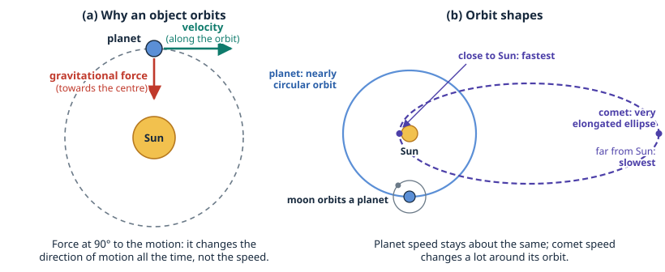

# Motion in the universe

## Specification coverage

| Field | Value |
| --- | --- |
| Qualification | Pearson Edexcel International GCSE Physics 4PH1 (separate science) |
| Specification points | 8.2–8.6 |
| Paper notes | Both papers. No `P` statements |
| Equations | *v* = 2π*r*/*T* is a "use" point and **not** on the Appendix 7 recall list, so it is given in the exam; you must be able to rearrange it |
| Source | 4PH1 specification, Issue 4, September 2024, p. 27; Appendix 7 |

| Point | Section |
| --- | --- |
| 8.2 know that the universe is a large collection of billions of galaxies; a galaxy is a large collection of billions of stars; our solar system is in the Milky Way galaxy | 1 |
| 8.3 understand why gravitational field strength, g, varies and know that it is different on other planets and the Moon from that on the Earth | 2 |
| 8.4 explain that gravitational force causes moons to orbit planets, planets to orbit the Sun, artificial satellites to orbit the Earth, comets to orbit the Sun | 3 |
| 8.5 describe the differences in the orbits of comets, moons and planets | 4 |
| 8.6 use orbital speed = 2π × orbital radius / time period, v = 2πr/T | 5 |

## 1. Stars, galaxies and the universe (8.2)

- A **galaxy** is a large collection of **billions of stars**, held together by gravity.
- The **universe** is a large collection of **billions of galaxies**.
- Our **solar system** (the Sun and everything orbiting it) is in the **Milky Way** galaxy.

## 2. Gravitational field strength varies (8.3)

Gravitational field strength *g* is the gravitational force on each kilogram of mass (N/kg). On
the surface of a planet or moon it depends on two things:

- the **mass** of the planet or moon — more mass gives a stronger pull, so a larger *g*;
- the **distance from its centre** — *g* gets weaker further from the centre, so it is smaller
  for a planet with a larger radius (same mass) and smaller at the height of a satellite than on
  the ground.

So *g* is different on every planet and moon. Your **mass stays the same** everywhere; your
**weight** (*W* = *m* × *g*, → 1.18) changes with *g*.

| Place | *g* at the surface (N/kg) |
| --- | --- |
| Earth | 10 (9.8) |
| Moon | 1.6 |
| Jupiter | 25 |

The Moon has a much smaller mass than the Earth, so its *g* is about one-sixth of the Earth's.

## 3. Gravity causes orbits (8.4)

*Figure 1. (a) The force on an orbiting object points to the centre of the orbit. (b) Planet, moon and comet orbits.*

An orbiting object is moving fast. The **gravitational force** from the larger body pulls it
**towards the centre** of that body, at right angles to its motion. The force does not speed it up
or slow it down; it **continually changes its direction**, so the path curves round into an orbit.
Without gravity the object would carry on in a straight line.

The same explanation works for every orbit — only the body doing the pulling changes:

- **moons** orbit planets — gravitational force of the **planet**;
- **planets** and **comets** orbit the Sun — gravitational force of the **Sun**;
- **artificial satellites** orbit the Earth — gravitational force of the **Earth**.

## 4. Orbits of planets, moons and comets (8.5)

| | Planets | Moons | Comets |
| --- | --- | --- | --- |
| Orbit around | the Sun | a planet | the Sun |
| Shape | nearly circular (slightly elliptical) | nearly circular | **highly elliptical** (very elongated) |
| Speed | almost constant | almost constant | **changes**: fastest close to the Sun, slowest far away |
| Plane of orbit | all in roughly the same plane | — | can be at any angle to the planets' plane |

## 5. Orbital speed (8.6)

::: note | Equation — given in the exam
**orbital speed = (2 × π × orbital radius) ÷ time period     *v* = 2π*r* / *T***

*v* in m/s · *r* in m (from the centre of the body being orbited) · *T* in s.
2π*r* is the distance round one circular orbit, travelled in one time period.
Rearranged: *T* = 2π*r* / *v* and *r* = *vT* / 2π.
:::

::: note | Worked example
The Earth orbits the Sun at a radius of 1.5 × 10¹¹ m in 1 year (3.15 × 10⁷ s).
*v* = 2π*r* / *T* = (2 × π × 1.5 × 10¹¹) ÷ 3.15 × 10⁷ = **3.0 × 10⁴ m/s** (30 km/s)
:::

::: traps
| Wrong | Right |
| --- | --- |
| "There is no gravity in space / on a satellite." | *g* is smaller further from the Earth, but not zero; gravity is what keeps the satellite in orbit. |
| Mass changes on the Moon. | Mass is the same; **weight** is smaller because *g* is smaller. |
| Using the Earth's radius as *r* for a satellite. | *r* is measured from the **centre** of the Earth to the satellite. |
:::
