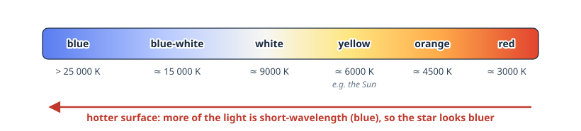
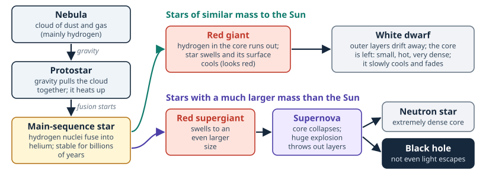

# Stellar evolution

## Specification coverage

| Field | Value |
| --- | --- |
| Qualification | Pearson Edexcel International GCSE Physics 4PH1 (separate science) |
| Specification points | 8.7–8.12P |
| Paper notes | 8.7–8.10 both papers. **8.11P and 8.12P are Paper 2 only** |
| Source | 4PH1 specification, Issue 4, September 2024, p. 28 |

| Point | Section |
| --- | --- |
| 8.7 understand how stars can be classified according to their colour | 1 |
| 8.8 know that a star's colour is related to its surface temperature | 1 |
| 8.9 describe the evolution of stars of similar mass to the Sun through the stages nebula, star (main sequence), red giant, white dwarf | 2 |
| 8.10 describe the evolution of stars with a mass larger than the Sun | 2 |
| 8.11P understand how the brightness of a star at a standard distance can be represented using absolute magnitude | 3 |
| 8.12P draw the main components of the Hertzsprung–Russell diagram (HR diagram) | 4 |

## 1. Star colour and surface temperature (8.7, 8.8)

*Figure 1. Star colour is set by surface temperature.*

A star's **colour depends on its surface temperature**. Every star emits a range of wavelengths;
the hotter the surface, the more of its light is at **shorter wavelengths**, so the **hottest stars
look blue** and the **coolest look red**, with the Sun (yellow) in between. This is why stars can be
**classified by colour**: sorting stars by colour sorts them by surface temperature.

## 2. The life cycle of a star (8.9, 8.10)

**Nebula → main-sequence star (every star).** Gravity pulls the dust and gas of a nebula together.
The collapsing cloud (a protostar) gets hotter until hydrogen nuclei are hot enough to **fuse**
into helium, releasing energy. The star is then on the **main sequence**. It stays there, stable,
for most of its life because two effects **balance**:

- **gravity** pulls the star's material **inwards**;
- the **outward pressure** of the hot gas, kept hot by the energy from fusion, pushes **outwards**.

*Figure 2. Every star starts in a nebula; its mass decides how it ends.*

**After the main sequence, mass decides the ending** (Figure 2):

- **similar mass to the Sun (8.9):** main sequence → **red giant** (core hydrogen runs out; the star
  swells and its surface cools) → **white dwarf** (outer layers drift away, leaving a small, hot,
  dense core that cools and fades);
- **much larger mass (8.10):** main sequence → **red supergiant** → **supernova** (core collapses,
  star explodes) → **neutron star**, or a **black hole** if the core left is massive enough.

## 3. Absolute magnitude (8.11P) — Paper 2 only

How bright a star **looks** from Earth depends on how much light it gives out **and** how far away it
is: a dim star close by can look brighter than a very powerful star far away. To compare stars
fairly, their brightness is compared at the **same, standard distance**.

::: definition
**Absolute magnitude** — the brightness a star would have if it were at a standard distance from the Earth (10 parsecs, about 3 × 10¹⁷ m).
:::

The scale runs **backwards**: the **lower** (more negative) the absolute magnitude, the **brighter**
the star. A star of absolute magnitude −5 is far brighter than one of +10. The Sun is about +5.

## 4. The Hertzsprung–Russell diagram (8.12P) — Paper 2 only

The HR diagram plots **absolute magnitude** (brightness) against **surface temperature** (colour).

::: note | To draw it (Figure 3)
1. **Vertical axis:** absolute magnitude — **brighter upwards**, so **negative numbers at the top**.
2. **Horizontal axis:** surface temperature — **hotter on the left**, cooler on the right (blue on the left, red on the right).
3. **Main sequence:** a diagonal band from **top left** (hot, bright, blue) to **bottom right** (cool, dim, red). Most stars, including the Sun, are here.
4. **Red giants:** above the main sequence on the **right** — cool but bright, because they are huge.
5. **Supergiants:** along the **top** — the brightest stars.
6. **White dwarfs:** **bottom left** — hot but dim, because they are tiny.
:::

*Figure 3. The HR diagram. The dashed path is the Sun's future: main sequence → red giant → white dwarf.*

::: traps
| Wrong | Right |
| --- | --- |
| Red stars are the hottest (red = "hot"). | Red stars are the **coolest**; blue stars are the hottest. |
| A star of absolute magnitude +10 is brighter than one of −5. | Lower (more negative) magnitude means **brighter**. |
| Drawing the HR temperature axis increasing to the right. | Temperature **decreases** to the right. |
| The Sun will become a supernova or a black hole. | The Sun will become a **red giant**, then a **white dwarf**. |
:::
