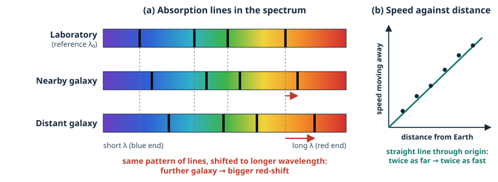
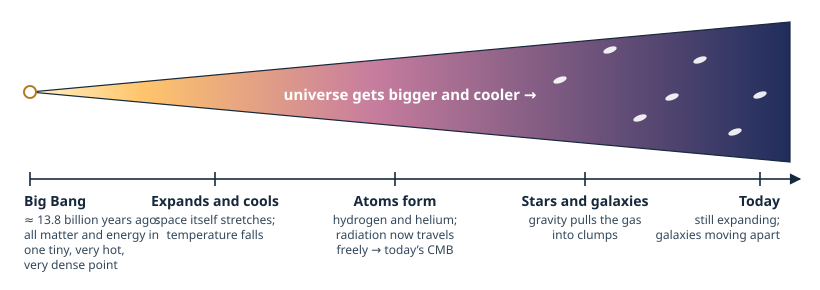

# Cosmology

## Specification coverage

| Field | Value |
| --- | --- |
| Qualification | Pearson Edexcel International GCSE Physics 4PH1 (separate science) |
| Specification points | 8.13P–8.18P |
| Paper notes | **All Paper 2 only** |
| Equations | Δλ/λ₀ = *v*/*c* is a "use" point and **not** on the Appendix 7 recall list, so it is given in the exam |
| Source | 4PH1 specification, Issue 4, September 2024, p. 28; Appendix 7 |

| Point | Section |
| --- | --- |
| 8.13P describe the past evolution of the universe and the main arguments in favour of the Big Bang theory | 3, 4 |
| 8.14P describe evidence that supports the Big Bang theory (red-shift and cosmic microwave background (CMB) radiation) | 4 |
| 8.15P describe that if a wave source is moving relative to an observer, there will be a change in the observed frequency and wavelength | 1 |
| 8.16P use (λ − λ₀)/λ₀ = Δλ/λ₀ = v/c | 2 |
| 8.17P describe the red-shift in light received from galaxies at different distances away from the Earth | 3 |
| 8.18P explain why the red-shift of galaxies provides evidence for the expansion of the universe | 3 |

## 1. Moving sources and red-shift (8.15P) — Paper 2 only

If a wave source is **moving relative to an observer**, the **observed frequency and wavelength
change** (the Doppler effect, explained with wavefronts in → 3.8). For light:

- source moving **away** → observed **wavelength longer**, frequency lower → the light is shifted
  towards the red end of the spectrum: **red-shift**;
- source moving **towards** the observer → wavelength shorter, frequency higher: **blue-shift**.

The speed of the light does not change.

To measure the shift, astronomers look at the **dark absorption lines** in a galaxy's spectrum.
Each element makes lines at fixed wavelengths, measured in a laboratory. In light from a moving
galaxy the **same pattern of lines** appears, but moved (Figure 1a).

*Figure 1. (a) The further the galaxy, the bigger the red-shift. (b) Speed of moving away is proportional to distance.*

## 2. The red-shift equation (8.16P) — Paper 2 only

::: note | Equation — given in the exam
**change in wavelength ÷ reference wavelength = velocity of a galaxy ÷ speed of light**

**(λ − λ₀) / λ₀ = Δλ / λ₀ = *v* / *c***

λ₀ = reference wavelength (from a source at rest in a laboratory) · λ = wavelength observed from the
galaxy · Δλ = λ − λ₀ · *v* = velocity of the galaxy relative to the Earth (m/s) ·
*c* = speed of light = 3.0 × 10⁸ m/s.
λ and λ₀ may be in any unit (often nm), as long as both are in the **same** unit.
A positive Δλ (red-shift) means the galaxy is moving **away**.
:::

::: note | Worked example
A hydrogen line has λ₀ = 656 nm in the laboratory. In light from a galaxy it is at 663 nm.
Δλ = 663 − 656 = 7 nm; *v* = *c* × Δλ/λ₀ = 3.0 × 10⁸ × 7 ÷ 656 = **3.2 × 10⁶ m/s**, moving away.
:::

## 3. Red-shift and the expanding universe (8.17P, 8.18P) — Paper 2 only

**What is observed (8.17P):**

- light from almost all distant galaxies is **red-shifted**, so they are **moving away** from us;
- the **further away** a galaxy is, the **greater its red-shift**, so the **faster** it is moving
  away — speed is proportional to distance (Figure 1b).

**Why this means the universe is expanding (8.18P):** galaxies are moving away from us in **every
direction**, and the more distant ones faster. This is exactly what happens if **space itself is
expanding**: the space between every pair of galaxies stretches, so the more space there is
between two galaxies, the faster the gap grows — like dots on a balloon being blown up. So the
universe is expanding.

## 4. The Big Bang theory and its evidence (8.13P, 8.14P) — Paper 2 only

*Figure 2. The past evolution of the universe according to the Big Bang theory.*

**Past evolution (8.13P).** About **13.8 billion years ago** all the matter and energy in the
universe was concentrated in an extremely **small, hot and dense** region. It has been **expanding
and cooling** ever since. As it cooled, atoms (mainly hydrogen and helium) formed, and gravity later
pulled matter together into stars and galaxies.

The two main arguments for the theory are the two pieces of evidence it explains (8.14P):

**1. Red-shift.** Distant galaxies are red-shifted, more so the further away they are, so the
universe is expanding (section 3). Running the expansion backwards, everything was once together
in one small, dense, hot region — the Big Bang.

**2. Cosmic microwave background (CMB) radiation.**

- *Observed:* microwave radiation arriving from **every direction** in space, almost exactly the
  **same** in all directions.
- *Explained:* it is the **leftover radiation from the hot early universe**. As the universe
  expanded, the radiation was stretched (red-shifted) from short wavelengths to **microwaves**.
  It fills the whole universe, so it arrives from everywhere. The Big Bang theory predicts it.

::: traps
| Wrong | Right |
| --- | --- |
| Red-shift means the light turns red. | The whole pattern of lines moves to **longer wavelengths**; the light does not become red. |
| The galaxies' light slows down. | The speed of light is unchanged; **wavelength and frequency** change. |
| The Big Bang was an explosion from a centre into empty space. | **Space itself** expands; every galaxy sees the others moving away. |
| Mixing λ in nm and λ₀ in m in Δλ/λ₀. | Use the **same** unit for both; the ratio has no unit. |
:::
